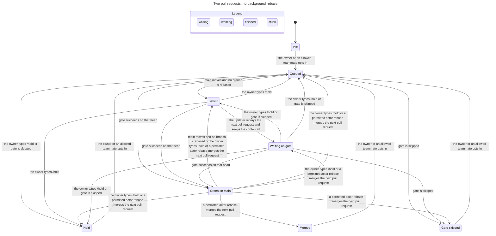

# Agent protocol

Coding agents on mitos pick up work, claim it, report, hand it off, ask the owner, and land it through one protocol. Claude Code and Grok Bot are the providers today. Each one implements an adapter and a thin land connector. A later provider adds those two and leaves the decision module alone.

The ledger is the GitHub conversation on the task issue and its pull request. Decision logic lives in Lean under `gate/`, in `MitosGate.Land` and one admission module beside it. Adapters decide nothing. This revision specifies that module and does not add it. `gate/` stays on the owner's merge list.

This revision answers the adversarial review on issue 172, posted at 20:53 Asia/Bangkok on 12 November 2026. The land loop is the design on issue 178. `https://github.com/kitimark/mitos/issues/172#issuecomment-6825493180` and `https://github.com/kitimark/mitos/issues/178#issuecomment-6821317899`.

Assignment, catch-up comments, `owner-ping.yml`, and issue 43 stay. An owner pull request that moves every caller is the only way those surfaces retire. This revision does not retire them.

## Reading one task

The owner types a line in the pull request conversation. No fence, no adapter footer, no app slug.

```text
/land aaaaaaaaaaaaaaaaaaaaaaaaaaaaaaaaaaaaaaaa
```

That line is a landing word. It names the commit. It does not by itself grant merge on a kept path.

An agent that the owner has allowed to merge posts one fence and one footer.

~~~~
```mitos-protocol
{"v":1,"kind":"land","task":30,"as":{"provider":"claude","teammate":"worker"},"head":"aaaaaaaaaaaaaaaaaaaaaaaaaaaaaaaaaaaaaaaa","cause":"https://github.com/kitimark/mitos/pull/30#issuecomment-1"}
```
---
_Generated by [Claude Code](https://claude.ai/code)_
~~~~

`read(30)` returns a view from the Lean snapshot. `submit` posts at most one comment, reads the ledger again, and returns `ok` only when that comment applied. A second submit with the same key posts nothing and returns `duplicate`.

## Decisions

| Choice | Principle | Why |
|---|---|---|
| The conversation is the ledger. Labels and a git ref are not state. | foundational-thinking, separate-before-serializing-shared-state | The owner catches up on GitHub. `docs/process.md`, "Owner catch-up on GitHub". Each comment is one actor appending. |
| Admission is a pure function of the ledger prefix and that comment's `created_at`. Live `gate`, carry, and bot review feed `summary` and `step` only. | model-the-domain | A past event stays admitted when later facts change. |
| An edited comment grants nothing. An edited owner comment is `/hold`. | boundary-discipline, encode-lessons-in-structure | Agents post as kitimark, so an edit could turn `progress` into `claim` or `fail` into `pass`. |
| Every event names `as`. The slug must match the declared provider. Role and author come from the registry and the `push`. | type-system-discipline | Two teammates of one provider must not be interchangeable. |
| `submit` returns `ok` only after a re-read shows the event applied. `push` runs only after that, and the lease is `holderHead`. | make-operations-idempotent, separate-before-serializing-shared-state | Two claimants can both post. Only the applied claim may move git, and it does not adopt the other tip. |
| `MitosGate.Land` decides who is next, what is pushed, when a merge is allowed, and who wakes. | encode-lessons-in-structure, laziness-protocol | The proof is about the code that runs. A connector cannot push a branch or choose a pull request to rebase. |
| No background rebase. A replay is pushed only for the next pull request, and only when the content id is unchanged. | foundational-thinking | Verdicts stay valid because `mitos-gate carry` still reaches them. A move of `main` moves no other branch. |
| Assignment, catch-ups, `owner-ping.yml`, and issue 43 stay until an owner pull request moves every caller. | migrate-callers-then-delete-legacy-apis, never-block-on-the-human | `owner-ping.yml` fires on assignment. A comment from the owner's account does not notify the owner. |
| The idempotency key is kind, task, actor, and one field of that kind. | make-operations-idempotent | A receipt's `accepted` is a different key from its `sending`. |
| The public calls are `read` and `submit`. | laziness-protocol, boundary-discipline | The caller names an intent. Lean decides. |
| The land loop is checked in TLA+, including liveness. The fold is specified for the Lean admission module. | prove-it-works | `docs/agent-protocol.tla`. Results are below. |

Owner questions that this revision does not answer are collected at the end. A chat acceptance is not a ledger event. One owner-typed line on issue 179 is what settles acceptance of the land design. This revision does not post that line.

## Admission

The fold walks conversation comments in ascending id. It skips review comments. A comment applies only under the rules below. Later live facts do not reopen the question.

An edited comment grants nothing. The shell treats `updated_at` different from `created_at` as an edit. An edited owner comment is `/hold` on that pull request. An edited agent comment contributes no event. If the edit was of a `claim`, that claim is no longer held. A deleted comment cannot be seen over the REST list. That gap is the same one the land design records, and it stays a residual risk.

Every agent event carries `as`, with `provider` and `teammate`. The app slug must be the provider the adapter registry declares for that teammate. The fence does not carry a role. The role is the registry row. `verdict.author` is the teammate on the applied `push` for that head. `verdict.model` must equal the judge's declared model. `push.model` is the author's declared model, written by the shell. A fence that disagrees with the registry does not apply.

A fence is a top-level block tagged `mitos-protocol`. A fence inside a quote or a code block is not an event. A comment with two fences, two footers, an unknown key, or a `v` other than `1` does not apply. A login of kitimark with no app slug is never forged. Owner lines are read from that comment. An app-posted `/land` or `/hold` is ignored.

The idempotency key is the kind, the task, the actor, and one field.

| Kind | Field in the key |
|---|---|
| `claim` | holder teammate and branch |
| `release` | actor |
| `push` | sha |
| `handoff` | head and target teammate |
| `verdict` | judge, head, and result |
| `ask-owner` | cause link, or the question text when the cause is absent |
| `land` | sha |
| `wake-receipt` | cause link and result |

`sending` and `accepted` are different keys. Both can apply. `submit` of a key that already applied returns `duplicate` and posts nothing.

## Land

There is no background rebase. A move of `main` moves no branch. The updater replays only the pull request that is next, and only when the replay is clean and the content id is unchanged. A replay that would change the id is not pushed. The branch stays behind, and the verdicts on the old head stay the verdicts.

Next is read from the conversation. The owner's `/land` is first, then a head already on `main`, then the older comment. A stuck entry is passed over. There is no timer. An entry ends on a merge, a content push, a `hold` or `fail` from that judge's newest verdict, or `/hold`.

`/land` and `/hold` are owner speech. They count when login kitimark types them in the pull request conversation, with no app slug, no protocol fence, and no adapter footer. `/land` may name a sha. An unknown sha gives no entry. `/land` does not move merge authority. On a kept path the owner still merges. `/hold` stops replay and merge until the owner's next `/land`.

`land` is the only merge intent. It replaces `merge`. Callers repeat `land` until the step is `merged` or `stopped`. The binary is `mitos-gate land`. The statements to prove are the fourteen in the land design, including push only when next, no push without an entry, one landing at a time, the updater's push keeps cover, a merge is gated, nothing lands while admins are unbound, `/hold` wins, and a quiet wake after a rebase.

```typescript
type LandConnector = ProviderAdapter & {
  merge(pr: number, head: Sha): Promise<MergeReceipt>
  wake(event: RepoEvent): Wake
  nudge?(): Promise<"asked" | "unavailable">
}
```

`merge` is rebase merge pinned to the sha. `wake` must equal the Lean table. `nudge` dispatches `update-prs.yml` with no inputs, and a provider may leave it out. No member pushes a branch or names which pull request to rebase. `post` on the adapter is how a `land` record is written.

| Event | Wake |
|---|---|
| `main` moved, or the updater pushed | nobody |
| `gate` failed | the holder |
| `gate` finished another way, and the pull request is in line | the lander. When the lander is the owner, the workflow posts the merge command and wakes no agent |
| `gate` finished another way, the head is covered, and the pull request is not in line | nobody |
| `gate` finished another way, and the head is not covered | the holder |
| bot review of covered work | nobody |
| bot review of work that is not covered | the holder |
| conflict on covered work | the holder |
| a `/land` or `/hold` that leaves the pull request in line | nobody. The workflow answers the owner |
| a `/land` or `/hold` that does not | the orchestrator |
| any other owner comment | the orchestrator |

Grok's own listeners are turned off in the connector proposal, so this table is the only wake. That settings change is an owner merge. It is not done here.

A covering verdict plus `behind` means the pull request is queued. The holder does not rebase it to keep the verdict. A holder `push` is new content. It clears verdicts on that pull request. The updater's push does not.

`enforced` means branch protection on `main` binds admins, the required check is `gate`, and stale heads are rejected. While `enforced` is false, `step` does not return `merge`, `present`, or a push. The setting is off today. Turning it on is an owner question, below. Wasutan accepted the land design's seven written defaults in chat, including this one, and has not posted that acceptance as owner speech on issue 178 or issue 179, and has not flipped the setting.

An agent merge that the connector did not perform, with no owner `/land` and no applied `land`, is the anomaly `unauthorized-merge`. The root posts a catch-up. The merge is not reverted by the protocol. The skill, "Catching the user up", allows the owner to merge before a verdict. That merge is a fact. The catch-up asks who merged. A later no-app owner comment answers it.

The only agent function that calls the merge API is `LandConnector.merge`, and only when `step` returned `merge`.

## Claim and push

A claim names the holder teammate, the branch, and the task. The lane is the task file's `touches` and `must_not_touch`, read by the shell at admission. The fence does not carry a second copy. A missing task file means the claim does not apply.

Two live claims whose paths intersect cannot both apply. Paths intersect when they are equal, or when one ends in `/` and is a prefix of the other. The smaller comment id applies. The later comment does not.

There is no `expiresAt` and no `renew`. A worker may claim while no orchestrator is named. Single-writer duties stay with the root. Who the root is remains an owner question.

`submit` for a claim posts the comment, then reads the ledger. It returns `ok` only when the fold applied that comment. Otherwise it returns `refused`. The other claimant can receive `ok` for the same moment only if their comment is the one that applied.

`push` is allowed only after that `ok`, and only for the holder. The guard runs before git. When `holderHead` is absent, the push creates the branch and fails if the remote ref already exists. When `holderHead` is set, the push is `git push --force-with-lease` pinned to that sha. A lease miss stops the push. The holder does not fetch the new tip and publish it under their name. The history after the update is linear on `origin/main`. A merge of `main` into the branch is `history-error` and is not pushed. A conflict returns `behind` and posts nothing.

The pull request for a task is the open pull request whose branch an applied claim names, plus issue n. `link: closes` writes a closing keyword for that issue into the body. `link: part-of` links the issue and uses no closing keyword.

A handoff names the head, the sender, and a target that can act. The target's registry row must include the work, and a routine target must be enabled. Rounds are the skill's rounds, under "Rounds". A pull request gets two. A round that only rebases and keeps the content id does not count. A handoff that would start a third round does not apply. The root narrows or splits before that round, as the skill says.

`ask-owner` posts the catch-up the skill already requires. The first line is `## Catch-up:`, then the question. The root assigns kitimark, which is what fires `owner-ping.yml`. The ping still defuses `@` and invisible characters, as "Catching the user up" describes. The root updates issue 43 the way that section describes. `requestsMerge` requires the ready conditions below, and the catch-up tells the owner to type `/land` and the sha. The ask closes on an owner word, a merge, a newer ask, or an owner comment that is not only a command to an outside handle. A comment that is only a CodeRabbit command does not close it.

## Types

These types are the JSON the admission module accepts and the view a connector reads. They are not a second decider.

```typescript
type Sha = string & { readonly brand: "Sha" }
type IssueNumber = number & { readonly brand: "IssueNumber" }
type CommentLink = string & { readonly brand: "CommentLink" }
type Provider = "claude" | "grok" | "relay"
type Teammate = { provider: Provider; teammate: string }

type Intent =
  | { kind: "claim"; task: IssueNumber; as: Teammate; holder: Teammate; branch: string; cause: CommentLink | null }
  | { kind: "release"; task: IssueNumber; as: Teammate; cause: CommentLink | null }
  | { kind: "push"; task: IssueNumber; as: Teammate; link: "closes" | "part-of" | "unchanged"; cause: CommentLink | null }
  | { kind: "handoff"; task: IssueNumber; as: Teammate; to: Teammate; head: Sha; findings: readonly Finding[]; cause: CommentLink | null }
  | { kind: "verdict"; task: IssueNumber; as: Teammate; head: Sha; result: "pass" | "fail" | "hold" | "wording-only"; findings: readonly Finding[]; evidence: string; cause: CommentLink | null }
  | { kind: "ask-owner"; task: IssueNumber; as: Teammate; question: string; requestsMerge: boolean; cause: CommentLink | null }
  | { kind: "land"; task: IssueNumber; as: Teammate; head: Sha; cause: CommentLink | null }
  | { kind: "wake-receipt"; task: IssueNumber; as: Teammate; to: Teammate; result: "sending" | "accepted" | "failed" | "rate-limited" | "missed"; http: number | null; cause: CommentLink }

type Finding = { path: string; summary: string; blocking: boolean }

type SubmitResult =
  | { ok: true; comment: CommentLink; view: TaskView }
  | { ok: false; refusal: { code: RefusalCode; detail: string }; view: TaskView }

type RefusalCode =
  | "forged" | "unknown-version" | "malformed" | "duplicate" | "capability" | "holder"
  | "lane" | "lane-intersect" | "refused" | "round-cap" | "unenforced" | "not-next" | "drift"

type TaskView = {
  task: IssueNumber
  summary: Summary
  holder: Teammate | null
  branch: string | null
  holderHead: Sha | null
  root: Teammate | null
  delegates: readonly Teammate[]
  round: 0 | 1 | 2
  openAsk: { comment: CommentLink; question: string; requestsMerge: boolean } | null
  verdicts: readonly Verdict[]
  anomalies: readonly { code: "unauthorized-merge" | "refused" | "malformed" | "edited"; comment: CommentLink }[]
}

type Summary =
  | "idle" | "claimed" | "waiting-ci" | "behind" | "history-error" | "asked"
  | "owner-comment" | "ready" | "head-unknown" | "done" | "wontfix" | "unexpected-close"

type Verdict = {
  head: Sha
  result: "pass" | "fail" | "hold" | "wording-only"
  model: string
  author: Teammate
  authorModel: string
  judge: Teammate
  comment: CommentLink
}
```

Owner speech is not an `Intent`. The lines are `/land`, `/hold`, `/delegate`, `/revoke`, and `/wontfix`. Each one that fails is answered by the workflow. `/delegate` adds a teammate for that task. `/revoke` removes one. Who is already in `delegates` when a task opens is an owner question.

`kept` is the Lean function `keptPath` proposed beside `Land.lean`. Unknown paths count as kept. The skill section "What stays with the user" is the list sessions follow until the owner accepts that function as the one list. `pr-state.sh` today answers yes, no, or unknown. Unknown stays kept. The package does not keep a second copy of the paths.

Carry is a map. For each verdict head, `carries` is true when the walk from that head to the live head is updater force-pushes only, and both heads have the same content id from one build of `main`'s tool. One value per pull request is not enough.

## Adapter

`ProviderAdapter` declares teammates, the app slug, the footer, and `post`. It does not decide admission, ready, or next. The declaration table is data the module reads.

| Declaration | Login | Slug | Writes |
|---|---|---|---|
| provider `claude` | kitimark | `claude` | yes |
| provider `grok` | kitimark | `cursor` | yes |
| `cursor[bot]`, declared by the Grok adapter as a past login | `cursor[bot]` | none | no new writes |
| updater `mitos-pr-updater[bot]` | that bot | the updater app | pushes only. No fence |
| relay | open, see below | open | receipts only, after the run check |

A comment from a declared actor with no fence is advisory. It is not forged and it is not an event. An unknown actor with a fence is forged and does not apply.

Claude teammates the adapter declares: `orchestrator`, `worker`, `verifier`, `verifier-opus`, `researcher`. The address a person types for an open Claude session is still `@claude`. A mention is not a ledger event.

Grok teammates are whatever that adapter declares, including the footers that have already posted. The protocol doc does not freeze a second copy of routings or secrets. A routine with `enabled` false cannot be a handoff target.

`wording-only` may be submitted only by the root, and only when the diff is wording-only. Any other judge's `wording-only` does not apply.

The root's single-writer duties are the catch-up, the assignment, the dashboard body, and posting the owner's merge command when the workflow is not the one posting it. One root performs them. The skill, "The root orchestrates", gives those duties to the session the owner talks to. The cursor rule "kitimark mode" says the same and does not name a provider. Naming the root is an owner question. This revision does not add a second writer.

## Wire

One JSON object, key order `v`, `kind`, `task`, `as`, the kind's fields, `cause` last. Then one footer. `cause` is a `https://github.com/kitimark/mitos` comment link, or null. The renderer rejects a bare numeric id in any string. The skill, "Catching the user up", forbids ids in posts and allows links to public comments. Amending that rule is an owner question. Until then the fence follows the rule as written.

The shell writes `push.head`, `push.model`, and the author on a verdict. They are not fields the caller chooses. A pull request body carries the closing keyword, a human summary, and one footer. It carries no fence. `open-pr.sh` remains the create path.

No session URL, no agent id, no key, and no email appear in the fence or the footer.

## Summary and ready

`summary` uses the fold plus live facts. First match.

1. Owner `/wontfix` and the issue is closed. `wontfix`.
2. The issue is closed and the body keyword closes it. `done`. The keyword is `Closes`, `Fixes`, or `Resolves` plus this issue. `part-of` does not close it.
3. The issue is closed otherwise. `unexpected-close`. The root reopens it with the GitHub API the skill already uses. That reopen is not a fence kind.
4. History contains a merge of `main`. `history-error`.
5. `holderHead` is set, the live head differs, and carry from `holderHead` is false. `head-unknown`.
6. `openAsk` is set and has not closed. `asked`.
7. An owner review thread, or an owner conversation comment addressed here, has no answer from the addressee. `owner-comment`. An answer is an event whose `cause` is that comment's link. A later advisory comment does not clear it.
8. The ready conditions below hold. `ready`.
9. A holder exists and `gate` on the live head is `pending` or `missing`. `waiting-ci`.
10. A holder exists and the branch is behind `main`. `behind`. With a covering verdict, this pull request is queued. It is not a request that the holder rebase.
11. A holder exists. `claimed`.
12. `idle`.

Ready, which is also what a merge ask requires, is all of the following.

- Each judge's newest verdict on a head that carry reaches is a `pass`. A later `fail` or `hold` from that judge blocks. An older `pass` does not outlive it.
- At least one of those passes is from a judge who differs from the author in teammate and in model.
- A trust-critical diff also has a `pass` from `verifier-opus`. That pass may share the author's model. The skill, "Verdicts", asks for an opus verifier on a trust-critical pull request, including one written on opus.
- `wording-only` covers only when the root recorded it and the diff is wording-only. It does not skip the independence rule for any other diff.
- `gate` on the live head is `success`. `skipped`, `cancelled`, `pending`, `missing`, and `failure` are not success.
- The pull request is not a draft, a fork, or a stack. Stacks do not carry a verdict. The owner may still merge a stack by the async endpoint outside agent `land`.
- The body has one footer.
- Bot review is `reviewed` or `refused` at a head carry reaches. `paused`, `behind`, and `missing` are not ready. `refused` is still a hand-over, as the skill says.
- A spec diff has a successful `gate` whose event carried `spec-approved`, and that label was added by kitimark with no app. Presence of the label is not enough. No adapter adds the label.
- No unanswered owner review thread.
- For an agent `land`, `enforced` is true, `keptPath` is false, and `as` is in `delegates`.
- The owner's own merge is not an intent the module guards. `present` gives the owner the command when the other conditions hold. The skill still allows an earlier owner merge.

`spec-approved` on the `gate` event is necessary and not sufficient. The labeled event's actor must be kitimark with no app. `.github/workflows/ci.yml` still fails the spec step when the event lacks the label, and a label change still re-runs `gate`.

## Checked model

`docs/agent-protocol.tla` is the land loop. Two pull requests, and P2 is kept. There is no background updater. `MainMove` sends an on-tip pull request to `behind` and rebases nothing. `Update` runs only for the next pull request, only while it is behind, and only while admins are bound. That step stands for a replay that keeps the content id.

TLC reached 293 states and 947 steps and exited 0. The chart draws 8 states and 23 arrows. These rules hold. `TypeOK`, `KeptIsOwner`, `AtMostOneGating`, `NoDeadlock`, `NoBackground`, `MergeIsGated`, `HoldWins`, `UnenforcedLandsNothing`, and `Progress`.

`KeptIsOwner` says a kept pull request is queued and merged only by the owner. `AtMostOneGating` says two replays are not in flight together. `NoBackground` says a behind pull request's next phase is behind, gating, or held. `MergeIsGated` says a merge step leaves a green head, with admins bound, by the owner or on a non-kept path, and that pull request is next. `HoldWins` says `/hold` stays held. `UnenforcedLandsNothing` says an unbound `main` is not replayed and not merged. `Progress` says that while admins are bound, a pull request that has left idle reaches merged, held, or skipped.



The label is the busier of the two pull requests. An arrow can be the other pull request moving, which is why a merge can land on "Gate skipped" or "Queued". Those joins are the drawing of two pull requests onto one node. The properties are the check. Steps that stay inside one label are omitted. `Finished` is hidden.

The model leaves out admission, edits, and the claim race. Those are the Lean rules above. It leaves out a computed content id, a second move of `main`, stacks, forks, drafts, bot review, review threads, the closing keyword, and the relay cap. Leaving idle stands for a pull request that already has a covering verdict. The agent opt-in on P1 is there so owner-before-agent and the kept-path refusal can be checked. It does not answer who is in `delegates` on day one.

Re-run from a checkout that has Java 11 or later and `tla2tools.jar`. The output directory must be empty. The jar for the recorded run is TLC 1.7.4, sha256 `936a262061c914694dfd669a543be24573c45d5aa0ff20a8b96b23d01e050e88`.

```bash
TLA2TOOLS=/path/to/tla2tools.jar JAVA=/usr/bin/java \
  node .cursor/skills/statechart/scripts/statechart.ts docs/agent-protocol.tla \
  --view docs/agent-protocol.view.mjs --out /tmp/agent-protocol-out
```

## Transport

| Fact | Where it lives | Who writes it |
|---|---|---|
| Claim, handoff, verdict, ask, land, receipt | Conversation comment | `submit`, after admission |
| `/land`, `/hold`, `/delegate`, `/revoke`, `/wontfix` | Conversation comment, no app | The owner |
| Closing keyword and one body footer | Pull request body | `open-pr.sh`, then a human edit |
| `gate` | Check run named `gate` | `ci.yml`. The protocol only reads it |
| `spec-approved` | Label, plus the actor on the labeled event | The owner. Every adapter leaves it unset |
| Kept path | `keptPath` once the owner accepts it. Until then the skill list and `pr-state.sh` | The owner merges the module |
| Content id and carry | `mitos-gate carry` and `content-id` from a checkout of `origin/main` | The updater checks the id before a push |
| Branch history | git | The holder, by rebase and a lease on `holderHead`. The updater, only when `plan` says push |
| Attempt journal | `ops/runs` | The worker. The fold does not read it for authority |
| Needs-owner | Catch-up comment, assignment of kitimark, issue 43 | The root, as the skill says today |
| Dashboard | Issue 43 | The root, until an owner pull request moves that caller |

`needs-rebase` and `agent:grok` are unread as protocol state. History comes from git. With no background rebase, a stale `needs-rebase` clears when `main` is already an ancestor. That clearer is the work on issue 148 and pull request 149, which the land design keeps.

Commit statuses are not a verdict channel. The session proxy refuses status writes.

## Addressing, receipts, and the root of trust

`@claude` reaches an open Claude session. It is not a ledger event. `@cursoragent` selects no provider.

`/grok <teammate>` wakes a routine only on an owner line, and only outside quotes and code blocks. Agents name a teammate in the fence field `to`. A Claude comment that quotes the token does not wake anyone. One classifier implements both tests.

A wake posts `wake-receipt` with result `sending`, then performs the POST, then posts `accepted` on HTTP 200 or `failed` otherwise. There is no retry. Caps are 200 runs an hour for one routine and 300 an hour across routines, counted from applied receipts in the current UTC hour of that quota. Over the cap, the result is `rate-limited` and there is no POST. A `sending` receipt with a later `accepted` is a completed wake. `missed` is the result when a subscription slot had no accepted receipt. It is not the meaning of a lone `sending`.

A receipt applies only after the shell checks the Actions run. The login is `github-actions[bot]`, the workflow is the relay workflow, and the head branch is the default branch. A job that runs from a pull request head does not apply. `ci.yml` posts as that bot from a head, so the run check is the bound. Which app should own the relay is an owner question. Until it is answered, the design names no new app.

The owner is login kitimark. Owner speech is a conversation comment from that login with no app slug, not edited. A missing slug is not proof of the person if an agent machine holds a user token. Issue 109 records that a merge carries no app, and the same shape applies to comments. Whether agents hold such tokens is an owner question. Until it is answered, admission uses the missing slug, and this paragraph is the risk. Agent machines must not store a token that posts with no app. That is a proposal for the owner, not a fact this revision can enforce.

`github-actions[bot]` on `owner-ping.yml` is a notification. It is not owner speech and it is not a receipt.

## Capabilities

The protocol version is `1`. Another `v` does not apply. A new provider adds an adapter module and a connector. It does not add a branch in admission or in `step`.

| Role | Kinds |
|---|---|
| root's single-writer duties | ask-owner, land when in `delegates`, wording-only verdict |
| worker | claim, release, push, handoff, land when in `delegates` |
| verifier | verdict, except `wording-only` |
| researcher | no deciding kind. Advisory comments only |
| relay | wake-receipt |

A kind outside the row returns `capability` and posts nothing. `ci-reviewer` and `tracker` are researchers. They do not verdict, close, or land.

Push, open a pull request, comment, and `LandConnector.merge` are effects of a kind the teammate already has. `file-issue` is not a kind. The root files a follow-up the way the skill already says. Opening an issue before its comment, and then retrying, is how a double issue was possible, so the protocol does not have that effect.

An agent may open a pull request that touches a kept path. Only the owner merges it. The migration steps below have an author for that reason.

## What the owner keeps

No adapter adds `spec-approved`. No adapter assigns anyone except the root's existing assignment of kitimark, which stays until the owner retires it. No adapter edits issue 43 except the root's existing dashboard update, which stays for the same reason. No connector merges a kept path. No connector merges while `enforced` is false.

Merging `main` into a feature branch is refused for every actor. The repository allows rebase merge only.

## Migration

One sequence. The land design's steps and the protocol's caller moves are the same list. Pull request 149 and issue 171 land before the updater switch, as that design says. Every trust-path step is an owner merge. This revision adds none of those files.

Recorded threads are the fixtures. The classifier is run on them before the watcher changes, so the difference from the footer test in `watch-github.sh` is visible first. The review's count of comments printed as the owner is that kind of run, not a threshold copied into `gate`. A `read` inside the watcher's short hook waits until that run has a measured cost. The footer test and the new classifier switch in one pull request, not several merges apart. Open pull requests that have no claim stay without an invented claim.

| Step | Change | Merged by | Waits |
|---|---|---|---|
| 0 | Protection on `main` binds admins | Owner, a setting | The setting is off. See the open question |
| 1 | `Land.lean` and the admission module, `mitos-gate land` over fixed JSON | Owner, `gate/` | The kept list moving into `keptPath` |
| 2 | Parser statements. The snapshot reads verdicts from issue 43 until they are conversation records. Fixtures: an app's `/land` is ignored, an edited comment holds | Owner, `gate/` | Issue 43 stays |
| 3 | Shadow `decide` prints a plan and its run time | Owner, `.github/` | |
| 4 | Claude connector, wake rules, `bot-review.sh` cover at a carried head | Owner, `.claude/` | |
| 5 | The switch. `apply` pushes only the planned pull request. `report` answers every `/land`. The old rebase loop is deleted. The watcher reads the snapshot, and the footer test is deleted in this same pull request | Owner, `.github/` and `.claude/` | Steps 0 to 4, and a measured hook cost |
| 6 | Skill, `CLAUDE.md`, `docs/process.md`, and the cursor rule point here. Merge means `land`. A hand-over tells the owner to type `/land` and the sha | Owner | |
| 7 | Grok connector. The relay applies the wake table. Grok's own listeners are turned off | Owner | The relay app |

To roll back the switch, revert step 5. Assignment, catch-ups, `owner-ping.yml`, and issue 43 have no retirement step on this list.

## Calls from issue 117

| Call | Position |
|---|---|
| Claude is the only root | Open. See below. The draft's rejection is withdrawn, and this revision does not accept the call either |
| Only the owner's words decide | Accepted for `/land`, `/hold`, `/delegate`, `/revoke`, `/wontfix`, `spec-approved`, and kept-path merges. Agent comments are events when the slug and `as` agree |
| `agent:grok` is the holder | Rejected. The applied `claim` names the holder and the branch. The label is unread |
| `@cursoragent` is Grok's handle | Rejected. That spelling selects no provider. Agents use fence `to`. An owner line may say `/grok <teammate>` |
| The planner posts no review comments through the owner account | Accepted. Review comments apply no kind |
| Lane merges wait while an owner merge waits | Open, together with who may land by default. The land design ranks the owner's `/land` first |
| Product settings for footers and planner instructions | Left to the owner. The protocol requires one footer and no session URL |
| The owner pastes work into Grok because nothing wakes it | The wake is the Lean table. The relay that carries it is a proposal, and the app is open |

## Requirements

| # | Requirement | Where it lives |
|---|---|---|
| 1 | Identity separate from the owner | App slug plus `as`. Owner speech is slug absent, no fence, no adapter footer, not edited |
| 2 | One address per teammate, with a receipt and a visible failure | Fence `to`, or an owner line `/grok <teammate>`. Receipt results `accepted`, `failed`, `rate-limited`, `missed` |
| 3 | A claim a second provider cannot push through | Applied `claim`. `push` only after re-read, lease on `holderHead` |
| 4 | One merge authority. `spec-approved` stays with the owner | `delegates` plus `keptPath`. The label is absent from `Intent` |
| 5 | Rebase is the only update | `push` rebases. The updater replays. A merge of `main` is `history-error` |
| 6 | Handoff and verdict name the head and both sides | `handoff` and `verdict` fields. Carry is per head |
| 7 | Lane scope | The task file. The later overlapping claim does not apply |
| 8 | Capabilities | The registry row. Refusal `capability` |
| 9 | Done means the link matches | `done` requires the closing keyword. `/wontfix` is the other close |
| 10 | One footer, and the monitor can see workers | Two footers do not apply. The watcher switch is step 5 |
| 11 | One mention, one reply | The key above. `duplicate` posts nothing |
| 12 | A scheduled lane reports a missed run | `wake-receipt` result `missed` |

## Overlap cases

| # | What happened | What this revision does |
|---|---|---|
| 1 | `@cursoragent` merged pull request 137, and the same spelling on 155 got a billing stub | That spelling selects no provider. Agent merge is `LandConnector.merge` after `step` says `merge`. Anything else with no `/land` and no applied `land` is `unauthorized-merge` and a catch-up |
| 2 | Two catch-ups on issue 106, one with no verdict | `requestsMerge` requires ready. The second identical ask is `duplicate` |
| 3 | Merge commits of `main` on seven branches | `push` refuses that history. The updater never merges `main` in |
| 4 | `needs-rebase` left on after a hand rebase | The label is not protocol state. Git says whether the branch is behind |
| 5 | Issue 162 closed without a closing keyword in the body | `done` requires the keyword. Otherwise `unexpected-close`, and the root may reopen. A researcher cannot close |
| 6 | Planner posts classed as the owner, worker posts invisible | Slug `cursor` plus `as` is Grok. The watcher switch reads the snapshot |
| 7 | Claude answered `@cursoragent` on issue 106 and pushed that branch | The spelling wakes nobody. A push from a non-holder is `refused` |
| 8 | Issues 124, 125, and 126 asked for a merge with no verifier, then sat on `needs-rebase` | Ready requires the newest verdict per judge. `behind` with a covering verdict is queued for the updater |
| 9 | Issue 153 answered twice | One cause link, one reply per teammate |
| 10 | `cursor[bot]` received HTTP 403 | New Grok writes use kitimark and slug `cursor`. The bot login is a past declaration |
| 11 | Two red nightlies and no nightly post | A slot with no accepted receipt gets result `missed`. The routine stays disabled until the owner enables it |
| 12 | The tracker footer used outside that lane, including a second footer | A researcher has no deciding kind. A second footer does not apply |
| 13 | `agent:grok` used as a lease | The label is unread. The claim names the holder and the branch. The lease is `holderHead` |
| 14 | Mergeable on one head and hold on another | The newest verdict per judge names the head. Ready uses the live head and carry |
| 15 | Duplicate bot replies to one mention | One receipt key, one POST |
| 16 | Two footers on pull request 149 | A footer count other than 1 blocks ready |
| 17 | Issues 169 and 170 share one expect file | The task files name the path. The later overlapping claim does not apply |

## Open owner questions

None of these is decided by this revision. None of them is an owner-typed comment on the issue. Wasutan accepted the seven land-design defaults in chat on 12 November 2026. That acceptance is not owner speech on issue 178 or issue 179, and this revision does not post it.

The seven written defaults, still unposted, are these. Bind admins. A kept path takes `/land` and then the owner's merge. A comment may start `decide`, which holds no key. There is no timer, and the owner's `/land` may overtake an agent landing. There is no standing keep-fresh mode. The owner types the words. `plan/` counts as kept.

The questions:

- Who is root. One session keeps the single-writer duties. The skill and the cursor rule give them to the session the owner talks to and do not name a provider.
- Who may land by default. `delegates` is filled by `/delegate` and cleared by `/revoke`. Whether a non-kept task starts with the worker already in that list is the question. `docs/process.md`, under "Roles", still says agents merge implementation pull requests. This revision does not delete that sentence and does not encode it as the module's initial list.
- When assignment, catch-ups, `owner-ping.yml`, and issue 43 retire. They stay until one owner pull request moves every caller.
- When protection on `main` binds admins. The module refuses agent land and updater pushes until then. The setting is off.
- Which app posts relay receipts. The run check above is the bound until that answer.
- Whether the skill's ban on ids in posts should be amended. Until then, `cause` is a comment link and the renderer rejects a bare id.
- Whether agent machines hold a token that posts with no app. Until then, a missing slug is owner speech and the risk is named above.
- Whether `keptPath` in the Lean module replaces the skill's list as the one list. Unknown paths count as kept either way.

---
_Generated by Grok Bot (Mitos Agent Protocol Architect)_
