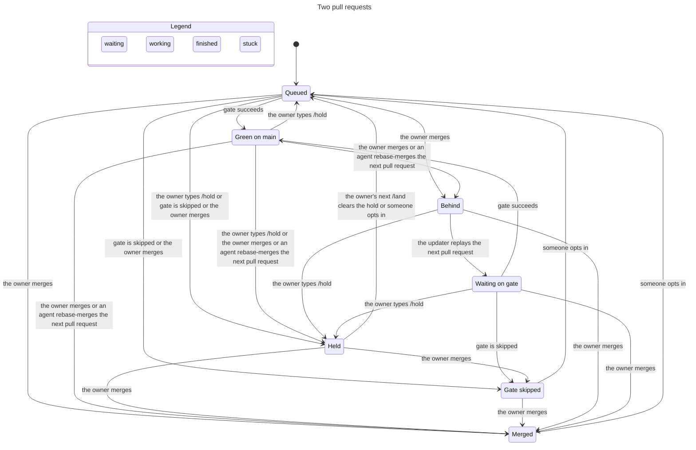

# Agent protocol

Coding agents on mitos claim work, hand it off, ask the owner, and land it through one protocol. Claude Code and Grok Bot are the providers today. Each provider implements an adapter and a thin land connector. A later provider adds those two. The decision module does not grow a branch for it.

The ledger is the GitHub conversation on the task issue and its pull request. `MitosGate.Admit` admits events. `MitosGate.Land` decides who is next, what is pushed, when an agent may merge, and who wakes. Both live under `gate/`. Adapters decide nothing. This document specifies them. It does not add the files.

The land loop is the design at `https://github.com/kitimark/mitos/issues/178#issuecomment-6821317899`. Where this document is silent, that design stands. The deltas are below.

## Reading one task

The owner types a line in the issue or pull request conversation. No app slug, no protocol fence, no trailing adapter footer.

```text
/land
```

A bare `/land` names the pull request head at that comment's `created_at`. `/land` plus a 40-character hex sha names that sha. An unknown sha is not an entry. The workflow answers either way.

An agent posts one fence and one trailing footer, and only through `submit`. The fence carries no numeric id. The module parses a comment URL to an id internally.

~~~~
```mitos-protocol
{"v":1,"kind":"land","task":30,"as":{"provider":"claude","teammate":"worker"},"head":"aaaaaaaaaaaaaaaaaaaaaaaaaaaaaaaaaaaaaaaa","cause":{"kind":"comment","url":"https://github.com/kitimark/mitos/pull/30#issuecomment-1"}}
```
---
_Generated by [Claude Code](https://claude.ai/code)_
~~~~

`read` returns the admission fold and, for each pull request, the `Step` from `MitosGate.Land`, including the sha or the stop reason on that step. The connector acts on that step. `submit` posts at most one comment and returns `ok`, `refused` with a code, or `unsettled`.

## Decisions

| Choice | Principle |
|---|---|
| The conversation is the ledger. A label and a git ref are not state. | foundational-thinking, separate-before-serializing-shared-state |
| Admission is a pure function of the rows up to that row and of each comment's `created_at`. | model-the-domain |
| Only a registry provider's edit holds. The row is a tombstone. | boundary-discipline, encode-lessons-in-structure |
| `submit` tests that kind's goal. A miss on the settle read is `unsettled`. | make-operations-idempotent |
| The slug proves the provider. Inside a provider, `as` is the agent's own word. | type-system-discipline |
| The author model is the model with strictly the most changed lines on carried holder pushes. No such push means not covered. | model-the-domain |
| One `covered` function reads only `verdict` records. | laziness-protocol, encode-lessons-in-structure |
| `read` returns `Step`. A display summary does not decide. | boundary-discipline |
| `holderHead` is the newest push, or else the claim's head. The lease sha is the live head when carry from `holderHead` reaches it. | make-operations-idempotent |
| Catch-ups, assignment, `owner-ping.yml`, and issue 43 stay until an owner pull request moves every caller. | migrate-callers-then-delete-legacy-apis, never-block-on-the-human |

A git ref could close a claim race by compare-and-swap. It loses because the owner catches up on GitHub, `docs/process.md` under "Owner catch-up on GitHub", and a ref the owner does not read is not the ledger. The race closes by admission order, a settle re-read, and a lease on the carried live head.

## Admission

`Admit.fold` walks rows in ascending id. A row is a conversation comment or a close. The fold skips review comments. It does not read the live `gate` or the clock. Every fact it does read is the fact at that row's `created_at`.

The head on a claim is the pull request head at `created_at`. The task file, when one exists, is the file at `created_at`. The registry row is the row active at `created_at`. A row is active when `retiredAt` is absent or later than that time. Retirement is the only change to a row. The module has no rename.

An edited comment has `updated_at` different from `created_at`. A fixture pins the difference. A body edit moves `updated_at`, and a reaction does not. Adapters never PATCH an event.

An edited owner comment is `/hold`. It does not clear an edit hold. An edited comment whose slug is a registry provider's slug is a tombstone. The body is not parsed. The holder does not change. Older verdicts and pushes stay in the fold, and they do not become covered again by the loss of the edited body. `covered` is false while a tombstone id is greater than every verdict id. A later verdict can cover. The task is held. No later claim applies until the owner types `/land` or `/release` after that tombstone. `/hold`, `/delegate`, `/grok`, and `/wontfix` do not clear the hold. The edit wakes the root. `ask-owner` still applies during the hold, so the wake has a way to reach the owner.

An edited comment whose slug is not a registry provider does not hold and does not tombstone. The fixture is an edited CodeRabbit summary. Twenty-eight of the thirty newest pull requests have one, and the task stays open for claims.

A deleted comment is absent from the REST list. Whether deleting a `fail` or a claim is accepted risk is an owner question. The module does not add an `after` link to paper over it.

A fence is a top-level block tagged `mitos-protocol`. A fence inside a quote or a code block is not an event. A fence applies only when its `task` is the issue the comment sits on. The only footer is a trailing one, one line that starts `_Generated by` and is the last non-empty line of the body. A quoted footer is not a footer. Two fences, two footers, an unknown key, a key named `id`, a bare digit string, or a `v` other than `1` do not apply. A login of kitimark with no app slug is never forged. A comment from a declared actor with no fence is advisory.

`submit` renders the event and posts it only when `step` returns `applied`. It then reads until that comment is in the list, or a second read still misses it.

| `step` | Settle read | Result |
|---|---|---|
| `already` | not posted | `ok` |
| `applied` | the comment is in the list and the fold applied it | `ok` |
| `applied` | the second read still misses it | `unsettled` |
| `refused` | not posted | `refused` and the code |

`unsettled` is not a refusal. The worker retries the read. The worker does not release the claim and does not post a second fence. A comment that shows up later still applies.

The goal is per kind. A second post happens only when that goal is not yet true.

| Kind | Goal already true |
|---|---|
| `claim` | This actor already holds the task. |
| `release` | The holder is already none. |
| `push` | `holderHead` is already this sha. |
| `handoff` | The holder is already the target. |
| `verdict` | This judge's newest verdict on this head is already this result. |
| `ask-owner` | This question is already the open ask. |
| `answer` | This cause URL is already recorded. The ask stays open. |
| `land` | This actor already has a landing entry for this head. |

A later `pass` after that judge's `fail` is a different goal, so it is posted. A re-claim after release is a different goal, so it is posted. A second `release` of an ended claim is the same goal, so `submit` returns `ok` and posts nothing. A refused claim, including a lane clash, returns `refused` and the code. It does not return `ok`.

Receipts are not part of this fold. They start at the relay row of the migration. Their key is the cause, the target, and the result.

## Owner lines

One parser reads owner lines, on the issue and on the pull request. It strips quotes and code blocks first. A line counts only from login kitimark with no app slug. An edited owner comment is `/hold`. The trailing-footer rule above is the same rule the fence uses.

| Line | Meaning |
|---|---|
| `/land` | Land the head at `created_at`. Clears an edit hold. |
| `/land <sha>` | Land that sha. A sha that is not 40 hex characters is refused. Clears an edit hold. |
| `/hold` | Stop replay and agent merge until the next `/land`. Does not clear an edit hold. |
| `/delegate <provider>` | Grant that whole provider for this task. |
| `/revoke <provider>` | Remove that provider. |
| `/release` | End the claim. Clears an edit hold. |
| `/wontfix` | Close the task without a landing. |
| `/grok <teammate>` | Wake that teammate. It is not a deciding word. |

Any other line that starts with `/` is an unknown word. The workflow answers every word. Applied, ignored because an app posted it, unknown word, bad sha, or unknown teammate.

`/delegate` grants the provider because the slug does not prove which teammate typed `as`. `/land` does not grant merge on a kept path. `/hold` wins over an agent `land`.

An owner thread is a review thread whose first comment is login kitimark with no app slug. It stays open until a later comment in that thread from that same login with no app slug. An agent reply does not clear it. A merge clears it.

`ask-owner` stays open until an owner comment after it, a merge of a task pull request, or a newer `ask-owner`. An `answer` does not clear it. The root does not clear its own ask.

## Lean sketch

This is `MitosGate.Admit`. Nothing under `gate/` is added by this document. The block type-checks alone on Lean 4.35.0, guards included. Copy it to a file and run `lean` on that file. The implementing pull request proves the propositions and deletes the guards.


```lean
namespace MitosGate.Admit

/-!
Admission. The body is parsed here. A shell does not fill the kind or the actor.
`proved` is false until the owner answers whether a teammate inside a provider is provable.
-/

abbrev Sha := String

structure Actor where
  provider : String
  teammate : String
  role : String
  model : String
  root : Bool
  slug : String
  retiredAt : Option Nat
  deriving DecidableEq, Repr

inductive Kind where
  | claim | release | push | handoff | verdict | «ask-owner» | answer | land
  deriving DecidableEq, Repr

inductive Code where
  | forged | malformed | capability | holder | lane | «lane-intersect»
  | «round-cap» | unenforced | «not-next» | kept | blocked | held
  deriving DecidableEq, Repr

inductive Result where
  | pass | fail | hold | «wording-only»
  deriving DecidableEq, Repr

structure Comment where
  id : Nat
  created : Nat
  edited : Bool
  login : String
  slug : Option String
  body : String
  onTask : Nat
  review : Bool
  deriving DecidableEq, Repr

inductive Row where
  | comment (c : Comment)
  | «closed» (explained : Bool)
  deriving DecidableEq, Repr

structure PushRec where
  actor : Actor
  head : Sha
  lines : Nat
  model : String
  id : Nat
  deriving DecidableEq, Repr

structure VerdictRec where
  judge : Actor
  head : Sha
  result : Result
  id : Nat
  deriving DecidableEq, Repr

structure Fold where
  holder : Option Actor
  claimHead : Option Sha
  stems : List String
  pushes : List PushRec
  verdicts : List VerdictRec
  tombstones : List Nat
  held : Bool
  blocked : Bool
  delegates : List String
  openAsk : Option String
  rounds : Nat
  ownerHold : Bool
  answers : List String
  others : List String
  deriving DecidableEq, Repr

def empty : Fold :=
  { holder := none, claimHead := none, stems := [], pushes := [], verdicts := []
    tombstones := [], held := false, blocked := false, delegates := [], openAsk := none
    rounds := 0, ownerHold := false, answers := [], others := [] }

def active (a : Actor) (atTime : Nat) : Bool :=
  match a.retiredAt with
  | none => true
  | some t => atTime < t

def providerSlug (reg : List Actor) (s : String) : Bool :=
  reg.any fun a => a.slug == s

def allows (role : String) (k : Kind) : Bool :=
  match role, k with
  | "worker", .claim | "worker", .release | "worker", .push | "worker", .handoff
  | "worker", .answer | "worker", .land => true
  | "root", .«ask-owner» | "root", .answer | "root", .handoff | "root", .release
  | "root", .verdict | "root", .land => true
  | "verifier", .verdict | "verifier", .answer => true
  | _, _ => false

def holderHead (f : Fold) : Option Sha :=
  match f.pushes.getLast? with
  | some p => some p.head
  | none => f.claimHead

def modelsOf (ps : List PushRec) : List String :=
  ps.foldl (fun acc p => if acc.contains p.model then acc else acc ++ [p.model]) []

def sumModel (ps : List PushRec) (m : String) : Nat :=
  (ps.filter (·.model == m)).foldl (fun n p => n + p.lines) 0

/-- The model with strictly the most changed lines. A tie is none. -/
def mostModel (ps : List PushRec) : Option String :=
  match modelsOf ps with
  | [] => none
  | m :: rest =>
    let best := rest.foldl (fun b x => if sumModel ps x > sumModel ps b then x else b) m
    let tied := (modelsOf ps).filter fun x => sumModel ps x == sumModel ps best
    if tied.length == 1 && sumModel ps best > 0 then some best else none

def judges (vs : List VerdictRec) : List Actor :=
  vs.foldl (fun acc v => if acc.contains v.judge then acc else acc ++ [v.judge]) []

def newest (vs : List VerdictRec) (j : Actor) : Option VerdictRec :=
  (vs.filter (·.judge == j)).foldl (fun best v =>
    match best with
    | none => some v
    | some b => if v.id > b.id then some v else some b) none

/-- One covered rule. No reachable holder push means not covered. -/
def covered (f : Fold) (critical : Bool) (carries : Sha → Bool) : Bool :=
  if f.tombstones.any fun t => f.verdicts.all fun v => v.id < t then false
  else
    match mostModel (f.pushes.filter fun p => carries p.head) with
    | none => false
    | some author =>
      let vs := f.verdicts.filter fun v => carries v.head
      let standing := judges vs |>.any fun j =>
        match newest vs j with
        | some v => v.result == .fail || v.result == .hold
        | none => false
      let wording := vs.any fun v => v.result == .«wording-only» && v.judge.root
      if wording && !standing then true
      else
        let js := judges vs
        !js.isEmpty &&
          (js.all fun j =>
            match newest vs j with
            | some v => v.result == .pass
            | none => false) &&
          (vs.any fun v => v.result == .pass && v.judge.model != author) &&
          (!critical || vs.any fun v => v.result == .pass && v.judge.teammate == "verifier-opus")

def stemOf (p : String) : Option String :=
  if p.any (· == ' ') || p == "" then none
  else if p.startsWith "ops/runs" then none
  else if p.startsWith "tasks/" then none
  else if p.any (· == '*') then
    let pre := (p.splitOn "*").headD ""
    let dir :=
      if pre.endsWith "/" then pre
      else
        let parts := pre.splitOn "/"
        if parts.length ≤ 1 then "" else String.intercalate "/" parts.dropLast ++ "/"
    if dir == "" || dir == "/" then none else some dir
  else some p

def stemsOf (ps : List String) : List String :=
  ps.filterMap stemOf

def overlaps (a b : String) : Bool :=
  a == b || a.startsWith b || b.startsWith a

def intersects (a b : List String) : Bool :=
  a.any fun x => b.any fun y => overlaps x y

private def dropWhile (cs : List Char) (p : Char → Bool) : List Char :=
  match cs with
  | [] => []
  | c :: rest => if p c then dropWhile rest p else cs

private def takeWhile (cs : List Char) (p : Char → Bool) : String × List Char :=
  match cs with
  | [] => ("", [])
  | c :: rest =>
    if p c then
      let (s, rest) := takeWhile rest p
      (c.toString ++ s, rest)
    else ("", cs)

private def skipSpace (cs : List Char) : List Char :=
  dropWhile cs fun c => c == ' ' || c == '\n' || c == '\t' || c == '\r'

private inductive JVal where
  | str (s : String)
  | num (n : Nat)
  | obj (fs : List (String × JVal))
  | arr (xs : List String)
  | yes | no
  deriving Repr

private def parseString : List Char → Option (String × List Char)
  | [] => none
  | '"' :: rest =>
    let (s, rest) := takeWhile rest (· != '"')
    match rest with
    | '"' :: rest => some (s, rest)
    | _ => none
  | _ => none

private def parseNum : List Char → Option (Nat × List Char)
  | [] => none
  | c :: rest =>
    if c.isDigit then
      let (s, rest) := takeWhile (c :: rest) (·.isDigit)
      s.toNat?.map fun n => (n, rest)
    else none

private def parseValue (fuel : Nat) (cs : List Char) : Option (JVal × List Char) :=
  match fuel with
  | 0 => none
  | fuel + 1 =>
    match skipSpace cs with
    | '"' :: _ => parseString (skipSpace cs) |>.map fun (s, r) => (.str s, r)
    | 't' :: 'r' :: 'u' :: 'e' :: r => some (.yes, r)
    | 'f' :: 'a' :: 'l' :: 's' :: 'e' :: r => some (.no, r)
    | '[' :: r =>
      let rec arrFields (n : Nat) (cs : List Char) (acc : List String) : Option (List String × List Char) :=
        match n with
        | 0 => none
        | n + 1 =>
          match skipSpace cs with
          | ']' :: rest => some (acc, rest)
          | _ =>
            match parseString (skipSpace cs) with
            | none => none
            | some (s, rest) =>
              match skipSpace rest with
              | ',' :: rest => arrFields n rest (acc ++ [s])
              | ']' :: rest => some (acc ++ [s], rest)
              | _ => none
      arrFields fuel r [] |>.map fun (xs, r) => (.arr xs, r)
    | '{' :: r =>
      let rec objFields (n : Nat) (cs : List Char) (acc : List (String × JVal)) :
          Option (List (String × JVal) × List Char) :=
        match n with
        | 0 => none
        | n + 1 =>
          match skipSpace cs with
          | '}' :: rest => some (acc, rest)
          | _ =>
            match parseString (skipSpace cs) with
            | none => none
            | some (k, rest) =>
              match skipSpace rest with
              | ':' :: rest =>
                match parseValue fuel (skipSpace rest) with
                | none => none
                | some (v, rest) =>
                  match skipSpace rest with
                  | ',' :: rest => objFields n rest (acc ++ [(k, v)])
                  | '}' :: rest => some (acc ++ [(k, v)], rest)
                  | _ => none
              | _ => none
      objFields fuel r [] |>.map fun (fs, r) => (.obj fs, r)
    | c :: _ =>
      if c.isDigit then parseNum (skipSpace cs) |>.map fun (n, r) => (.num n, r) else none
    | [] => none

private def lookup (fs : List (String × JVal)) (k : String) : Option JVal :=
  (fs.find? (·.1 == k)).map (·.2)

private def hasKey (fs : List (String × JVal)) (k : String) : Bool :=
  fs.any fun
    | (name, .obj nested) => name == k || nested.any (·.1 == k)
    | (name, _) => name == k

private def digitsOnly (s : String) : Bool :=
  !s.isEmpty && s.all (·.isDigit) && !s.startsWith "http"

private def bareString (v : JVal) : Bool :=
  match v with
  | .str s => digitsOnly s
  | .obj fs => fs.any fun (_, v) =>
      match v with
      | .str s => digitsOnly s
      | _ => false
  | .arr xs => xs.any digitsOnly
  | _ => false

private structure Parsed where
  kind : Kind
  task : Nat
  provider : String
  teammate : String
  head : Option String
  touches : List String
  toProvider : Option String
  toTeammate : Option String
  narrowed : Bool
  result : Option Result
  lines : Nat
  question : Option String
  kept : Bool
  cause : Option String

private def kindOf : String → Option Kind
  | "claim" => some .claim
  | "release" => some .release
  | "push" => some .push
  | "handoff" => some .handoff
  | "verdict" => some .verdict
  | "ask-owner" => some .«ask-owner»
  | "answer" => some .answer
  | "land" => some .land
  | _ => none

private def resultOf : String → Option Result
  | "pass" => some .pass
  | "fail" => some .fail
  | "hold" => some .hold
  | "wording-only" => some .«wording-only»
  | _ => none

private def fenceBody (body : String) : Option String :=
  let lines := body.splitOn "\n"
  let rec go (xs : List String) (inside : Bool) (acc : List String) (depth : Nat) : Option (List String) :=
    match xs with
    | [] => if inside then none else some []
    | line :: rest =>
      if !inside then
        if line.startsWith ">" || line.startsWith "    " then go rest false acc depth
        else if line == "```mitos-protocol" then go rest true [] (depth + 1)
        else go rest false acc depth
      else if line == "```" then
        if acc.isEmpty then none else some acc
      else go rest true (acc ++ [line]) depth
  (go lines false [] 0).map fun ls => String.intercalate "\n" ls

private def parseFence (body : String) : Option Parsed :=
  match fenceBody body with
  | none => none
  | some raw =>
    match parseValue 20 raw.toList with
    | some (.obj fs, rest) =>
      if skipSpace rest != [] then none
      else if hasKey fs "id" || fs.any fun (_, v) => bareString v then none
      else
        match lookup fs "v", lookup fs "kind", lookup fs "task", lookup fs "as" with
        | some (.num 1), some (.str k), some (.num task), some (.obj as) =>
          match kindOf k, lookup as "provider", lookup as "teammate" with
          | some kind, some (.str provider), some (.str teammate) =>
            let head := match lookup fs "head" with
              | some (.str h) => some h
              | _ => none
            let touches := match lookup fs "touches" with
              | some (.arr xs) => xs
              | _ => []
            let (toP, toT) := match lookup fs "to" with
              | some (.obj o) =>
                match lookup o "provider", lookup o "teammate" with
                | some (.str p), some (.str t) => (some p, some t)
                | _, _ => (none, none)
              | _ => (none, none)
            let narrowed := match lookup fs "narrowed" with
              | some .yes => true
              | _ => false
            let result := match lookup fs "result" with
              | some (.str s) => resultOf s
              | _ => none
            let lines := match lookup fs "lines" with
              | some (.num n) => n
              | _ => 0
            let question := match lookup fs "question" with
              | some (.str s) => some s
              | _ => none
            let kept := match lookup fs "kept" with
              | some .yes => true
              | _ => false
            let cause := match lookup fs "cause" with
              | some (.obj o) =>
                match lookup o "url" with
                | some (.str u) => some u
                | _ => none
              | _ => none
            let opens := (body.splitOn "\n").filter (· == "```mitos-protocol")
            if opens.length != 1 then none
            else
              some { kind, task, provider, teammate, head, touches
                     toProvider := toP, toTeammate := toT, narrowed, result, lines
                     question, kept, cause }
          | _, _, _ => none
        | _, _, _, _ => none
    | _ => none

def footerCount (body : String) : Nat :=
  (body.splitOn "\n").foldl (fun n line =>
    if line.startsWith "_Generated by" then n + 1 else n) 0

def trailingFooter (body : String) : Bool :=
  let lines := (body.splitOn "\n").filter (· != "")
  match lines.getLast? with
  | some last => last.startsWith "_Generated by" && footerCount body == 1
  | none => false

def findActor (reg : List Actor) (atTime : Nat) (provider teammate slug : String) : Option Actor :=
  reg.find? fun a =>
    a.provider == provider && a.teammate == teammate && a.slug == slug && active a atTime

inductive StepResult where
  | applied (f : Fold)
  | already (f : Fold)
  | refused (c : Code)
  deriving DecidableEq, Repr

def ownerWord (c : Comment) : Option String :=
  if c.review || c.login != "kitimark" || c.slug.isSome then none
  else if c.edited then some "hold"
  else if c.body == "/land" || c.body.startsWith "/land " then some "land"
  else if c.body == "/release" then some "release"
  else if c.body == "/hold" then some "hold"
  else if c.body.startsWith "/delegate " then some "delegate"
  else if c.body.startsWith "/revoke " then some "revoke"
  else if c.body == "/wontfix" then some "wontfix"
  else if c.body.startsWith "/grok " then some "grok"
  else if c.body.startsWith "/" then some "unknown"
  else none

def delegateProvider (body : String) : Option String :=
  let rest := String.ofList (body.toList.drop "/delegate ".length)
  let name := (rest.splitOn " ").headD ""
  if name.isEmpty then none else some name

private def clearEdit (f : Fold) : Fold :=
  { f with held := false }

private def applyWord (f : Fold) (word : String) (body : String) : Fold :=
  match word with
  | "land" => clearEdit f
  | "release" => { clearEdit f with holder := none, stems := [], claimHead := none, blocked := false }
  | "hold" => { f with ownerHold := true }
  | "delegate" =>
    match delegateProvider body with
    | some p => { f with delegates := if f.delegates.contains p then f.delegates else f.delegates ++ [p] }
    | none => f
  | "revoke" =>
    match delegateProvider (body.replace "/revoke " "/delegate ") with
    | some p => { f with delegates := f.delegates.filter (· != p) }
    | none => f
  | _ => f

def isOwner (c : Comment) : Bool :=
  !c.review && c.login == "kitimark" && c.slug.isNone

def step (proved : Bool) (reg : List Actor) (f : Fold) (c : Comment) : StepResult :=
  if c.review then .already f
  else if c.edited && c.slug.any (providerSlug reg) then
    .applied { f with held := true, tombstones := f.tombstones ++ [c.id] }
  else if isOwner c then
    if c.edited then .applied { f with ownerHold := true }
    else
      let f := { f with openAsk := none }
      match ownerWord c with
      | some "unknown" => .refused .malformed
      | some word => .applied (applyWord f word c.body)
      | none => .applied f
  else if c.edited then .already f
  else
    match parseFence c.body with
    | none => .already f
    | some p =>
      if !trailingFooter c.body then .refused .malformed
      else
          if p.task != c.onTask then .refused .malformed
          else
            match c.slug with
            | none => .refused .forged
            | some slug =>
              match findActor reg c.created p.provider p.teammate slug with
              | none => .refused .forged
              | some actor =>
                if !allows actor.role p.kind then .refused .capability
                else
                  let privileged := actor.root && (p.kind == .release || p.kind == .handoff ||
                    (p.kind == .verdict && p.result == some .«wording-only»))
                  if privileged && !proved && !(p.kind == .release && f.holder == some actor) &&
                      !(p.kind == .handoff && f.holder == some actor) then
                    .refused .capability
                  else
                    match p.kind with
                    | .claim =>
                      if f.held then .refused .held
                      else if f.blocked then .refused .blocked
                      else if f.holder == some actor then .already f
                      else
                        let stems := stemsOf p.touches
                        if !p.touches.isEmpty && stems.isEmpty then .refused .lane
                        else if intersects f.others stems || intersects f.stems stems then .refused .«lane-intersect»
                        else if f.holder.isSome then .refused .holder
                        else .applied { f with holder := some actor, claimHead := p.head, stems := stems }
                    | .release =>
                      if f.holder.isNone then .already f
                      else if f.holder == some actor || (actor.root && proved) then
                        .applied { f with holder := none, stems := [], claimHead := none }
                      else .refused .holder
                    | .push =>
                      if f.holder != some actor then .refused .holder
                      else if holderHead f == p.head then .already f
                      else
                        match p.head with
                        | none => .refused .malformed
                        | some h =>
                          let rounds := if p.lines != 0 &&
                              ((f.verdicts.getLast?).any fun v => v.result == .fail || v.result == .hold)
                            then f.rounds + 1 else f.rounds
                          if rounds > 2 then .refused .«round-cap»
                          else
                            let push : PushRec := { actor, head := h, lines := p.lines, model := actor.model, id := c.id }
                            .applied { f with rounds := rounds, pushes := f.pushes ++ [push] }
                    | .handoff =>
                      match p.toProvider, p.toTeammate with
                      | some tp, some tt =>
                        match reg.find? fun a => a.provider == tp && a.teammate == tt && active a c.created with
                        | none => .refused .capability
                        | some target =>
                          if f.holder != some actor && !(actor.root && proved) then .refused .holder
                          else if f.holder == some target then .already f
                          else if f.rounds ≥ 2 && !p.narrowed then .refused .«round-cap»
                          else if p.narrowed && !actor.root then .refused .capability
                          else if f.rounds ≥ 2 && p.narrowed && !proved then .refused .capability
                          else
                            let nextRounds := f.rounds + 1
                            .applied { f with holder := some target, rounds := nextRounds, claimHead := p.head }
                      | _, _ => .refused .malformed
                    | .verdict =>
                      match p.result, p.head with
                      | some r, some h =>
                        let mine := f.verdicts.filter (·.judge == actor)
                        match mine.getLast? with
                        | some last => if last.result == r && last.head == h then .already f
                          else .applied { f with verdicts := f.verdicts ++ [{ judge := actor, head := h, result := r, id := c.id }] }
                        | none => .applied { f with verdicts := f.verdicts ++ [{ judge := actor, head := h, result := r, id := c.id }] }
                      | _, _ => .refused .malformed
                    | .«ask-owner» =>
                      match p.question with
                      | none => .refused .malformed
                      | some q => if f.openAsk == some q then .already f
                        else .applied { f with openAsk := some q }
                    | .answer =>
                      match p.cause with
                      | none => .refused .malformed
                      | some url =>
                        if f.answers.contains url then .already f
                        else .applied { f with answers := f.answers ++ [url] }
                    | .land =>
                      if p.kept then .refused .kept
                      else if f.ownerHold then .refused .held
                      else if !f.delegates.contains actor.provider then .refused .capability
                      else if f.held then .refused .held
                      else .applied f

def fold (proved : Bool) (reg : List Actor) (rows : List Row) : Fold :=
  rows.foldl (fun f row =>
    match row with
    | .comment c =>
      match step proved reg f c with
      | .applied g => g
      | .already g => g
      | .refused _ => f
    | .«closed» explained =>
      if explained then { f with holder := none, stems := [], claimHead := none, blocked := false, openAsk := none }
      else { f with blocked := true }) empty

inductive Submit where
  | ok
  | refused (c : Code)
  | unsettled
  deriving DecidableEq, Repr

/-- `seen` is the settle re-read. A miss is unsettled, and the comment may still apply. -/
def submit (seen : Bool) : StepResult → Submit
  | .refused c => .refused c
  | .already _ => .ok
  | .applied _ => if seen then .ok else .unsettled

def providerEdit (reg : List Actor) (c : Comment) : Bool :=
  c.edited && !c.review && c.slug.any (providerSlug reg)

def EditNeverLifts : Prop :=
  ∀ (proved : Bool) (reg : List Actor) (rows : List Row) (c : Comment),
    providerEdit reg c = true →
      let before := fold proved reg rows
      let after := fold proved reg (rows ++ [.comment c])
      after.holder = before.holder ∧ after.verdicts = before.verdicts ∧
        after.pushes = before.pushes ∧ after.held = true

def CodeRabbitEditDoesNotHold : Prop :=
  ∀ (proved : Bool) (reg : List Actor) (rows : List Row) (c : Comment),
    c.edited = true → c.slug = some "coderabbit" → providerSlug reg "coderabbit" = false →
      (fold proved reg (rows ++ [.comment c])).held = (fold proved reg rows).held

def OnlyLandOrReleaseClears : Prop :=
  ∀ (proved : Bool) (reg : List Actor) (rows : List Row) (c : Comment),
    (fold proved reg rows).held = true →
      ownerWord c = some "hold" →
        (fold proved reg (rows ++ [.comment c])).held = true

def NotCoveredWithoutPush : Prop :=
  ∀ (f : Fold) (critical : Bool) (carries : Sha → Bool),
    f.pushes = [] → f.tombstones = [] → covered f critical carries = false

def ForgedNeverApplies : Prop :=
  ∀ (proved : Bool) (reg : List Actor) (f : Fold) (c : Comment) (slug : String),
    c.edited = false → c.review = false → c.slug = some slug →
      providerSlug reg slug = false → trailingFooter c.body = true → parseFence c.body ≠ none →
        step proved reg f c = .refused .forged

def KindWithinRole : Prop :=
  ∀ (proved : Bool) (reg : List Actor) (f : Fold) (c : Comment) (p : Parsed) (a : Actor),
    c.edited = false → c.review = false → trailingFooter c.body = true →
      parseFence c.body = some p → p.task = c.onTask → c.slug.isSome = true →
        findActor reg c.created p.provider p.teammate (c.slug.getD "") = some a →
          allows a.role p.kind = false →
            step proved reg f c = .refused .capability

def OnlyHolderPushes : Prop :=
  ∀ (proved : Bool) (reg : List Actor) (f : Fold) (c : Comment) (p : Parsed) (a : Actor),
    parseFence c.body = some p → p.kind = .push →
      findActor reg c.created p.provider p.teammate (c.slug.getD "") = some a →
        f.holder ≠ some a → allows a.role .push = true → c.edited = false → c.review = false →
          trailingFooter c.body = true → p.task = c.onTask → c.slug.isSome = true →
            step proved reg f c = .refused .holder

def HandoffMovesHolder : Prop :=
  ∀ (proved : Bool) (reg : List Actor) (f g : Fold) (c : Comment) (target : Actor),
    step proved reg f c = .applied g →
      (parseFence c.body).any (fun p => p.kind = .handoff) = true →
        (parseFence c.body).bind (fun p =>
          match p.toProvider, p.toTeammate with
          | some tp, some tt => reg.find? fun a => a.provider == tp && a.teammate == tt
          | _, _ => none) = some target →
          g.holder = some target

def SubmitIdempotent : Prop :=
  ∀ (f : Fold) (c : Code),
    submit true (.already f) = .ok ∧
      submit true (.refused c) = .refused c ∧
        submit false (.applied f) = .unsettled

def LaneDisjoint : Prop :=
  ∀ (proved : Bool) (reg : List Actor) (f : Fold) (c : Comment) (p : Parsed),
    parseFence c.body = some p → p.kind = .claim →
      intersects f.others (stemsOf p.touches) = true →
        c.edited = false → c.review = false → isOwner c = false →
          trailingFooter c.body = true → p.task = c.onTask →
            match step proved reg f c with
            | .refused .«lane-intersect» => True
            | .refused .held => True
            | .refused .blocked => True
            | .refused .forged => True
            | .refused .capability => True
            | .already _ => True
            | _ => False

private def foot : String :=
  "\n---\n_Generated by [Claude Code](https://claude.ai/code)_\n"

private def fenced (json : String) : String :=
  "```mitos-protocol\n" ++ json ++ "\n```" ++ foot

private def C (id created : Nat) (edited : Bool) (login : String) (slug : Option String)
    (body : String) (onTask : Nat) : Comment :=
  { id, created, edited, login, slug, body, onTask, review := false }

private def worker : Actor :=
  { provider := "claude", teammate := "worker", role := "worker", model := "sonnet"
    root := false, slug := "claude", retiredAt := none }

private def grok : Actor :=
  { provider := "grok", teammate := "worker", role := "worker", model := "grok"
    root := false, slug := "cursor", retiredAt := none }

private def verifier : Actor :=
  { provider := "claude", teammate := "verifier-opus", role := "verifier", model := "opus"
    root := false, slug := "claude", retiredAt := none }

private def rootA : Actor :=
  { provider := "claude", teammate := "root", role := "root", model := "opus"
    root := true, slug := "claude", retiredAt := none }

private def reg : List Actor := [worker, grok, verifier, rootA]

private def claimJson : String :=
  "{\"v\":1,\"kind\":\"claim\",\"task\":30,\"as\":{\"provider\":\"claude\",\"teammate\":\"worker\"},\"touches\":[\"core/Mitos/**/*.lean\",\"ops/runs/x.json\",\"see the notes\"],\"head\":\"abc\"}"

private def passJson : String :=
  "{\"v\":1,\"kind\":\"verdict\",\"task\":30,\"as\":{\"provider\":\"claude\",\"teammate\":\"verifier-opus\"},\"head\":\"abc\",\"result\":\"pass\",\"lines\":4}"

private def failEdit : Comment :=
  C 3 3 true "kitimark" (some "claude")
    (fenced "{\"v\":1,\"kind\":\"verdict\",\"task\":30,\"as\":{\"provider\":\"claude\",\"teammate\":\"verifier-opus\"},\"head\":\"abc\",\"result\":\"fail\"}")
    30

#guard stemOf "core/Mitos/**/*.lean" = some "core/Mitos/"
#guard stemOf "ops/runs/x.json" = none
#guard stemOf "see the notes" = none
#guard stemOf "tasks/foo.md" = none

#guard (parseFence (fenced claimJson)).isSome = true
#guard (parseFence (fenced "{\"v\":1,\"kind\":\"claim\",\"task\":30,\"as\":{\"provider\":\"claude\",\"teammate\":\"worker\"},\"id\":1}")).isNone = true

private def rows : List Row :=
  [ .comment (C 1 1 false "kitimark" (some "claude") (fenced claimJson) 30)
  , .comment (C 2 2 false "kitimark" (some "claude") (fenced passJson) 30)
  , .comment failEdit ]

#guard (fold false reg rows).held = true
#guard (fold false reg rows).verdicts.length = 1
#guard (fold false reg rows).holder = some worker
#guard covered (fold false reg rows) false (fun _ => true) = false

private def held : Fold := fold false reg rows

#guard (fold false reg (rows ++ [.comment (C 4 4 false "kitimark" none "/hold" 30)])).held = true
#guard (fold false reg (rows ++ [.comment (C 5 5 false "kitimark" none "/land" 30)])).held = false
#guard covered (fold false reg (rows ++ [.comment (C 5 5 false "kitimark" none "/land" 30)])) false (fun _ => true) = false

private def rabbit : Comment :=
  C 9 9 true "coderabbit[bot]" (some "coderabbit") "edited summary" 30

#guard (fold false reg [.comment rabbit]).held = false

private def ask : String :=
  "{\"v\":1,\"kind\":\"ask-owner\",\"task\":30,\"as\":{\"provider\":\"claude\",\"teammate\":\"root\"},\"question\":\"ship?\"}"

#guard
  match step false reg empty (C 7 7 false "kitimark" (some "claude") (fenced ask) 30) with
  | .applied g => g.openAsk = some "ship?"
  | _ => false

private def asked : Fold := { empty with openAsk := some "ship?" }

#guard
  match step false reg asked (C 8 8 false "kitimark" (some "claude") (fenced ask) 30) with
  | .already _ => true
  | _ => false

private def hand : String :=
  "{\"v\":1,\"kind\":\"handoff\",\"task\":30,\"as\":{\"provider\":\"claude\",\"teammate\":\"worker\"},\"to\":{\"provider\":\"grok\",\"teammate\":\"worker\"},\"head\":\"abc\",\"narrowed\":false}"

#guard
  match step false reg (fold false reg [.comment (C 1 1 false "kitimark" (some "claude") (fenced claimJson) 30)])
      (C 2 2 false "kitimark" (some "claude") (fenced hand) 30) with
  | .applied g => g.holder = some grok
  | _ => false

private def pushGrok : String :=
  "{\"v\":1,\"kind\":\"push\",\"task\":30,\"as\":{\"provider\":\"grok\",\"teammate\":\"worker\"},\"head\":\"abc\",\"lines\":3}"

#guard
  match step false reg (fold false reg [.comment (C 1 1 false "kitimark" (some "claude") (fenced claimJson) 30)])
      (C 2 2 false "kitimark" (some "cursor") (fenced pushGrok) 30) with
  | .refused .holder => true
  | _ => false

#guard
  match submit true (step false reg held (C 8 8 false "kitimark" (some "cursor") (fenced claimJson) 30)) with
  | .ok => false
  | .unsettled => false
  | .refused _ => true

#guard (fold false reg [.comment (C 1 1 false "kitimark" (some "claude") (fenced claimJson) 30), .«closed» false]).holder = some worker
#guard (fold false reg [.comment (C 1 1 false "kitimark" (some "claude") (fenced claimJson) 30), .«closed» false]).blocked = true
#guard (fold false reg [.comment (C 1 1 false "kitimark" (some "claude") (fenced claimJson) 30), .«closed» true]).holder = none

def RefusedClaimIsNotOk : Prop :=
  ∀ (c : Code), submit true (.refused c) ≠ .ok

end MitosGate.Admit
```

`proved` stays false until the owner answers whether a teammate inside a provider must be provable before `delegates` is filled. While it is false, a fence does not receive the root-only powers. Those are a `release` or `handoff` of someone else's claim, a `wording-only` verdict, and a narrowed third round. The owner still uses `/release` and `/land`. Wakes still use the interim root row.

`holderHead` is the head on the newest push, or the head on the claim when there is no push. `covered` is the one rule. It is false when no holder push is reachable, and it is false when a tombstone is newer than every verdict. A `wording-only` verdict counts only from the root and only when no judge's newest carried verdict is `fail` or `hold`. Otherwise each judge's newest carried verdict must be `pass`, including a judge whose model equals the author model, at least one `pass` must come from a different model, and a critical diff also needs a `pass` from `verifier-opus`.

The author model is `mostModel`. It sums `lines` on the holder pushes that carry reaches, grouped by model. The winner is the model with a strictly greater sum. A tie is none, and then the head is not covered.

## Land

`MitosGate.Land` is unchanged except where this list says so.

- A pull request that is behind, and whose verdicts cover the head, waits for a landing word. It is not queued by the covering verdict alone. The default stays out, as that design says.
- A replay that would change the content id is not pushed. That stuck row wakes the holder. `drift` wakes the holder and the root. A conflict on covered work wakes the holder. A move of `main`, the updater's push, and a bot review of covered work wake nobody.
- A merge is authorized only when carry reaches the merged sha from a sha named by `/land` or by an applied `land`, `mayMerge` holds for the landing actor, and no newer `/hold` stands. `mayMerge` is the land design's function. The path is not kept, and the actor's provider is in `delegates`. An agent `land` on a kept path is refused and is not admitted. Any other merge wakes the root.
- `requestsMerge` uses the land design's `eligible` plus `gate` conclusion `success` on the live head. `eligible` is updatable, enforced, covered, reviewed, and the rest of that design's `rest`. It does not require a non-kept path and it does not require `delegates`. The owner is asked to merge the pull requests the owner merges, kept paths included.
- `enforced` is one read of the branch protection on `main`. The read must show admins bound, the required check `gate`, strict status checks, and a required pull request. A missing field, a failed read, or a partial read is false. Admins are bound on `main`. The module still reads the setting. No owner-typed line on issue 178 or issue 179 is implied by that fact.
- The connector re-reads owner words immediately before `merge`. A new `/hold`, or an edit that counts as `/hold`, stops the call.
- The `land` record is posted only by `submit`.
- `read` returns each pull request's `Step`. The connector does not also consult a summary.

```typescript
type Sha = string & { readonly brand: "Sha" }
type MergeReceipt = { merged: boolean; sha: Sha }
type RepoEvent =
  | { kind: "mainMoved" }
  | { kind: "updaterPushed"; pr: number }
  | { kind: "gateDone"; pr: number; gate: "success" | "failure" | "cancelled" | "skipped" | "pending" | "missing" }
  | { kind: "botReviewed"; pr: number }
  | { kind: "conflictFound"; pr: number }
  | { kind: "contentChanged"; pr: number }
  | { kind: "drift"; pr: number }
  | { kind: "commentEdited"; pr: number }
  | { kind: "unexplainedClose"; pr: number }
  | { kind: "unauthorizedMerge"; pr: number }
  | { kind: "landWord"; pr: number }
  | { kind: "ownerSpoke"; pr: number }
type Wake =
  | { kind: "nobody" }
  | { kind: "lander"; pr: number }
  | { kind: "holder"; pr: number }
  | { kind: "root" }

type LandConnector = {
  merge(pr: number, head: Sha): Promise<MergeReceipt>
  wake(event: RepoEvent): Wake
  nudge?(): Promise<"asked" | "unavailable">
}
```

`merge` is rebase merge pinned to the sha. `wake` equals the land design's table, with four added rows. `contentChanged` wakes the holder. `drift` wakes the holder and the root. `commentEdited`, `unexplainedClose`, and `unauthorizedMerge` wake the root. When the lander is the owner, the workflow posts the merge command and wakes no agent. `nudge` dispatches `update-prs.yml` with no inputs. No member pushes a branch or chooses which pull request to rebase.

`delegates` starts empty. `/delegate` and `/revoke` name a provider, and the grant is the whole provider. Who should already be in the list is an owner question. Whether a teammate must be provable before the list is filled is a separate owner question. Until both have an answer, an agent `land` waits. The owner can land. `docs/process.md` under "Roles" still says agents merge implementation pull requests. The module does not copy that sentence into the initial list.

## Claims, push, and lease

`as` is the holder. The fence has no second holder field. The slug must be the registry slug for `as.provider`. The teammate string is the agent's own word, matched to a row that is active at `created_at`.

`claim` carries `touches` and an optional `head`. A touch with a space in it is prose and is dropped. `ops/runs` and `tasks/` are outside the lane, because every task pull request adds a run-log file and the task file arrives in the task's own pull request. A glob is stored as its directory stem, so `core/Mitos/**/*.lean` is `core/Mitos/`. If a task file exists at `created_at`, its path stems must equal the claim's stems, or the claim does not apply. If no task file exists, the claim's stems are the lane. Two live claims whose stems overlap do not both apply. Overlap means the stems are equal or one starts with the other. The smaller comment id applies.

While `proved` is false, only the holder may `release` or `handoff` by a fence. The owner releases with `/release`. A handoff sets the holder to its target. The target must be an active registry row that can push, and a routine target must be enabled.

A claim ends when a merged pull request of the task explains the close, or a `release` applies. The explanation is a closing keyword in that merged pull request's body. A close that no merged task pull request explains ends nothing. The holder stays, new claims do not apply, and the root is woken. The root does not reopen a close whose actor cannot be read.

An open pull request with no claim is adopted by `claim` with `head` set to that pull request's head at `created_at`. The branch must match.

The pull requests of a task are the open and the merged pull requests whose branch an applied claim names. `done` requires a closing keyword in the body, or `/wontfix`.

`push` reads, then runs git, then posts the record of the sha that was pushed, then settles the re-read. The guard runs before git. The history after the update is linear on `origin/main`. A merge of `main` into the branch is not pushed. A conflict posts nothing and wakes the holder. If git has moved the branch and the settle read is `unsettled`, the worker's exit is `release`, then `claim` with `head` set to the sha that was pushed. That adopts the branch the push left behind.

`holderHead` is the head on the newest applied push by the holder. When that list is empty, it is the head on the applied claim. The lease sha is the live head when carry from `holderHead` reaches that live head, so an updater replay does not make the next push miss the lease. The next push uses `git push --force-with-lease` pinned to that live sha. The replay is not a holder push, so the author stays the newest holder push that carry reaches. When carry does not reach the live head, the push is `drift`, it does not run, and the holder and the root are woken. The holder does not fetch a foreign tip and publish it. When `holderHead` is absent and `head` on the claim is absent, the push creates the branch and fails if the remote ref exists.

Rounds are counted per pull request. A round starts when a `handoff` applies, or when the holder pushes lines after a blocking verdict. A push that only rebases and keeps the content id does not start a round. The budget is two, as the skill under "Rounds". A third round is a handoff with `narrowed` true from the root. That power waits on the provability question, so while `proved` is false the fence does not open round 3. The skill's narrowed brief is the rule the module applies once the owner answers.

## Types

```typescript
type IssueNumber = number & { readonly brand: "IssueNumber" }
type Cause =
  | { kind: "comment"; url: string }
  | { kind: "gate"; head: Sha }
  | { kind: "slot"; name: string; at: string }
type Teammate = { provider: "claude" | "grok"; teammate: string }
type Intent =
  | { kind: "claim"; task: IssueNumber; as: Teammate; branch: string; touches: readonly string[]; head: Sha | null; cause: Cause | null }
  | { kind: "release"; task: IssueNumber; as: Teammate; cause: Cause | null }
  | { kind: "push"; task: IssueNumber; as: Teammate; head: Sha; lines: number; cause: Cause | null }
  | { kind: "handoff"; task: IssueNumber; as: Teammate; to: Teammate; head: Sha; narrowed: boolean; cause: Cause | null }
  | { kind: "verdict"; task: IssueNumber; as: Teammate; head: Sha; result: "pass" | "fail" | "hold" | "wording-only"; cause: Cause | null }
  | { kind: "ask-owner"; task: IssueNumber; as: Teammate; question: string; requestsMerge: boolean; cause: Cause | null }
  | { kind: "answer"; task: IssueNumber; as: Teammate; cause: Cause }
  | { kind: "land"; task: IssueNumber; as: Teammate; head: Sha; kept: boolean; cause: Cause | null }

type RefusalCode =
  | "forged" | "unknown-version" | "malformed" | "capability" | "holder"
  | "lane" | "lane-intersect" | "round-cap" | "unenforced" | "not-next" | "drift"
  | "kept" | "blocked" | "held"

type Step =
  | { kind: "enter"; about: Sha }
  | { kind: "wait"; ahead: number }
  | { kind: "awaitPush"; head: Sha }
  | { kind: "awaitGate"; head: Sha }
  | { kind: "merge"; head: Sha }
  | { kind: "present"; head: Sha }
  | { kind: "stop"; why: "held" | "unenforced" | "notEligible" | "noEntry" | "conflict" | "contentChanged" | "red" | "historyError" | "unread" }
```

There is no `ended` field. The claim is ended when `holder` is none and `blocked` is false. `blocked` is the unexplained close. `narrowed` is the skill's third brief. The land `Step` carries the sha or the stop reason. `holderHead` is the function in the sketch, not a second stored field.

`lane` is a path outside `touches` after prose, `ops/runs`, and `tasks/` are dropped. `lane-intersect` is the later overlapping claim. `holder` is a `release`, `handoff`, or `push` by someone other than the holder. `not-next` is an agent `land` or an updater push for a pull request that is not next. `drift` is a lease miss. `unenforced` is an agent `land` while the protection read is false. `kept` is an agent `land` on a kept path. `blocked` is a claim during an unexplained close. `held` is a claim or an agent `land` during an edit hold or `/hold`. `forged` is a slug that is not the registry provider for `as`. `capability` is a kind outside the role row, or a root-only power while `proved` is false. `malformed` is a bad fence, a bad footer, an unknown key, a bare id, or a fence whose `task` is a different issue. `round-cap` is a third round without a proved narrowed handoff. `unknown-version` is a `v` other than 1.

A bare id is a string of one to twelve digits that is not inside a `github.com/kitimark/mitos` comment URL. The renderer rejects one in any fence string, and the parser rejects a key named `id`. Inside the module, a comment URL is parsed to its numeric id. Whether the skill's ban on ids in posts should be amended is an owner question. Until then the fence follows the rule as written.

The shell writes `lines` from the diff. The model string is the registry model of the holder at `created_at`. The caller does not send the model.

## Identity

The registry is one data file on a kept path, proposed as `gate/MitosGate/Registry.lean`, which the owner merges. It lists actors by provider, teammate, role, model, slug, and `retiredAt`. A worker is not one model. `verifier-opus` and a sonnet verifier are different rows. The admission module takes the list as an argument. It has no provider branch.

The slug proves the provider and nothing inside it. One Claude slug serves every Claude teammate, so `as.teammate` is the agent's own word. The row must exist and be active, and that is a declaration, not a proof of which teammate posted. The same holds for Grok.

| Declaration | Login | Slug | Writes |
|---|---|---|---|
| provider `claude` | kitimark | `claude` | yes |
| provider `grok` | kitimark | `cursor` | yes |
| past Grok login `cursor[bot]` | `cursor[bot]` | `cursor` | no new writes |
| updater `mitos-pr-updater[bot]` | that bot | the updater app | pushes only |
| relay | open | open | receipts, after the run check |

A comment from a declared actor with no fence is advisory. An unknown actor with a fence is forged.

The registry has one row with `root` true. Until the owner names a different row, that row is the root in the skill under "The root orchestrates". The cursor rule "kitimark mode" says the session the owner talks to plans and delegates, and it does not name a provider. Who is root remains an owner question. That row is the wake target for an owner comment, an edit, an unexplained close, an unauthorized merge, and a `/grok` line whose teammate has no row. When the row is missing, the wake goes to the holder. `/grok <teammate>` wakes that row when it exists.

`@claude` reaches an open Claude session. It is not a ledger event, so it has no sender rule. `@cursoragent` selects no provider.

The owner is login kitimark. Owner speech is a conversation comment from that login with no app slug. A missing slug is not proof of the person if an agent machine holds a user token. Whether any agent machine holds one is an owner question. Agent machines must not store a token that posts with no app. That sentence is a proposal.

A receipt applies only when the relay workflow's log names the comment id it posted, the workflow file is the relay workflow, and the run's branch is the default branch. A comment carries no Actions run id, so the log line is the check. A job from a pull request head does not apply. Which app should post receipts is an owner question.

`github-actions[bot]` on `owner-ping.yml` is a notification. It is not owner speech and it is not a receipt.

## Capabilities

The version is `1`.

| Role | Kinds |
|---|---|
| root | ask-owner, answer, land when the provider is in `delegates`, release and handoff of the claim it holds |
| worker | claim, release, push, handoff, answer, land when the provider is in `delegates` |
| verifier | verdict other than wording-only, answer |
| researcher | no deciding kind |

`wording-only`, a release of another holder's claim, and a narrowed third round are root powers. They wait on the provability question. `ci-reviewer` and `tracker` are researchers. They do not verdict, close, or land. Follow-up issues are filed as the skill already says, outside the fence.

An agent may open a pull request that touches a kept path. Only the owner merges it.

## Checked models

`docs/AgentProtocol.tla` is the two-pull-request loop. The file name matches the module name. P1 starts opted in, by the owner or by an agent. P2 is kept, and an agent may opt it. Only the owner merges it. The owner takes it first when an agent opened it. A merge moves `main`, so the other on-tip pull request goes behind. `/hold` clears on the owner's next `/land`. The owner can also merge out of a hold. The owner's merge is its own action and is not the agent's gate.

Fairness is weak fairness of the updater, of a successful gate, and of the two merge actions. `/hold` and a skipped gate are not fair. `Progress` says that when admins are bound, the owner does not hold, and gate reaches success, P1 merges. P1 starts opted, so that state is real.

TLC reached 399 states and 1288 steps and exited 0. The chart draws 7 states and 22 arrows. These rules hold. `TypeOK`, `KeptMergeIsOwner`, `AtMostOneGating`, `NoDeadlock`, `PushOnlyNext`, `AgentMergeIsGated`, `MergeOnTip`, `HoldClears`, `UnenforcedLandsNothing`, `NoBackground`, and `Progress`.

A region per pull request was tried earlier. One merge changes both pull requests, and the drawer will not draw a region step the model never takes as a single-region step. The chart below is the busier pull request. Joined arrow labels are two steps that share a start and an end in that collapse. The chart hides 168 steps of the end stutter, and it does not draw 409 steps that stay in one label. One of those is the owner taking a kept pull request, which does not change the phase the chart shows.



`docs/AgentProtocolTip.tla` is the checked-only model. It has three pull requests, and `main`'s tip is a number. A head is on the tip only when its number equals that tip. The owner's merge requires the head to be the tip and the gate to be for that head, because admins are bound and strict applies to them. Statement 3 of the land design is `OneLandingAtATime`. While a landable pull request sits on the tip, the only replay is the owner's, over an agent's.

TLC reached 547 distinct states and exited 0. The statechart run also exited 0. 547 is over the chart budget of 500, so there is no second chart. These rules hold. `TypeOK`, `NoDeadlock`, `StrictMerge`, `KeptMergeIsOwner`, `PushOnlyNext`, `MergeOnTip`, `OwnerBeforeAgent`, `TipBeforeStale`, and `OneLandingAtATime`.

The two-pull-request model leaves out a real tip, so a green phase can stand in for being on `main`. The tip model is the one that refuses a stale head. Both leave out admission, edits, the claim race, a computed content id, stacks, forks, drafts, bot review, and review threads.

The output directory must be empty. TLC prints `TLC2 Version 2.19 of 08 August 2024`. The jar used for these runs has sha256 `936a262061c914694dfd669a543be24573c45d5aa0ff20a8b96b23d01e050e88`.

```bash
TLA2TOOLS=/path/to/tla2tools.jar JAVA=/usr/bin/java \
  node .cursor/skills/statechart/scripts/statechart.ts docs/AgentProtocol.tla \
  --view docs/AgentProtocol.view.mjs --out /tmp/agent-protocol-out

java -jar /path/to/tla2tools.jar -workers 1 \
  -config docs/AgentProtocolTip.cfg docs/AgentProtocolTip.tla
```

## Transport

| Fact | Where it lives | Who writes it |
|---|---|---|
| Claim, handoff, verdict, ask, answer, land | Conversation comment | `submit` |
| Owner lines | Conversation comment, no app | The owner |
| Closing keyword and one trailing body footer | Pull request body | `open-pr.sh` |
| `gate` | Check run named `gate` | `ci.yml` |
| `spec-approved` | The latest qualifying `labeled` event | The owner |
| Kept and critical paths | `keptPath` and `criticalPath` | The owner merges the module |
| Carry and content id | `mitos-gate carry` from a checkout of `origin/main` | The updater checks the id before a push |
| Needs-owner | Catch-up, assignment of kitimark, issue 43 | The root, as the skill says |
| Verdicts | `verdict` records | The judge, through `submit` |
| Receipts | Relay log, then a receipt comment | The relay row below |

`needs-rebase` and `agent:grok` are not protocol state. Issue 43 is a dashboard. It is not a verdict source.

## Migration

This is one list with issue 179, `https://github.com/kitimark/mitos/issues/179`. The rows below are that list. Pull request 149 has merged. Issue 171 lands before the switch. Assignment, catch-ups, `owner-ping.yml`, and issue 43 have no retirement row. The rollback of the switch is to revert row 5.

| Row | Issue 179 | Change | Red, then green | Waits |
|---|---|---|---|---|
| 0 | 0 | Read protection. Admins are bound. The fixture is what goes red. | A failed read is treated as enforced. Then a failed or partial read is false, and the live read requires admins, `gate`, strict checks, and a required pull request. | |
| 1 | 1 | `Land.lean` and `mitos-gate land` | `lake build` has no such module. The build succeeds and the statements have no `sorry`. | |
| 2 | 2 | `read`, `submit`, and `Admit.lean`. Claim records and push records start here, and so do verdict records, before any shadow decide. | An open pull request has no author, and a cell of issue 43 counts as covered. Then the author is the newest holder push, and issue 43 is not a source. | |
| 3 | 3 | Shadow `decide` prints a plan. The real run measures the time. | The job prints nothing. The plan matches the fixture queue. A pull request with no push record is not covered. | Row 2 |
| 4 | 4 | Claude connector on `.claude/`, a kept path. `land` goes through `submit`. One real agent landing is the run, once the waits are answered. | A connector posts a fence on its own. The test shows only `submit`. | Who starts in `delegates`, and whether a teammate must be provable. Until then the connector wakes and the owner merges. |
| 5 | 5 | Updater switch. `apply` pushes only the planned pull request. Real runs. `main` moves and nothing is pushed. `/land` gives one push and one `gate`. `/hold` holds. | A push to `main` rebases every open pull request. Only the planned one moves, and a bad replay pushes nothing and wakes the holder. | Rows 0 to 4, and issue 171. Empty `delegates` does not start an agent merge. |
| 6 | 6 | Skill, `CLAUDE.md`, `docs/process.md`, and the cursor rule point at the Lean module. | The skill still rebases every pull request. It says `land`. | Whether `docs/agent-protocol.*` joins the kept list. This row does not add those files. |
| 7 | | Classifier for conversation comments. The footer test stays for review comments. Measure one `read` before it enters the hook. | A `cursor` comment with no Claude footer counts as the owner. It counts as the declared provider. | The measurement |
| 8 | | `pr-state.sh` calls `keptPath`. One list, the module's. | The hook has its own list. Unknown stays kept. | |
| 9 | 7 | Grok connector and the relay. Receipts start here. Grok's own listeners are turned off. | A comment from a head workflow is a receipt. Only a comment id in a default-branch relay log is. | Which app posts receipts |
| 10 | 8 | This design, including the tip model | The TLC runs above | |

## Calls from issue 117

| Call | Position |
|---|---|
| Claude is the only root | Open. The interim registry row is the skill's root, and it is the wake target. |
| Only the owner's words decide | Accepted for the owner lines, `spec-approved`, and kept-path merges. |
| `agent:grok` is the holder | The applied `claim` is the holder. The label is unread. |
| `@cursoragent` is Grok's handle | That spelling selects no provider. |
| The planner posts no review comments through the owner account | Review comments apply no kind. |
| Lane merges wait while an owner merge waits | Open, with who starts in `delegates`. The owner's `/land` ranks first. |
| Product settings | The owner decides. The protocol requires one trailing footer and no session URL. |
| Nothing wakes Grok | `/grok <teammate>` on an owner line, or fence `to`. The relay is row 9. |

## Requirements

| # | Where it lives |
|---|---|
| 1. Identity separate from the owner | The slug proves the provider. Owner speech has no slug, no fence, and no trailing adapter footer. |
| 2. One address, with a receipt | Fence `to`, or an owner `/grok` line. Receipts start at row 9. The key is cause, target, and result. |
| 3. A second provider cannot push through a claim | `as` is the holder. The lease is the carried live head. |
| 4. One merge authority | `delegates` grants a provider. `keptPath` stays with the owner. The label is absent from `Intent`. |
| 5. Rebase is the only update | `push` rebases. The updater replays. A merge of `main` is not pushed. |
| 6. Handoff and verdict name the head | Their fields. Carry is per head. |
| 7. Lane scope | `touches` on the claim, with prose, `ops/runs`, and `tasks/` removed. A task file checks the stems when it exists. |
| 8. Capabilities | The registry row. Root-only powers wait on the provability question. |
| 9. Done means the link matches | A closing keyword on a merged task pull request, or `/wontfix`. |
| 10. One footer, and workers are visible | The trailing-footer rule in Admission. Row 7 reads the slug. |
| 11. One wake, one POST | The per-kind goal, and the receipt key at row 9. |
| 12. A missed schedule is visible | Receipt result `missed`, at row 9. |

## Overlap cases

| # | What this design does |
|---|---|
| 1. `@cursoragent` merged 137 and stubbed 155 | That spelling selects no provider. A merge that carry does not reach from a landed sha wakes the root. |
| 2. Two catch-ups on 106 | The same open question is `already`, so the second `submit` returns `ok` and posts nothing. |
| 3. Merge commits of `main` on seven branches | `push` does not publish that history. |
| 4. `needs-rebase` left on after a hand rebase | The label is not state. Git says whether the branch is behind. |
| 5. Issue 162 closed without a closing keyword | The close ends no claim. New claims wait, and the root is woken. |
| 6. Planner posts read as the owner | Slug `cursor` is Grok, at row 7. |
| 7. Claude pushed the branch named in an `@cursoragent` line | The spelling wakes nobody. A non-holder push is `holder`. |
| 8. 124, 125, and 126 asked for a merge with no verifier | `covered` requires the newest verdict per judge. Behind waits for a landing word. |
| 9. Issue 153 answered twice | One cause URL, one `answer`. The ask stays open until the owner, a merge, or a newer ask. |
| 10. `cursor[bot]` received HTTP 403 | New writes use kitimark and slug `cursor`. The bot login stays in the registry with slug `cursor` and does not write. |
| 11. Two red nightlies and no post | Result `missed`, once row 9 is on. |
| 12. Tracker footer outside that lane | A researcher has no deciding kind. A second footer does not apply. |
| 13. `agent:grok` used as a lease | The label is unread. The lease is the carried live head. |
| 14. Mergeable on one head and hold on another | The newest verdict per judge, on a head carry reaches. |
| 15. Duplicate replies to one mention | One receipt key, one POST, at row 9. |
| 16. Two footers on 149 | A missing or extra trailing footer blocks agent `land`. |
| 17. Issues 169 and 170 share one expect file | Both claims name that stem. The later one does not apply. A fence on the other issue does not apply either. |

## Open owner questions

None of these is an owner-typed comment. Admins are bound on `main`. That setting is not an acceptance of issue 178 or issue 179.

- Who is root. The interim registry row is the skill's root, and wakes use it.
- Who starts in `delegates`. The list stays empty until `/delegate` or an owner-typed answer. Agent `land` waits. Row 5 does not start an agent merge while the list is empty.
- Whether a teammate inside a provider must be provable, for example by separate apps for the root and the verifiers, before `delegates` is filled. Until that answer, `proved` is false.
- Whether `docs/agent-protocol.*` joins the kept list. The Lean modules under `gate/` are already kept. Row 6 does not add these files.
- Whether deleting a `fail` or a claim is accepted risk.
- Whether a wording-only diff may be recognized from its paths. Until then the only wording-only path is the root verdict in `covered`, and that verdict waits on the provability question.
- Which app posts relay receipts.
- Whether the skill's ban on ids in posts should be amended.
- Whether an agent machine holds a token that posts with no app.
- When assignment, catch-ups, `owner-ping.yml`, and issue 43 retire.

---
_Generated by Grok Bot (Mitos Agent Protocol Architect)_
