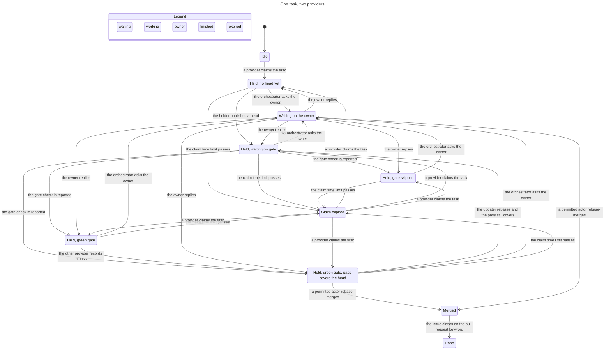

# Agent protocol

Coding agents on mitos pick up work, claim it, report progress, hand it off, ask the owner, get a review, and finish through one protocol. Claude Code and Grok Bot are the providers today. Each one implements an adapter. A later provider adds an adapter and leaves the core alone.

The ledger is the GitHub conversation on the task issue and its pull request. One comment is one event. `read` walks those comments in ascending id and applies an event only when the same guards would allow a new `submit`. That walk is the fold. Adapters call `read` and `submit`. They do not keep a second copy of the task.

This pass used the two sketches already on disk. The adversarial review is the later `@claude` pass on GitHub.

## Reading one task

Open the task issue. Find the newest comment whose fence parsed and whose event the fold applied. The fence is one JSON object. The footer is one line. Together they are the whole event.

~~~~
```mitos-protocol
{"v":1,"kind":"handoff","task":30,"from":{"provider":"claude","teammate":"worker","role":"worker"},"to":{"provider":"grok","teammate":"planner","role":"worker"},"head":"aaaaaaaaaaaaaaaaaaaaaaaaaaaaaaaaaaaaaaaa","findings":[],"blocking":true,"cause":null}
```
---
_Generated by [Claude Code](https://claude.ai/code)_
~~~~

`read(30)` returns a view. The holder is `grok` / `planner` on the branch named in the claim. `expiresAt` is the time limit from that claim. The handoff names the head above. `summary` is `waiting-ci` while the check named `gate` on the live head is still pending, and `ready` only after the rules in the state machine all hold. You act by submitting one intent. A second submit with the same derived key returns `duplicate` and posts nothing.

## Decisions

Each row is a choice, the principle that forced it, and the fact in this repo that made the other shape lose.

| Choice | Principle | Why this one |
|---|---|---|
| The conversation is the ledger. There is no protocol ref, no task file, and no write to issue 43. | foundational-thinking, separate-before-serializing-shared-state | The owner catches up on GitHub. `docs/process.md` lines 468 to 474. The root edits no repo file. A git ref the owner cannot see, and a JSON file that needs a pull request, both fail that. Each comment is one actor appending. The fold merges at read time. |
| `read` and `submit` are the whole public interface. | laziness-protocol, boundary-discipline | The caller names an intent. The package parses GitHub, decides, and posts. `Observed` and the fold stay inside the package. |
| The fold applies an event only when `decide` would allow it. The smaller comment id wins. | encode-lessons-in-structure | Two claim comments can both exist. The later one becomes the anomaly `refused` and the holder does not change. One holder is a property of the fold. |
| A teammate is a name inside a provider, with its own capability list. | model-the-domain, type-system-discipline | `grok` / `tracker` posted outside the tracker lane, and `grok` / `ci-reviewer` is not a verifier. A role cap is the maximum. The teammate list only narrows it. |
| Owner-only kinds are absent from `Intent`. | type-system-discipline, encode-lessons-in-structure | An adapter program cannot name `delegate-merge`, `wontfix`, `name-orchestrator`, or `subscribe`. The parser accepts those four only from owner speech. |
| Idempotency keys are derived. A wake posts a `sending` receipt before the POST and never posts that key again. | make-operations-idempotent | GitHub returns 200 and does not retry. The receipt comment is the lock. |
| `gate` must be `success` on the live head. A skipped check is not a pass. A carried verdict still needs that success. | encode-lessons-in-structure | The required check is `gate`. A skipped required check counts as passed at GitHub, so the protocol fails closed on the conclusion. See the comment on issue 164, linked below. |
| Merge authority starts as the owner. It changes when the owner posts `delegate-merge` on that task. | encode-lessons-in-structure | The owner asked for an explicit delegation on the task. A claim does not grant merge. |
| Kept paths come from `pr-state.sh`. The package stores no second list. | subtract-before-you-add | `.claude/skills/kitimark-mode/SKILL.md` lines 404 to 418 are the one list. `pr-state.sh` is the check sessions already run. |
| Ship the package and the fixtures before any trust-path edit. Delete the footer test only after a caller reads the fold. | sequence-verifiable-units, migrate-callers-then-delete-legacy-apis, never-block-on-the-human | `.github/`, `gate/`, `.claude/`, `docs/process.md`, and `.cursor/` are proposals in this doc. The library does not wait on them. |
| The state machine is checked in TLA+ and drawn. | prove-it-works | `docs/agent-protocol.tla`. Results are in the state machine section. |

The comment-log sketch is the base. These parts are grafted from the record sketch. Teammates are first-class, with a capability row each. The handle for Grok is `/grok <teammate>`. The wake crash table is append-only receipt comments. A raw push is drift and is not adopted. Overlapping allow-paths refuse the later claim. A trust-critical head needs two passes from two teammates, both different from the author, and one of those teammates is `verifier-opus`.

These parts of the record sketch were set aside. The git ref `refs/mitos/protocol` is a single mutable object. Two unrelated claims share one revision, and a push outside the writer wedges every adapter. Auto-setting merge authority to the orchestrator on claim contradicts an explicit owner delegation. `@mitos-grok` names no teammate and notifies nobody.

Issue 117 is the proposal this protocol answers. `https://github.com/kitimark/mitos/issues/117`

The required check fact is in `https://github.com/kitimark/mitos/issues/164#issuecomment-6803482527`. The lazy-rebase note is in `https://github.com/kitimark/mitos/issues/116#issuecomment-6803571515`.

## Concepts

A task is one GitHub issue. The plan row that links it is a pointer. Status lives in the issue and its pull request. `docs/process.md` lines 483 to 485.

A claim is one applied `claim` event. It names the holder, the provider, the teammate, the role, the allow paths, the deny paths, the branch, and `expiresAt`. The word lease in this protocol means `git push --force-with-lease=<branch>:<noted tip>`. The time limit is `expiresAt`. The skill uses lease for that compare-and-swap and stores no expiry.

A role is the maximum an actor of that kind may do. The roles an adapter may advertise are `orchestrator`, `worker`, `verifier`, `researcher`, and `relay`. `docs/process.md` lines 96 to 105 also names Planner, Red team, Evaluator, and Reviewer. Those four are not protocol roles. Planner work is a teammate with the worker cap. Red team and Evaluator stay with the owner and with CI. Reviewer comments are advisory and carry no wire kind.

A teammate is one named actor inside a provider. `claude` / `worker` and `grok` / `planner` are different holders. The capability row is the law for that name.

A message is one conversation comment with one fence and one footer. Review comments are not messages. A pull request body is not a message.

A handoff is one applied `handoff` event. It names the head, the sender, the receiver, and the findings. A blocking handoff increments the round. The round budget is two. `.claude/skills/kitimark-mode/SKILL.md` lines 237 to 243.

An owner gate is the pair the owner keeps. `spec-approved` on a spec diff, and the owner as merger when the diff touches a kept path. No adapter adds the label. No adapter merges a kept path.

A review is one applied `verdict` on one head, by a teammate who did not author that head. `hold` and `fail` do not cover a later head. `pass` and `wording-only` cover a later head only when `mitos-gate carry` exits 0. The live head still needs `gate` conclusion `success`. `.claude/skills/kitimark-mode/SKILL.md` lines 257 to 280.

A run record is one file under `ops/runs`. The proved key is `task`, `role`, `attempt`. `gate/MitosGate/RunLog.lean` line 133. The protocol does not read those files to decide authority. A record may mention a comment URL in `note`. That field already exists. `ops/runs/README.md` lines 8 to 20.

## Types

Exported types are `Intent`, `TaskView`, `SubmitResult`, `Protocol`, and `ProviderAdapter`. Storage types stay in the package.

```typescript
type IsoInstant = string // YYYY-MM-DDTHH:MM:SSZ
type IssueNumber = number & { readonly brand: "IssueNumber" }
type CommentId = number & { readonly brand: "CommentId" }
type Sha = string & { readonly brand: "Sha" } // 40 lowercase hex
type Provider = "claude" | "grok" | "relay"
type Role = "orchestrator" | "worker" | "verifier" | "researcher" | "relay"
type Teammate = { provider: Provider; teammate: string; role: Role }

type Intent =
  | { kind: "claim"; task: IssueNumber; as: Teammate; holder: Teammate; branch: string;
      allow: readonly string[]; mustNotTouch: readonly string[]; expiresAt: IsoInstant; cause: CommentId | null }
  | { kind: "renew"; task: IssueNumber; as: Teammate; expiresAt: IsoInstant; cause: CommentId | null }
  | { kind: "release"; task: IssueNumber; as: Teammate; cause: CommentId | null }
  | { kind: "push"; task: IssueNumber; as: Teammate; link: "closes" | "part-of" | "unchanged"; model: string; cause: CommentId | null }
  | { kind: "handoff"; task: IssueNumber; as: Teammate; to: Teammate; head: Sha;
      findings: readonly Finding[]; blocking: boolean; cause: CommentId | null }
  | { kind: "verdict"; task: IssueNumber; as: Teammate; head: Sha;
      result: "pass" | "fail" | "hold" | "wording-only"; model: string; findings: readonly Finding[]; evidence: string; cause: CommentId | null }
  | { kind: "ask-owner"; task: IssueNumber; as: Teammate; question: string; requestsMerge: boolean; cause: CommentId | null }
  | { kind: "merge"; task: IssueNumber; as: Teammate; head: Sha; cause: CommentId | null }
  | { kind: "reopen"; task: IssueNumber; as: Teammate; cause: CommentId | null }
  | { kind: "progress"; task: IssueNumber; as: Teammate; note: string; cause: CommentId | null }
  | { kind: "file-issue"; task: IssueNumber; as: Teammate; title: string; body: string;
      topic: "follow-up" | "process"; cause: CommentId | null }
  | { kind: "wake-receipt"; task: IssueNumber; as: Teammate; to: Teammate;
      result: "sending" | "accepted" | "failed" | "rate-limited"; http: number | null; cause: CommentId }
  | { kind: "missed-run"; task: IssueNumber; as: Teammate; subscription: string; slot: IsoInstant; cause: CommentId | null }

type Finding = { path: string; summary: string; blocking: boolean }

type OwnerWire =
  | { v: 1; kind: "delegate-merge"; task: IssueNumber; to: Teammate; cause: null }
  | { v: 1; kind: "wontfix"; task: IssueNumber; cause: null }
  | { v: 1; kind: "name-orchestrator"; task: IssueNumber; to: Teammate; cause: null }
  | { v: 1; kind: "subscribe"; task: IssueNumber; id: string; schedule: string; to: Teammate; enabled: boolean; cause: null }

type RefusalCode =
  | "forged" | "unknown-version" | "malformed" | "duplicate" | "capability" | "role" | "holder"
  | "expired" | "lane" | "lane-intersect" | "merged-main" | "behind" | "fork" | "stack"
  | "ask-without-verdict" | "gate-not-success" | "bot-review-not-ready" | "judge-is-author"
  | "round-cap" | "merge-authority" | "orchestrator" | "kept-path" | "head-moved"
  | "spec-approved-missing" | "keyword-missing" | "not-owner" | "drift"

type SubmitResult =
  | { ok: true; commentId: CommentId; view: TaskView }
  | { ok: false; refusal: { code: RefusalCode; detail: string }; view: TaskView }

type TaskView = {
  task: IssueNumber
  summary: Summary
  holder: Teammate | null
  branch: string | null
  allow: readonly string[]
  mustNotTouch: readonly string[]
  expiresAt: IsoInstant | null
  holderHead: Sha | null
  orchestrator: Teammate | null
  merge: { kind: "owner" } | { kind: "teammate"; who: Teammate; by: CommentId }
  round: 0 | 1 | 2
  openAsk: { comment: CommentId; question: string; requestsMerge: boolean } | null
  handoff: { head: Sha; from: Teammate; to: Teammate; findings: readonly Finding[] } | null
  verdicts: readonly Verdict[]
  wakes: readonly { cause: CommentId; to: Teammate; result: "sending" | "accepted" | "failed" | "rate-limited" }[]
  missed: readonly { subscription: string; slot: IsoInstant }[]
  anomalies: readonly { code: AnomalyCode; comment: CommentId }[]
}

type Summary =
  | "idle" | "claimed" | "waiting-ci" | "behind" | "history-error" | "asked" | "owner-comment"
  | "ready" | "expired" | "head-unknown" | "done" | "wontfix" | "unexpected-close"

type Protocol = {
  read(task: IssueNumber): Promise<TaskView>
  submit(intent: Intent): Promise<SubmitResult>
}
```

`TaskState` is the fold. It has no label field and no dashboard field. `Observed` is GitHub at read time. The fold does not store it.

```typescript
type Verdict = {
  head: Sha
  result: "pass" | "fail" | "hold" | "wording-only"
  model: string
  author: Teammate
  authorModel: string
  judge: Teammate
  findings: readonly Finding[]
  comment: CommentId
}

type AnomalyCode =
  | "forged" | "malformed" | "two-fences" | "two-footers" | "duplicate"
  | "unauthorized-merge" | "unknown-version" | "refused"

type Observed = {
  issueClosed: boolean
  prs: readonly PrObserved[]
  otherClaims: readonly { task: IssueNumber; allow: readonly string[] }[]
}

type PrObserved = {
  number: number
  branch: string
  body: string
  footerCount: number
  head: Sha | null
  draft: boolean
  fork: boolean
  stacked: boolean
  merged: boolean
  history: "linear-on-main" | "behind" | "merged-main"
  gate: "success" | "failure" | "cancelled" | "skipped" | "pending" | "missing"
  carry: "covers" | "fresh" | "stack" | "stopped" | "not-run"
  specPaths: boolean
  keptPaths: boolean
  issueLinkOnly: boolean
  wordingOnly: boolean
  botReview: "reviewed" | "refused" | "paused" | "behind" | "missing"
  keyword: "closes" | "part-of" | "absent"
}
```

`gate` is the newest check run whose name is `gate` on that head. `carry` is the exit of `lake exe mitos-gate carry` from a checkout of `origin/main`, as the skill specifies at lines 263 to 272. `keptPaths` is the answer from `pr-state.sh` for that diff. The package does not embed the path list.

The idempotency key is derived.

- A non-null `cause` keys `wake:${cause}:${provider}:${teammate}`. One reply from that teammate to that comment.
- A claim retries as `claim:${task}:${holder.provider}:${holder.teammate}:${branch}:${expiresAt}`. A later instant is a new claim.
- `push` keys `push:${task}:${sha}` after the shell knows the sha.
- A verdict retries as `verdict:${task}:${head}:${judge.provider}:${judge.teammate}:${result}` together with the findings. A different result is a new event.
- `merge` keys `merge:${task}:${head}`.
- `ask-owner` and `progress` with a null cause key the task, the head, and the text.
- `subscribe` retries as `subscribe:${id}:${schedule}:${enabled}`.

A crash after GitHub accepts the comment is recovered by the next `submit`. The comment is already the event.

## Adapter interface

```typescript
type ProviderAdapter = {
  readonly provider: Provider
  readonly protocolVersion: 1
  readonly app:
    | { via: "app"; login: "kitimark"; slug: "claude" | "cursor" }
    | { via: "bot"; login: "github-actions[bot]" }
  teammates(): readonly TeammateSpec[]
  footer(teammate: string): string
  post(target: { type: "issue" | "pr"; number: number }, body: string): Promise<Posted>
  wake?(teammate: string, payload: WakePayload): Promise<{ http: number | null }>
}

type TeammateSpec = {
  teammate: string
  role: Role
  capabilities: readonly Intent["kind"][]
  address: { kind: "mention"; handle: "@claude" } | { kind: "routine"; handle: string }
  enabled: boolean
}

type Posted = { id: CommentId; login: string; appSlug: string | null }
```

`post` sends the rendered string unchanged. `wake` exists on the Grok adapter. The core calls it only after a `sending` receipt is visible. Secrets stay in the adapter. They are not fields of the event.

Recognition, first match.

| Comment | Fence provider | Actor |
|---|---|---|
| login `kitimark`, app slug `claude` | `claude` | that Claude teammate |
| login `kitimark`, app slug `cursor` | `grok` | that Grok teammate |
| login `cursor[bot]`, fence provider `grok` | `grok` | legacy, read-only |
| login `github-actions[bot]` | `relay` | relay, and only `wake-receipt` or `missed-run` |
| login `kitimark`, app slug absent, no fence, no adapter footer, conversation comment | none | owner speech |
| login `kitimark`, app slug absent, owner wire kind, conversation comment | the kind implies owner | owner authority |
| a review comment | anything | not applied |
| any other pairing | anything | forged, and the fold ignores it |

The app slugs are `claude` and `cursor`. The footer is not an identity input. A copied footer with the wrong slug is forged.

### Claude Code

The adapter provider is `claude`. The app slug is `claude`. The login is `kitimark`. `CLAUDE.md` still loads kitimark-mode. The root remains the session the owner talks to, and it still edits no repo file. It calls `read`, then `submit` for `ask-owner`, `handoff`, `merge` when the view says it may, `file-issue`, and `verdict` with result `wording-only`.

Teammates.

| Teammate | Role | Address | Capabilities |
|---|---|---|---|
| `orchestrator` | orchestrator | `@claude` | claim, release, handoff, ask-owner, merge, reopen, progress, file-issue, verdict |
| `worker` | worker | `@claude` | claim, renew, release, push, handoff, progress |
| `verifier` | verifier | `@claude` | verdict, progress |
| `verifier-opus` | verifier | `@claude` | verdict, progress |
| `researcher` | researcher | `@claude` | progress |

`open-pr.sh` stays the only create path that `check-no-session-link.sh` allows. After it returns, the worker submits `push`. The shell writes the new sha into the fence. A push that landed with no comment retries the comment only.

`watch-github.sh` lines 66 to 69 treat a kitimark comment with no Claude footer as the owner. That predicate is how a Grok footer prints as an owner comment. The proposal in migration step 3 replaces it with `read`. Step 7 deletes the predicate after that caller exists.

The verdict cell on issue 43 is a projection. This protocol does not write issue 43. `pr-state.sh` keeps reading that cell until the proposal in step 3 teaches it to read the fold.

### Grok Bot

The adapter provider is `grok`. The app slug is `cursor`. The login on new writes is `kitimark`. `cursor[bot]` stays readable so an old comment still parses. New writes do not use that login. That login received HTTP 403 on a follow-up.

The footer is one line, `_Generated by Grok Bot (<teammate>)_`. The renderer also inserts the skip marker `<!-- mitos-agent -->` above the footer on Grok and relay posts. Claude posts do not carry that marker.

Teammates. `enabled` is false on every routine until the owner posts `subscribe` or turns that routine on. A wake to a disabled routine records `failed` and does not POST.

| Teammate | Role | Address | Capabilities | Starts |
|---|---|---|---|---|
| `planner` | worker | `/grok planner` | claim, renew, release, push, handoff, progress | disabled |
| `worker` | worker | `/grok worker` | claim, renew, release, push, progress | disabled |
| `ci-reviewer` | researcher | `/grok ci-reviewer` | progress | disabled |
| `tracker` | researcher | `/grok tracker` | progress | disabled |
| `nightly` | researcher | `/grok nightly` | progress, missed-run | disabled, schedule one day |

`ci-reviewer` cannot submit `verdict`. A sentence about a red check is `progress`. `tracker` cannot submit `reopen`, `merge`, or `file-issue`. `planner` cannot submit `ask-owner` or `merge`. The role cap would allow a worker to hand off. `tracker` and `ci-reviewer` are researchers, so the cap already excludes handoff, and the teammate list does not add it back.

A routine wakes from a webhook POST with a bearer key. HTTP 200 means a run started. There is no retry. The caps are 200 runs an hour for one routine and 300 an hour across routines. The relay counts those caps from its own receipt comments in the current UTC hour.

Built-in Grok listeners cover pull request events, CI pass and fail, and issue assignment. They do not cover `issues.labeled` or an arbitrary mention. The relay below is the wake for `/grok <teammate>`. The Events Bridge, still unbuilt, adopts this handle spelling.

## Wire format

One JSON object inside a fence tagged `mitos-protocol`, then one footer. A second fence or a second footer makes the comment `malformed`, and none of it applies. Unknown keys do the same. `v` other than `1` is `unknown-version` and does not apply.

Key order is `v`, `kind`, `task`, the kind's fields, and `cause` last.

| Kind | Fields beyond `v`, `kind`, `task`, `cause` |
|---|---|
| `claim` | `holder`, `branch`, `allow`, `mustNotTouch`, `expiresAt` |
| `renew` | `expiresAt` |
| `release` | none |
| `push` | `head`, `link`, `model` |
| `handoff` | `from`, `to`, `head`, `findings`, `blocking` |
| `verdict` | `head`, `author`, `judge`, `result`, `model`, `findings`, `evidence` |
| `ask-owner` | `head`, `question`, `requestsMerge` |
| `merge` | `head` |
| `reopen` | none |
| `progress` | `note` |
| `file-issue` | `filed` |
| `wake-receipt` | `to`, `result`, `http` |
| `missed-run` | `subscription`, `slot` |
| `delegate-merge` | `to` |
| `wontfix` | none |
| `name-orchestrator` | `to` |
| `subscribe` | `id`, `schedule`, `to`, `enabled` |

The shell writes `push.head`, `verdict.author`, and `file-issue.filed`. They are not fields of `Intent`. `handoff.from` is the holder at apply time. A pull request body carries the closing keyword, a human summary, and one footer. It carries no fence.

No session URL, no agent id, no key, and no email appear in the fence or the footer.

## State machine

`summary` is a pure function. First match.

1. The fold's closed flag is `wontfix` and the issue is closed. Summary `wontfix`.
2. The issue is closed and the claimed pull request keyword is `closes`. Summary `done`.
3. The issue is closed otherwise. Summary `unexpected-close`.
4. The claimed pull request history is `merged-main`. Summary `history-error`.
5. `holderHead` is set, the live head differs, and `carry` is not `covers`. Summary `head-unknown`.
6. `openAsk` is set. Summary `asked`.
7. An owner conversation comment is newer than the last applied agent comment and is not one of the four owner kinds. Summary `owner-comment`.
8. A holder exists and `now` is at or after `expiresAt`. Summary `expired`.
9. A covering pass or `wording-only` exists, `gate` is `success`, history is `linear-on-main`, the pull request is not a draft or a fork, the footer count is 1, bot review is `reviewed` or `refused`, and a spec diff has a successful `gate` whose event carried `spec-approved`. A trust-critical diff also has a pass from `verifier-opus` and a pass from a second teammate. Both judges differ from the author teammate, and each judge `model` differs from the author `model` on the `push`. Summary `ready`.
10. A holder exists and `gate` is `pending` or `missing`. Summary `waiting-ci`.
11. A holder exists and history is `behind`. Summary `behind`.
12. A holder exists. Summary `claimed`.
13. Summary `idle`.

A verdict covers the live head when its `head` equals that sha, or when the result is `pass` or `wording-only` and `carry` is `covers`. `hold` and `fail` do not carry. `carry` values `stack` and `stopped` do not cover. `skipped`, `cancelled`, `pending`, `missing`, and `failure` are not `success`.

The keyword `closes` means the pull request body contains `Closes`, `Fixes`, or `Resolves` and this issue number. `part-of` does not close the issue. A close without that keyword and without owner `wontfix` is `unexpected-close`, and the orchestrator may `reopen`.

| Event | From | Guard |
|---|---|---|
| `claim` | `idle`, or a holder whose time limit has passed | No unexpired holder. Allow-paths do not intersect another live claim. `as` is the holder, or `as` is the orchestrator and `holder` is a worker. Merge stays `{ kind: "owner" }`. |
| `renew` | holder present, not expired | The actor is the holder. The new instant is later. |
| `release` | holder present | The actor is the holder or the orchestrator. |
| `push` | holder present, not expired | The actor is the holder. The diff is inside `allow` and outside `mustNotTouch`. The branch is not a fork. The history after rebase onto `origin/main` is linear. The command is rebase, then `git push --force-with-lease` against the noted tip. A conflict returns `behind` and posts nothing. `link: closes` writes `Closes #<task>` into the pull request body. `link: part-of` links the issue and uses no closing keyword. |
| `handoff` | holder present, not expired | The actor is the holder. `head` equals `holderHead` or `carry` covers it. `blocking` true increments the round, and round 2 refuses another blocking handoff with `round-cap`. A content-preserving updater rebase does not increment the round. |
| `verdict` | a head exists | The judge teammate differs from the author teammate. The judge `model` differs from the author `model` on the `push`. Result `wording-only` is the exception, and the orchestrator may record it after reading the diff. The head is the live head or a head `carry` still covers. |
| `ask-owner` | holder present | The actor is the orchestrator. `requestsMerge` true also requires a covering verdict and `gate` success. |
| `merge` | summary `ready`, or the owner is merging from `asked` | The actor is the owner, or the actor is the teammate named by `delegate-merge`. A kept path requires the owner. A spec path requires the successful `gate` event to have carried `spec-approved`. The merge command is rebase merge pinned to that sha. |
| `reopen` | `unexpected-close` | The actor is the orchestrator. |
| `delegate-merge` | any open phase | Owner authority only. It names one teammate on this task. |
| `wontfix` | any open phase | Owner authority only. |
| `name-orchestrator` | any open phase | Owner authority only. |
| `subscribe` | the named lane | Owner authority only. |
| `wake-receipt` | a cause comment | Relay only. See receipts. |
| `missed-run` | a subscription slot with no receipt | Relay only. One comment on the subscribe event's issue. |

Path overlap is exact equality, or one path ends in `/` and is a prefix of the other. `core/Mitos/Core/` overlaps `core/Mitos/Core.lean`. `core/Mitos/Core.lean` does not overlap `core/Mitos/CoreExtra.lean`.

A raw push does not move `holderHead`. The updater's force-push is adopted only as coverage when `carry` exits 0. The stored head stays the sha the holder published. The live sha still needs its own `gate` success. Any other moved tip is `head-unknown` until the holder submits `push` and the fence names the new sha. That push clears the verdict.

Two claim comments posted before either is read are both on the ledger. The smaller id applies. The later id is `refused`. The loser's commits are not the task head. Their later `push` fails the holder guard. If they already moved the branch, the winner's `force-with-lease` against the noted tip fails, the winner rebases onto `origin/main` from the tip they fetch, and they publish that sha. The anomaly stays on the losing comment.

### Checked model

`docs/agent-protocol.tla` is one task and two providers. The holder is one slot. Claim and handoff assign that slot. TLC, with symmetry on the two providers, reached 427 states and 1467 steps. The chart draws 10 states and 30 arrows. These rules hold. `TypeOK`, `OneHolder`, `HandoffNamesHead`, `OwnerGate`, `NoSkipAsPass`, `SpecLabelIsOwner`, `NoDeadlock`.

`OneHolder` says the slot is empty or one actor. `HandoffNamesHead` says a handoff that happened names the head. `OwnerGate` says merged or done implies `gate` success, a covering pass from the other actor, the owner's spec label when the task is spec, and the owner as merger of a spec task. A plain task is merged by the owner or by the provider the owner named. `NoSkipAsPass` says merged or done implies `gate` success, so a skipped report cannot merge. `SpecLabelIsOwner` says the spec label is unset or the owner action set it.



The node Waiting on the owner includes heads that are already green. The merge arrow out of that node is the owner merging a green covered head. A skipped gate has no arrow to Merged. The updater arrow returns a covered head to waiting on gate, because the new sha needs its own success. Steps that stay inside one label are omitted. Symmetry draws an arrow to the representative state, so one arrow stands for both providers.

The model leaves out a second head name, stacks, forks, bot review, the keyword string, the relay cap, the nightly lane, and a `fail` verdict. A fail is a head that never gains `pass`. Spec tasks in the model are kept, so only the owner merges them. Plain tasks accept `delegate-merge`. The full fold is the table above. The model checks the four rules that must not break while that table is implemented.

Re-run from a checkout that has Java 11 or later and `tla2tools.jar`.

```bash
TLA2TOOLS=/path/to/tla2tools.jar JAVA=/usr/bin/java \
  node .cursor/skills/statechart/scripts/statechart.ts docs/agent-protocol.tla \
  --view docs/agent-protocol.view.mjs --out /tmp/agent-protocol-out
```

The output directory must be empty. The jar used for the recorded run is TLC 1.7.4, sha256 `936a262061c914694dfd669a543be24573c45d5aa0ff20a8b96b23d01e050e88`.

## Transport

| Fact | Where it lives | What writes it | What must not write it |
|---|---|---|---|
| Claim, handoff, verdict, ask, merge, receipt | Issue or pull request conversation comment | `submit`, after `decide` | Review comments, labels, issue 43 |
| Owner delegation, wontfix, orchestrator name, subscription | Conversation comment with an owner wire kind | The owner, app slug absent | Any adapter |
| Closing keyword and the single body footer | Pull request body | `open-pr.sh`, then a human edit | A fence |
| `gate` conclusion | Check run named `gate` | `.github/workflows/ci.yml` | The protocol. It only reads the conclusion. |
| `spec-approved` | Label, read from the `gate` run's event | The owner | Every adapter. A label change re-runs `gate`. `.github/workflows/ci.yml` line 7 and lines 215 to 225. |
| Kept path | `pr-state.sh` on the diff | The hook | A copied list in this package |
| Branch history | `git` | The holder, by rebase and force-with-lease | A merge of `main` into the branch |
| Attempt journal | `ops/runs/<date>/<task>-<role>-<attempt>.json` | The worker, append-only once on `main` | The fold. It is not authority. |
| Needs-owner display | Applied `ask-owner` comment | The orchestrator | Assignment of `kitimark`, until the owner changes the ping workflow |
| Dashboard | Issue 43 | Nobody, under this protocol | Every adapter |

`needs-rebase` and `agent:grok` are unread and unwritten. History comes from `git`, including a two-parent merge of `main`. The label `needs-rebase` can stay after a hand rebase, because `rebase-prs.sh` lines 55 to 58 leave it when `origin/main` is already an ancestor. `no-auto-rebase` is consulted at line 36 and is not a label on the repo.

Commit statuses are not a verdict channel. The session proxy refuses status writes.

## Addressing, receipts, and identity

`@claude` addresses the Claude orchestrator. `/grok planner`, `/grok worker`, `/grok ci-reviewer`, `/grok tracker`, and `/grok nightly` address those teammates. The token is the two words, lowercase, in a conversation comment. `@cursoragent` is not an address. A comment that contains it selects no provider.

The relay is a proposed GitHub Actions workflow. It is a trust-path change, so this doc only specifies it. Its adapter provider is `relay`, its login is `github-actions[bot]`, and its one teammate is `receipt` with role `relay`.

The workflow runs when a conversation comment is created. It keeps the event when `sender.login` is `kitimark`. It drops a body that contains `<!-- mitos-agent -->` unless the fence parses and `to` names a `/grok` teammate. Owner prose has no marker, so `/grok planner` wakes the planner. A Claude handoff has no marker, so a fence `to` of `grok` / `planner` wakes the planner. A Grok progress comment has the marker and no such `to`, so it does not wake another routine. A Grok handoff to another Grok teammate has both the marker and the `to`, so the target wakes.

Before the POST, the workflow submits `wake-receipt` with result `sending`. A later run that sees any receipt for that key does not POST. After the POST, it submits `accepted` when the HTTP status is 200, and `failed` otherwise. A non-200 does not retry. Over the cap, it submits `rate-limited` and does not POST. A `sending` receipt with no later `accepted` or `failed` for the same key is the missed wake. It stays visible on the issue.

A subscription with `enabled` true and no receipt in its slot produces one `missed-run` on the issue named in the `subscribe` event. That comment is never posted on issue 43.

Identity follows the table in the adapter section. Login `kitimark` is the owner, Claude, and Grok. The reader uses `performed_via_github_app.slug` plus the fence. Slug absent, no fence, and no adapter footer, on a conversation comment, is the owner speaking. Owner authority kinds apply only from that class. An app-posted fence of those kinds is forged.

`github-actions[bot]` on `owner-ping.yml` is a notification actor. It is not owner speech. The relay login is the same bot, and it may apply only the two receipt kinds.

## Capabilities and version

The protocol version is the constant `1` on the fence and on the adapter. A comment with another `v` does not apply. A new provider does not add a branch inside `fold` or `decide`. It adds a module that implements `ProviderAdapter`.

The role cap is the maximum.

| Role | Kinds |
|---|---|
| `orchestrator` | claim, release, handoff, ask-owner, merge, reopen, progress, file-issue, verdict |
| `worker` | claim, renew, release, push, handoff, progress |
| `verifier` | verdict, progress |
| `researcher` | progress |
| `relay` | wake-receipt, missed-run |

The teammate row is a subset of the cap. `submit` of a kind outside the row returns `capability` and posts nothing. `verdict` on the orchestrator row is only `wording-only`. A `pass`, `fail`, or `hold` from the orchestrator returns `role`.

An adapter advertises capabilities by returning `teammates()`. The package checks the row. The adapter does not check it again.

Push, open a pull request, comment, merge, edit a file, and add a label are effects of a kind the teammate already has. `push` may rebase, force-with-lease, and call `open-pr.sh`. `merge` may call the rebase-merge API when the guards hold. `file-issue` may add `follow-up` or `process` on an issue it just opened. No effect adds `spec-approved`, edits a kept path, assigns `kitimark`, or edits issue 43.

## Owner-only actions

No adapter may do these. `Intent` has no field for them.

- Merge a pull request, unless the owner has posted `delegate-merge` naming that teammate on that task. A kept path stays with the owner even after a delegation. The issue-link exception in the skill, lines 412 to 417, is owner-merged until `pr-state.sh` grows the same exception. The hook today marks every `plan/` touch as kept.
- Add `spec-approved`.
- Assign or unassign `kitimark`.
- Edit issue 43.
- Push a trust path. The list is the skill, lines 404 to 418. `gate/`, `eval/cheats/`, `.github/`, the root `lean-toolchain` and `lakefile.toml`, `core/lakefile.toml`, `docs/process.md`, `CLAUDE.md`, `.claude/`, `.cursor/`, and `plan/`. Spec paths are the same section. `CODEOWNERS` is wider and is not this list.

The owner posts `delegate-merge`, `wontfix`, `name-orchestrator`, and `subscribe` from a user token or the GitHub website, so the app slug is absent.

Merging `main` into a feature branch is refused for every actor, owner included, inside `push`. The repository allows rebase merge only. The seven branches that received merge commits were later force-pushed back to a linear history.

## Migration

Each step has a check. Steps 1 and 2 add files outside the trust paths. Steps 3 to 6 are proposals. They edit trust paths only after the owner accepts them. Step 7 deletes the old predicate after step 3 has a caller.

| Step | Change | Check | Trust path |
|---|---|---|---|
| 1 | Add `protocol/` with `fold`, `decide`, `summary`, and fixtures for the 17 cases. | The fixtures pass offline. No network. | No |
| 2 | Add the Claude and Grok adapters and a dry-run renderer. | A fixture comment round-trips. The renderer refuses two footers. | No |
| 3 | Proposal. `watch-github.sh` and `pr-state.sh` call `read`. | A Grok footer comment prints as the Grok teammate. A kitimark comment with no app and no fence still prints as the owner. | Yes, `.claude/` and the hook |
| 4 | Proposal. The relay workflow and a subscriptions file. | A `/grok planner` comment from the owner posts `sending`, then `accepted` on HTTP 200. A second delivery does not POST. A body with the skip marker and no `/grok` target posts nothing. | Yes, `.github/` |
| 5 | Proposal. `owner-ping.yml` fires on a new applied `ask-owner` and does not assign. | The owner is mentioned. `assignee` is unchanged. `gate` does not re-run because of this step. | Yes, `.github/` |
| 6 | Proposal. Point the skill, `CLAUDE.md`, and `docs/process.md` at this doc. | The one kept-path list is still the skill list. This doc links to it. | Yes |
| 7 | Delete the footer test in `watch-github.sh` lines 68 to 69. | Step 3 is the caller. A comment with a forged Claude footer and slug `cursor` does not count as Claude or as the owner. | Yes, after step 3 |

Nothing in these steps edits `gate/`, assigns `kitimark`, writes issue 43, or adds `spec-approved`. `ops/runs` stays as it is. Verifier rows in the run log are a later `gate/` change, and this protocol does not require them.

What goes away after the callers move. The rule that a missing Claude footer means the owner. The use of `agent:grok` as a holder signal. The `## Transfer:` comment shape from issue 117. The practice of answering `@cursoragent`. Writing protocol state into labels. Writing the verdict only into issue 43.

## Calls from issue 117

All eight boxes on that issue were unticked when this doc was written. The protocol takes these positions.

| Call | Position |
|---|---|
| Claude is the only root. | Rejected. `orchestrator` is a role any provider may advertise. Today only the Claude adapter advertises it. |
| Only the owner's words decide. | Accepted for the four owner kinds, for `spec-approved`, for assignment, and for kept-path merges. Agent comments are events when the slug and the fence agree. They are not owner speech. |
| `agent:grok` means Grok holds the branch, and a `## Transfer:` comment releases it. | Rejected. The applied `claim` and `handoff` name the holder, the head, the paths, and the time limit. The label is unread. |
| `@cursoragent` is Grok's handle. | Rejected. The handle is `/grok <teammate>`. `@claude` stays. `@cursoragent` merged a spec pull request and also produced billing stubs, so one spelling cannot mean one actor. |
| The planner posts no review comments through the owner account. | Accepted. Review comments do not apply a wire kind. Grok writes conversation comments. |
| Lane merges wait while an owner merge waits. | Accepted as the default, because merge authority stays the owner until `delegate-merge` on that task. |
| Roll out tools, paste planner instructions, turn off Cursor pull request footer links. | Left to the owner. The protocol requires one footer and no session URL. It does not choose the product setting. |
| The owner pastes work into Grok chat because Grok has no wake. | Rejected as the steady state. The relay is the wake. It stays a proposal until the owner merges the workflow. |

## Requirements

| # | Requirement | Mechanism |
|---|---|---|
| 1 | Identity separate from the owner. | App slug plus fence. Owner speech is slug absent, no fence, no adapter footer. |
| 2 | One address per teammate, with a receipt and a visible failed wake. | `/grok <teammate>` and `@claude`. Receipt comments. A stuck `sending` is the missed wake. |
| 3 | A claim with teammate, provider, issue, branch, and expiry. A second provider does not push until a handoff names the new holder and the head. | Applied `claim` and `handoff`. The fold ignores a push from anyone else. |
| 4 | One merge authority, named on the task. A worker cannot merge because a mention said merge. `spec-approved` stays with the owner. | Default owner. `delegate-merge` names the teammate. `merge` is outside the worker cap. The label is absent from `Intent`. |
| 5 | Rebase is the only update. `needs-rebase` matches the commits. Merging `main` in is an error. | `push` rebases and force-with-leases. `merged-main` is `history-error`. The label is unread. `git` is the history. |
| 6 | Handoff, findings, and verdict name the head and both providers. | `handoff` and `verdict` fields. `HandoffNamesHead` holds in the model. |
| 7 | Lane scope on the claim. An out-of-lane write is refused. | `allow` and `mustNotTouch`. Overlap refuses the later claim. |
| 8 | Capability advertisement. Refuse outside the set. | `teammates()` and the role cap. Refusal `capability`. |
| 9 | Done means the link matches. | `done` requires the closing keyword. Owner `wontfix` is the other close. Anything else is `unexpected-close` and may be reopened. |
| 10 | One footer, and the monitor sees workers. | Two footers do not apply. Step 3 makes the monitor call `read`. |
| 11 | One mention, one reply. | Derived wake key. `duplicate` posts nothing. |
| 12 | A scheduled lane is a subscription with a missed-run event. | Owner `subscribe`. One `missed-run` per missed slot. `nightly` starts disabled. |

## Overlap cases

| # | What happened | What resolves it |
|---|---|---|
| 1 | `@cursoragent` merged pull request 137, and the same spelling on 155 got a billing stub. | `@cursoragent` is not an address. Merge requires `ready` and the named authority. A spec pull request also needs the owner's label on the `gate` event. |
| 2 | Two catch-ups on issue 106, 43 seconds apart, one with no verdict. | `ask-owner` with `requestsMerge` requires a covering verdict. The second identical text is `duplicate`. |
| 3 | Merge commits on the seven branches for 136, 137, 138, 139, 142, 144, and 145. | `push` refuses a merge of `main`. Summary becomes `history-error`. |
| 4 | `needs-rebase` left on after a hand rebase. | The label is unread. `behind` comes from `git`. |
| 5 | Issue 162 closed on a closing line the pull request body does not have. | `done` requires the keyword in the body. Otherwise `unexpected-close`, and the orchestrator may `reopen`. `tracker` cannot close. |
| 6 | Planner posts classed as owner words, and worker posts invisible. | Slug `cursor` plus a Grok fence is Grok. The monitor proposal reads the fold. |
| 7 | On issue 106, `@cursoragent` was answered by Claude, including a push onto the Cursor branch. | That spelling wakes nobody. A push from a non-holder is `refused`. |
| 8 | Issues 124, 125, and 126 asked the owner to merge with no verifier, then stalled on `needs-rebase`. | `ready` requires the covering verdict and a linear history. `behind` stays `behind` until the holder rebases. |
| 9 | Issue 153, a question at 10:02 answered at 16:55 twice. | One cause, one reply per teammate. The second is `duplicate`. |
| 10 | `cursor[bot]` received HTTP 403 writing a follow-up on 150. | New Grok writes use login `kitimark` and slug `cursor`. `cursor[bot]` is legacy read-only. |
| 11 | Two red nightlies, runs 42805303543 and 43007738353, and zero nightly posts. | `nightly` is a subscription. A slot with no receipt posts `missed-run`. The routine stays disabled until the owner enables it. |
| 12 | The tracker footer showed up on comments outside the tracker lane, including a second footer on one body. | `tracker` can submit only `progress`. The footer must name the fence teammate. A second footer makes the comment malformed, and the fold ignores it. |
| 13 | `agent:grok` is not a lease. | The label is unread. The claim carries the holder, the branch, and `expiresAt`. |
| 14 | A worker reported mergeable on one head while Claude said hold on another, on 138, 139, and 144. | The verdict names the head. `ready` uses the live head. A worker cannot submit `merge`. |
| 15 | Duplicate `cursor[bot]` replies to one mention. | The wake key is one receipt. The second POST does not happen. |
| 16 | Two footers on the body of pull request 149. | Footer count other than 1 blocks `ready`. |
| 17 | Issues 169 and 170 share one expect file. | Both claims name that path. The later claim intersects and is `refused`. |

## Open questions

For the owner.

- Should the standing rule that agents merge implementation pull requests, `docs/process.md` lines 107 to 108, become one standing `delegate-merge`, or stay a per-task comment?
- `owner-ping.yml` today fires on assignment of `kitimark`. The proposal fires it on `ask-owner` and assigns nobody. Until that proposal lands, the assignee search does not list asks.
- The issue-link exception is in the skill and absent from `pr-state.sh`. Until the hook grows it, those pull requests stay owner-merged.
- Who may push `refs` other than the holder, and do you want a branch-protection rule that rejects a merge commit on feature branches? The protocol refuses the event either way. The commit can still exist until someone force-pushes.
- `nightly` stays disabled until you post `subscribe` with `enabled` true.

For the adversarial review.

- A worker may `claim` while `orchestrator` is null. Merge and `ask-owner` stay unavailable until the owner names an orchestrator.
- Cause comment ids sit in the public fence. The id is already on the comment URL. The receipt key needs it.
- The owner posts the four authority kinds with no app slug. A session that posts through the Claude or Cursor app cannot emit them. The website or a user token can.
- Version 1 refuses to treat a stack as carrying a verdict. Each head needs its own pass and its own `gate` success. Stack merge still uses the async endpoint when the owner, or the named delegate, merges.
- The concurrent-claim race is first id wins, plus a possible force-with-lease miss. A git ref would close that race and hide the ledger from the owner. This doc keeps the ledger.

---
_Generated by Grok Bot (Mitos Agent Protocol Architect)_
