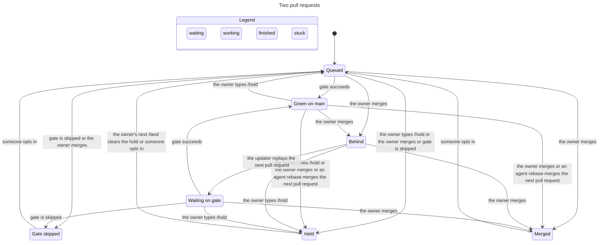

# Agent protocol

Coding agents on mitos claim work, hand it off, answer the owner, and land it through one protocol. Claude Code and Grok Bot are the providers today. Each provider implements an adapter and a thin land connector. A later provider adds those two. The decision module does not grow a branch for it.

The ledger is the GitHub conversation on the task issue and its pull request. `MitosGate.Admit` admits events. `MitosGate.Land` decides who is next, what is pushed, when an agent may merge, and who wakes. Both live under `gate/`. Adapters decide nothing. This document specifies them. It does not add the files.

The land loop is the design at `https://github.com/kitimark/mitos/issues/178#issuecomment-6821317899`. Where this document is silent, that design stands. The deltas are below.

## Reading one task

The owner types a line in the issue or pull request conversation. No app slug, no protocol fence, no trailing adapter footer.

```text
/land
```

A bare `/land` names the pull request head at that comment's `created_at`. `/land` plus a 40-character hex sha names that sha. An unknown sha is not an entry. The workflow answers either way.

An agent posts one fence and one trailing footer, and only through `submit`.

~~~~
```mitos-protocol
{"v":1,"kind":"land","task":30,"as":{"provider":"claude","teammate":"worker"},"head":"aaaaaaaaaaaaaaaaaaaaaaaaaaaaaaaaaaaaaaaa","cause":{"kind":"comment","url":"https://github.com/kitimark/mitos/pull/30#issuecomment-1","id":1}}
```
---
_Generated by [Claude Code](https://claude.ai/code)_
~~~~

`read` returns the admission fold and, for each pull request, the `Step` from `MitosGate.Land`. The connector acts on that step. `submit` posts at most one comment, settles the read, and returns `ok: true` when the fold applied the comment or when the comment would not change the fold.

## Decisions

| Choice | Principle |
|---|---|
| The conversation is the ledger. A label and a git ref are not state. | foundational-thinking, separate-before-serializing-shared-state |
| Admission is a pure function of the comment list up to that comment and of its `created_at`. | model-the-domain |
| An edited agent comment holds the task. Adapters never PATCH an event. | boundary-discipline, encode-lessons-in-structure |
| A duplicate is a submit that would leave the fold unchanged. It returns `ok: true` and posts nothing. | make-operations-idempotent |
| `as` is checked against the app slug. The slug proves the provider. The registry proves the role and the model. | type-system-discipline |
| The author model is the model that wrote most of the diff. | model-the-domain |
| One `covered` rule reads only `verdict` records. | laziness-protocol, encode-lessons-in-structure |
| `read` returns `Step`. A display summary does not decide. | boundary-discipline |
| The lease sha is the live head when carry from `holderHead` reaches it. | make-operations-idempotent |
| Catch-ups, assignment, `owner-ping.yml`, and issue 43 stay until an owner pull request moves every caller. | migrate-callers-then-delete-legacy-apis, never-block-on-the-human |

A git ref could close a claim race by compare-and-swap. It loses because the owner catches up on GitHub, `docs/process.md` under "Owner catch-up on GitHub", and a ref the owner does not read is not the ledger. The race closes by admission order, a settle re-read, and a lease on the carried live head.

## Admission

`Admit.fold` walks conversation comments in ascending id. It skips review comments. It does not read the live `gate`, the live head, or the clock except each comment's `created_at`.

An edited comment has `updated_at` different from `created_at`. A fixture pins the difference: a body edit moves `updated_at`, and a reaction does not. Adapters never PATCH an event.

An edited owner comment is `/hold`. An edited agent comment is not re-parsed. Its current body is not a new kind. If that comment id was already admitted, the admitted event stays. The task is held, and no later claim applies, until the owner's next word. Editing a `fail` therefore does not uncover an older `pass`. Editing the winning claim does not admit the claim that was refused. The owner's next word clears the hold.

A deleted comment is absent from the REST list. Whether deleting a `fail` or a claim is accepted risk is an owner question. The module does not add an `after` link to paper over it.

A fence is a top-level block tagged `mitos-protocol`. A fence inside a quote or a code block is not an event. The only footer is a trailing one. A quoted footer is not a footer. Two fences, two footers, an unknown key, or a `v` other than `1` do not apply. A login of kitimark with no app slug is never forged.

`submit` renders the event, posts it, and reads until that comment id is in the list or a second read still misses it. A miss returns `refused` and is not `ok`. If the fold applied the comment, the result is `ok: true`. If the event would leave the fold unchanged, the result is `ok: true` and `submit` does not post a second comment. A later `pass` after that judge's `fail` changes the fold, so it is posted. A re-claim after the claim has ended changes the fold, so it is posted. A second `release` of an ended claim does not change the fold, so it returns `ok: true` and posts nothing.

Receipts key on the cause, the target teammate, and the result. `sending` and `accepted` are different keys. A receipt for one teammate does not collide with a receipt for another.

The idempotency comparison is the fold, not a key that collapses two different states. The receipt key is the exception that keeps one POST from running twice.

## Owner lines

One parser reads owner lines, on the issue and on the pull request. It strips quotes and code blocks first. A line counts only from login kitimark with no app slug, not edited, except that an edited owner comment is `/hold`.

| Line | Meaning |
|---|---|
| `/land` | Land the head at `created_at`. |
| `/land <sha>` | Land that sha. A sha that is not 40 hex characters is refused. |
| `/hold` | Stop replay and merge until the next `/land`. |
| `/delegate <provider> <teammate>` | Add that teammate for this task. |
| `/revoke <provider> <teammate>` | Remove that teammate. |
| `/release` | End the claim. The holder becomes none. |
| `/wontfix` | Close the task without a landing. |
| `/grok <teammate>` | Wake that teammate. It is not a deciding word. |

Any other line that starts with `/` is an unknown word. The workflow answers every word: applied, ignored because an app posted it, unknown word, bad sha, or unknown teammate.

`/land` does not grant merge on a kept path. `/hold` wins over an agent `land`.

## Lean sketch

This is the shape of `MitosGate.Admit`. The implementing pull request proves the statements. Nothing here is built.

```lean
namespace MitosGate.Admit

structure Actor where
  provider : String
  teammate : String
  role : String
  model : String
  root : Bool
  deriving DecidableEq

inductive Kind where
  | claim | release | push | handoff | verdict | ask | answer | land | receipt
  deriving DecidableEq

/-- One conversation comment after the shell has parsed a top-level fence.
An edited row keeps `kind` none: the body is not trusted. -/
structure Row where
  id : Nat
  created : Nat
  edited : Bool
  slug : Option String
  ownerLine : Bool
  kind : Option Kind
  actor : Option Actor
  head : Option String

structure Event where
  id : Nat
  kind : Kind
  actor : Actor
  head : Option String

structure Fold where
  events : List Event
  heldByEdit : Bool
  holder : Option Actor
  ended : Bool

def empty : Fold := { events := [], heldByEdit := false, holder := none, ended := true }

def mayRelease (f : Fold) (a : Actor) : Bool :=
  f.holder == some a || a.root

def step (f : Fold) (r : Row) : Fold :=
  if r.ownerLine then { f with heldByEdit := false }
  else if r.edited && r.slug.isSome then { f with heldByEdit := true }
  else if f.heldByEdit then f
  else
    match r.kind, r.actor with
    | some .claim, some a =>
      if f.ended then { f with holder := some a, ended := false,
          events := f.events ++ [{ id := r.id, kind := .claim, actor := a, head := r.head }] }
      else f
    | some .release, some a =>
      if mayRelease f a then { f with holder := none, ended := true,
          events := f.events ++ [{ id := r.id, kind := .release, actor := a, head := none }] }
      else f
    | some .handoff, some a =>
      if mayRelease f a then
        { f with events := f.events ++ [{ id := r.id, kind := .handoff, actor := a, head := r.head }] }
      else f
    | some k, some a =>
      { f with events := f.events ++ [{ id := r.id, kind := k, actor := a, head := r.head }] }
    | _, _ => f

def fold (rows : List Row) : Fold := rows.foldl step empty

def unchanged (a b : Fold) : Bool := a == b

def EditHolds : Prop :=
  ∀ (rows : List Row) (r : Row),
    r.edited = true → r.slug.isSome = true → r.ownerLine = false →
      (fold (rows ++ [r])).heldByEdit = true

def OwnerWordClearsHold : Prop :=
  ∀ (rows : List Row) (r : Row),
    r.ownerLine = true → (fold (rows ++ [r])).heldByEdit = false

def NoClaimWhileHeld : Prop :=
  ∀ (rows : List Row) (r : Row),
    (fold rows).heldByEdit = true → r.ownerLine = false →
      (fold (rows ++ [r])).holder = (fold rows).holder

def ReleaseOnlyHolderRootOrOwner : Prop :=
  ∀ (f : Fold) (a : Actor),
    mayRelease f a = false → a.root = false →
      (step f { id := 0, created := 0, edited := false, slug := some "cursor",
          ownerLine := false, kind := some .release, actor := some a, head := none }).holder
        = f.holder

end MitosGate.Admit
```

The implementing pull request proves those four propositions and the rest of this list, with no `sorry`.

- An edited agent row sets `heldByEdit`, and its body is not a kind.
- An owner line clears that hold.
- While the hold stands, a later claim does not change the holder.
- `release` applies only for the holder or the registry root. The owner's release is the owner line, which is not this fence.
- A claim ends on merge, close, or an applied `release`. `ended` starts true so the first claim can apply.
- `submit` posts only when `unchanged` is false. An unchanged fold returns `ok: true`.
- A later `pass` after a `fail` by the same judge makes `unchanged` false.
- `covered` reads verdict events only. It groups by judge, keeps judges whose model equals the author model, and requires each judge's newest verdict to be a pass. The author model is the model that wrote most of the diff on the newest holder `push` that carry reaches.

## Land

`MitosGate.Land` is unchanged except where this list says so.

- A pull request that is behind, and whose verdicts cover the head, waits for a landing word. It is not queued by the covering verdict alone. The default stays out, as that design says.
- A replay that would change the content id is not pushed. That stuck row wakes the holder. A conflict on covered work wakes the holder. A move of `main`, the updater's push, and a bot review of covered work wake nobody.
- A merge is authorized only when carry reaches the merged sha from a sha named by `/land` or by an applied `land`. The existence of some other `/land` does not authorize it.
- `enforced` is one read of the branch protection on `main`. The read must show admins bound, the required check `gate`, strict status checks, and a required pull request. A failed or partial read is false. Admins are bound on `main`. The module still reads the setting. No owner-typed line on issue 178 or issue 179 is implied by that fact.
- The connector re-reads owner words immediately before `merge`. A new `/hold`, or an edit that counts as `/hold`, stops the call.
- The `land` record is posted only by `submit`.
- `read` returns each pull request's `Step`. The connector does not also consult a summary.

```typescript
type Sha = string & { readonly brand: "Sha" }
type MergeReceipt = { merged: boolean; sha: Sha }
type RepoEvent =
  | { kind: "mainMoved" }
  | { kind: "updaterPushed"; pr: number }
  | { kind: "gateDone"; pr: number; gate: "success" | "failure" | "cancelled" | "skipped" | "pending" | "missing" }
  | { kind: "botReviewed"; pr: number }
  | { kind: "conflictFound"; pr: number }
  | { kind: "contentChanged"; pr: number }
  | { kind: "landWord"; pr: number }
  | { kind: "ownerSpoke"; pr: number }
type Wake =
  | { kind: "nobody" }
  | { kind: "lander"; pr: number }
  | { kind: "holder"; pr: number }
  | { kind: "root" }

type LandConnector = {
  merge(pr: number, head: Sha): Promise<MergeReceipt>
  wake(event: RepoEvent): Wake
  nudge?(): Promise<"asked" | "unavailable">
}
```

`merge` is rebase merge pinned to the sha. `wake` equals the Lean table, including the `contentChanged` row, which wakes the holder. When the lander is the owner, the workflow posts the merge command and wakes no agent. `nudge` dispatches `update-prs.yml` with no inputs. No member pushes a branch or chooses which pull request to rebase.

`delegates` starts empty. `/delegate` and `/revoke` change it. Who should already be in the list is an owner question. Until that answer, an agent `land` waits. The owner can land. `docs/process.md` under "Roles" still says agents merge implementation pull requests. The module does not copy that sentence into the initial list.

## Claims, push, and lease

`as` is the holder. The fence has no second holder field.

`claim` carries `touches` and an optional `head`. A glob is stored as its directory stem, so `core/Mitos/**/*.lean` is `core/Mitos/`. If a task file exists, its `touches` must equal the claim's stems, or the claim does not apply. If no task file exists, the claim's stems are the lane. Two live claims whose stems intersect cannot both apply. The smaller comment id applies. A stem intersects another when they are equal or one is a prefix.

Only the holder, the registry root, or the owner may `release` or `handoff`. The owner releases with `/release`. A teammate who is none of those three does not apply. A handoff sets the holder to its target.

A claim ends when its pull request merges, its issue closes, or a `release` applies. A later claim can then apply. An open pull request with no claim is adopted by `claim` with `head` set to that pull request's head. The branch must match, and the sha must be the live head.

The pull requests of a task are the open and the merged pull requests whose branch an applied claim names. `done` requires a closing keyword in the body, or `/wontfix`. The root reopens a close only when the closer can be attributed and the body has no keyword and there was no `/wontfix`. A close whose actor cannot be read stays closed.

`push` reads, then runs git, then posts the record of the sha that was pushed, then settles the re-read. The guard runs before git. The history after the update is linear on `origin/main`. A merge of `main` into the branch is not pushed. A conflict posts nothing and wakes the holder.

The lease sha is the live head when carry from `holderHead` reaches that live head. The fold then stores the live head as `holderHead`, so an updater replay moves it. The next push uses `git push --force-with-lease` pinned to that sha. When carry does not reach the live head, the push is `drift` and does not run. The holder does not fetch a foreign tip and publish it. When `holderHead` is absent and `head` on the claim is absent, the push creates the branch and fails if the remote ref exists.

A round starts when a `handoff` applies, or when the holder pushes after a blocking verdict. A push that only rebases and keeps the content id does not start a round. The round budget is two, as the skill under "Rounds". A third round does not apply. The target of a handoff must have a registry row that can push, and a routine target must be enabled.

`ask-owner` posts the catch-up the skill already requires, assigns kitimark, and updates issue 43. `owner-ping.yml` still defuses `@` and invisible characters, as "Catching the user up" describes. `requestsMerge` requires `covered`, a successful `gate` on the live head, and the rest of the agent-merge conditions except the merge itself. The catch-up tells the owner to type `/land` and the sha. The ask names an addressee. When it names none, the addressee is the root.

`answer` clears an ask or an owner thread. The actor is the addressee. The cause is that comment. A `push` does not clear an ask. An owner comment that is not only a command to an outside handle also clears an ask. A comment that is only a CodeRabbit command does not.

## Types

```typescript
type IssueNumber = number & { readonly brand: "IssueNumber" }
type Cause =
  | { kind: "comment"; url: string; id: number }
  | { kind: "gate"; head: Sha }
  | { kind: "slot"; name: string; at: string }
type Teammate = { provider: "claude" | "grok" | "relay"; teammate: string }
type Intent =
  | { kind: "claim"; task: IssueNumber; as: Teammate; branch: string; touches: readonly string[]; head: Sha | null; cause: Cause | null }
  | { kind: "release"; task: IssueNumber; as: Teammate; cause: Cause | null }
  | { kind: "push"; task: IssueNumber; as: Teammate; cause: Cause | null }
  | { kind: "handoff"; task: IssueNumber; as: Teammate; to: Teammate; head: Sha; blocking: boolean; cause: Cause | null }
  | { kind: "verdict"; task: IssueNumber; as: Teammate; head: Sha; result: "pass" | "fail" | "hold" | "wording-only"; cause: Cause | null }
  | { kind: "ask-owner"; task: IssueNumber; as: Teammate; question: string; requestsMerge: boolean; cause: Cause | null }
  | { kind: "answer"; task: IssueNumber; as: Teammate; cause: Cause }
  | { kind: "land"; task: IssueNumber; as: Teammate; head: Sha; cause: Cause | null }
  | { kind: "wake-receipt"; task: IssueNumber; as: Teammate; to: Teammate; result: "sending" | "accepted" | "failed" | "rate-limited" | "missed"; http: number | null; cause: Cause }

type RefusalCode =
  | "forged" | "unknown-version" | "malformed" | "capability" | "holder"
  | "lane" | "lane-intersect" | "refused" | "round-cap" | "unenforced" | "not-next" | "drift"

type StepName =
  | "enter" | "wait" | "awaitPush" | "awaitGate" | "merge" | "present" | "stop"

type TaskView = {
  task: IssueNumber
  holder: Teammate | null
  holderHead: Sha | null
  ended: boolean
  heldByEdit: boolean
  prs: readonly { number: number; step: StepName }[]
}
```

`lane` is a path outside `touches`. `lane-intersect` is the later overlapping claim. `holder` is a `release`, `handoff`, or `push` by someone other than the holder, the root, or the owner. `not-next` is an agent `land` or an updater push for a pull request that is not next. `drift` is a lease miss. `unenforced` is an agent `land` while the protection read is false. `refused` is a settle read that never sees the comment, or a comment the fold does not apply. `forged` is a slug that is not the registry provider for `as`. `capability` is a kind outside the role row. `malformed` is a bad fence, a bad footer, an unknown key, or a bare id. `round-cap` is a third round. `unknown-version` is a `v` other than 1.

A bare id is a string of one to twelve digits that is not inside a `github.com/kitimark/mitos` comment URL. The renderer rejects one in any fence string. Inside the module, a comment URL is parsed to its numeric id. Whether the skill's ban on ids should be amended is an owner question. Until then the fence follows the rule as written.

The shell writes the judge's model from the registry and the author model from the diff. The caller does not send either field.

## Covered

One rule. It reads `verdict` records only.

Take the verdicts whose head carry reaches the live head. The author is the actor on the newest holder `push` that carry reaches, and the author model is the model that wrote most of that diff. Group the verdicts by judge. Each judge's newest verdict must be `pass`. A newer `fail` or `hold` blocks, including when that judge's model equals the author model. At least one `pass` must come from a judge whose model differs from the author model. When the diff touches `criticalPath`, a `pass` from `verifier-opus` is also required, and that pass may share the author model.

`criticalPath` is the land design's function for spec and trust infrastructure. `keptPath` is `criticalPath` plus the rule paths. Unknown paths count as both. Trust-critical means `criticalPath`. Kept means `keptPath`.

A `wording-only` verdict applies only from the root, and it satisfies `covered` on its own. Whether a wording-only diff may be recognized from its paths, with no such verdict, is an owner question. The module does not do that.

Agent `land` also needs `enforced`, `keptPath` false, `as` in `delegates`, one trailing footer, bot review `reviewed` or `refused` at a carried head, no unanswered owner thread, a pull request that is not a draft, a fork, or a stack, and `gate` conclusion `success` on the live head. `skipped`, `cancelled`, `pending`, `missing`, and `failure` are not success. Stacks do not carry. The owner may merge a stack by the async endpoint. That merge is a fact.

`spec-approved` counts only from the latest `labeled` event that adds it, by kitimark with no app, at a time after the last content push and before the `gate` run being read. No adapter adds the label. A label change still re-runs `gate`, as `.github/workflows/ci.yml` specifies.

The owner's merge is not an intent the module guards. `present` gives the owner the command when `covered` and `gate` hold. The skill under "Catching the user up" allows the owner to merge before a verdict.

## Identity

The registry is one data file on a kept path, proposed as `gate/MitosGate/Registry.lean`, which the owner merges. It lists actors by provider, teammate, role, and model. A worker is not one model. `verifier-opus` and a sonnet verifier are different rows. The admission module takes the list as an argument. It has no provider branch.

| Declaration | Login | Slug | Writes |
|---|---|---|---|
| provider `claude` | kitimark | `claude` | yes |
| provider `grok` | kitimark | `cursor` | yes |
| past Grok login `cursor[bot]` | `cursor[bot]` | `cursor` | no new writes |
| updater `mitos-pr-updater[bot]` | that bot | the updater app | pushes only |
| relay | open | open | receipts, after the run check |

A comment from a declared actor with no fence is advisory. An unknown actor with a fence is forged.

The registry has one row with `root` true. Until the owner names a different row, that row is the root in the skill under "The root orchestrates". The cursor rule "kitimark mode" says the session the owner talks to plans and delegates, and it does not name a provider. Who is root remains an owner question. The interim row is what `ask-owner`, `wording-only`, and owner wakes use, so those events can apply before the answer. An owner comment wakes that root. When the row is missing, the wake goes to the holder. `/grok <teammate>` wakes that row when it exists, and otherwise the root.

`@claude` reaches an open Claude session. It is not a ledger event, so it has no sender rule. `@cursoragent` selects no provider.

The owner is login kitimark. Owner speech is a conversation comment from that login with no app slug. A missing slug is not proof of the person if an agent machine holds a user token. Whether any agent machine holds one is an owner question. Agent machines must not store a token that posts with no app. That sentence is a proposal.

A receipt applies only when the relay workflow's log names the comment id it posted, the workflow file is the relay workflow, and the run's branch is the default branch. A comment carries no Actions run id, so the log line is the check. A job from a pull request head does not apply. Which app should post receipts is an owner question. Receipts are part of the relay step in the migration, not of the admission core.

`github-actions[bot]` on `owner-ping.yml` is a notification. It is not owner speech and it is not a receipt.

## Capabilities

The version is `1`.

| Role | Kinds |
|---|---|
| root | ask-owner, answer, land when in `delegates`, wording-only verdict, release, handoff |
| worker | claim, release, push, handoff, answer, land when in `delegates` |
| verifier | verdict other than wording-only, answer |
| researcher | no deciding kind |
| relay | wake-receipt |

`ci-reviewer` and `tracker` are researchers. They do not verdict, close, or land. Follow-up issues are filed as the skill already says, outside the fence.

An agent may open a pull request that touches a kept path. Only the owner merges it.

## Checked model

`docs/AgentProtocol.tla` is the land loop. The file name matches the module name. P1 starts opted in, by the owner or by an agent. P2 is kept. A merge moves `main`, so the other on-tip pull request goes behind. `/hold` clears on the owner's next `/land`. The owner's merge is its own action and is not gated. An agent merge is gated.

Fairness is weak fairness of the updater, of a successful gate, and of the two merge actions. `/hold` and a skipped gate are not fair. `Progress` says that when admins are bound, the owner does not hold, and gate reaches success, P1 merges. P1 starts opted, so that state is real.

TLC reached 250 states and 624 steps and exited 0. The chart draws 7 states and 19 arrows. These rules hold. `TypeOK`, `KeptIsOwner`, `AtMostOneGating`, `NoDeadlock`, `PushOnlyNext`, `AgentMergeIsGated`, `MergeOnTip`, `HoldClears`, `UnenforcedLandsNothing`, `NoBackground`, and `Progress`.

A region per pull request was the first view. One merge changes both pull requests, and the drawer will not draw a region step the model never takes as a single-region step. The chart below is the busier pull request. Joined arrow labels are two steps that share a start and an end in that collapse.



The model leaves out admission, edits, the claim race, a computed content id, stacks, forks, drafts, bot review, and review threads. `gateSucceeds` false and `ownerHolds` true are the cases where P1 is not required to merge.

The output directory must be empty. The jar for the recorded run is TLC 1.7.4, sha256 `936a262061c914694dfd669a543be24573c45d5aa0ff20a8b96b23d01e050e88`.

```bash
TLA2TOOLS=/path/to/tla2tools.jar JAVA=/usr/bin/java \
  node .cursor/skills/statechart/scripts/statechart.ts docs/AgentProtocol.tla \
  --view docs/AgentProtocol.view.mjs --out /tmp/agent-protocol-out
```

## Transport

| Fact | Where it lives | Who writes it |
|---|---|---|
| Claim, handoff, verdict, ask, answer, land, receipt | Conversation comment | `submit` |
| Owner lines | Conversation comment, no app | The owner |
| Closing keyword and one trailing body footer | Pull request body | `open-pr.sh` |
| `gate` | Check run named `gate` | `ci.yml` |
| `spec-approved` | The latest qualifying `labeled` event | The owner |
| Kept and critical paths | `keptPath` and `criticalPath` | The owner merges the module |
| Carry and content id | `mitos-gate carry` from a checkout of `origin/main` | The updater checks the id before a push |
| Needs-owner | Catch-up, assignment of kitimark, issue 43 | The root, as the skill says |
| Verdicts | `verdict` records | The judge, through `submit` |

`needs-rebase` and `agent:grok` are not protocol state. Issue 43 is a dashboard. It is not a verdict source.

## Migration

Each row is an owner merge except where it says the work is a setting. The check is red before the row and green after it. Pull request 149 and issue 171 land before the updater switch, as the land design says. Assignment, catch-ups, `owner-ping.yml`, and issue 43 have no retirement row.

| Step | Change | Red, then green |
|---|---|---|
| 0 | Read protection. Admins are bound. The read still requires `gate`, strict checks, and a required pull request | A fixture with a failed read is not enforced. The live read is enforced only when all four hold |
| 1 | Add `Land.lean` and `Admit.lean` under `gate/`, with the statements above and `mitos-gate land` | `lake build` has no such modules. The build succeeds and the statements have no `sorry` |
| 2 | Verdict records, before any shadow decide | A cell of issue 43 is not `covered`. A `verdict` event is |
| 3 | Registry file on the kept path | An unknown teammate is admitted. It is refused |
| 4 | Shadow `decide` prints a plan | The job prints nothing. The plan matches the fixture queue |
| 5 | Claude connector. `land` goes through `submit` | A connector posts a fence on its own. The test shows only `submit` |
| 6 | Updater switch. `apply` pushes only the planned pull request. A content-id miss wakes the holder | A push to `main` rebases every open pull request. Only the planned one moves, and a bad replay pushes nothing |
| 7 | Classifier for conversation comments. The footer test stays for review comments. Measure one `read` before it enters the hook | A `cursor` comment with no Claude footer counts as the owner. It counts as the declared teammate. The hook waits on the measurement |
| 8 | Skill, `CLAUDE.md`, `docs/process.md`, and the cursor rule point at the Lean module | The skill still rebases every pull request. It says `land`. This row does not add `docs/agent-protocol.*` to the kept list |
| 9 | `pr-state.sh` calls `keptPath` | The hook has its own list. Unknown stays kept, and there is one list |
| 10 | Grok connector and the relay. Receipts start here. Grok's own listeners are turned off | A comment from a head workflow is a receipt. Only a comment id in a default-branch relay log is |

Whether `docs/agent-protocol.*` joins the kept list is an owner question. The deciding code is already under `gate/`, which is kept. Step 8 does not answer the question.

## Calls from issue 117

| Call | Position |
|---|---|
| Claude is the only root | Open. The interim registry row is the skill's root |
| Only the owner's words decide | Accepted for the owner lines, `spec-approved`, and kept-path merges |
| `agent:grok` is the holder | The applied `claim` is the holder. The label is unread |
| `@cursoragent` is Grok's handle | That spelling selects no provider |
| The planner posts no review comments through the owner account | Review comments apply no kind |
| Lane merges wait while an owner merge waits | Open, with who starts in `delegates`. The owner's `/land` ranks first |
| Product settings | The owner decides. The protocol requires one trailing footer and no session URL |
| Nothing wakes Grok | `/grok <teammate>` on an owner line, or fence `to`. The relay is step 10 |

## Requirements

| # | Where it lives |
|---|---|
| 1. Identity separate from the owner | Slug plus `as`. Owner speech has no slug, no fence, and no trailing adapter footer |
| 2. One address, with a receipt | Fence `to`, or an owner `/grok` line. Receipt key is cause, target, and result |
| 3. A second provider cannot push through a claim | `as` is the holder. The lease is the carried live head |
| 4. One merge authority | `delegates` and `keptPath`. The label is absent from `Intent` |
| 5. Rebase is the only update | `push` rebases. The updater replays. A merge of `main` is not pushed |
| 6. Handoff and verdict name the head | Their fields. Carry is per head |
| 7. Lane scope | `touches` on the claim. A task file checks them when it exists |
| 8. Capabilities | The registry row |
| 9. Done means the link matches | A closing keyword, or `/wontfix` |
| 10. One footer, and workers are visible | A trailing footer. Step 7 reads the slug |
| 11. One wake, one POST | The receipt key |
| 12. A missed schedule is visible | Receipt result `missed`, at step 10 |

## Overlap cases

| # | What this design does |
|---|---|
| 1. `@cursoragent` merged 137 and stubbed 155 | That spelling selects no provider. An agent merge without a carried landing sha is unauthorized |
| 2. Two catch-ups on 106 | `requestsMerge` needs `covered`. The second unchanged ask returns `ok: true` and posts nothing |
| 3. Merge commits of `main` on seven branches | `push` does not publish that history |
| 4. `needs-rebase` left on after a hand rebase | The label is not state. Git says whether the branch is behind |
| 5. Issue 162 closed without a closing keyword | A close is reopened only when the closer can be attributed |
| 6. Planner posts read as the owner | Slug `cursor` plus `as` is Grok, at step 7 |
| 7. Claude pushed the branch named in an `@cursoragent` line | The spelling wakes nobody. A non-holder push is `holder` |
| 8. 124, 125, and 126 asked for a merge with no verifier | `covered` requires the newest verdict per judge. Behind waits for a landing word |
| 9. Issue 153 answered twice | One cause, one `answer` |
| 10. `cursor[bot]` received HTTP 403 | New writes use kitimark and slug `cursor`. The bot login stays in the registry with slug `cursor` and does not write |
| 11. Two red nightlies and no post | Result `missed`, once step 10 is on |
| 12. Tracker footer outside that lane | A researcher has no deciding kind. A second footer does not apply |
| 13. `agent:grok` used as a lease | The label is unread. The lease is the carried live head |
| 14. Mergeable on one head and hold on another | The newest verdict per judge, on a head carry reaches |
| 15. Duplicate replies to one mention | One receipt key, one POST |
| 16. Two footers on 149 | A missing or extra trailing footer blocks agent `land` |
| 17. Issues 169 and 170 share one expect file | Both claims name that stem. The later one does not apply |

## Open owner questions

None of these is an owner-typed comment. Admins are bound on `main`. That setting is not an acceptance of issue 178 or issue 179.

- Who is root. The interim registry row is the skill's root.
- Who starts in `delegates`. The list stays empty until `/delegate` or an owner-typed answer. Agent `land` waits.
- Whether `docs/agent-protocol.*` joins the kept list. The Lean modules under `gate/` are already kept. Step 8 does not add these files.
- Whether deleting a `fail` or a claim is accepted risk.
- Whether a wording-only diff may be recognized from its paths. Until then only the root's `wording-only` verdict satisfies `covered`.
- Which app posts relay receipts.
- Whether the skill's ban on ids in posts should be amended.
- Whether an agent machine holds a token that posts with no app.
- When assignment, catch-ups, `owner-ping.yml`, and issue 43 retire.

---
_Generated by Grok Bot (Mitos Agent Protocol Architect)_
