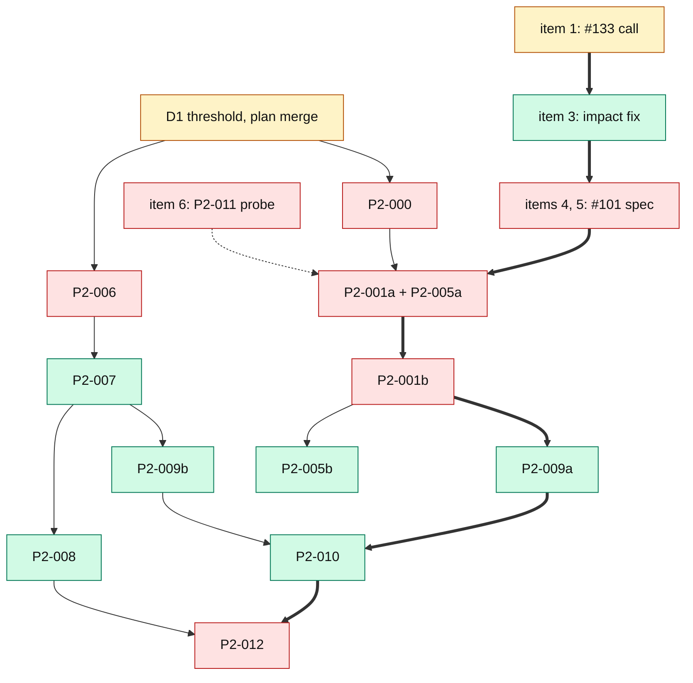

# Phase 2: chains and the first real extractor

**Goal:** a reference resolver for chains, where a requirement reaches its provider through a
binding (config key → deployment → service → repo). Each edge carries one derivation, and the
resolver's properties are proven against owner-approved statements. Beside it, the first built-in
extractor for a real format (go.mod), checked nightly against the real tool.

Names marked *(new)* do not exist on `main` yet. This phase adds them.

**Exit criteria**

1. `cd core && lake comparator` accepts `Mitos.Proofs.Resolver` against the Phase 2
   `core/Challenge/Resolver.lean`: every theorem, #101's no-duplicates included, standard axioms
   only, also with `--paranoid`.
2. `cd core && lake check` passes: no `sorry` in any target it builds, and standard axioms only.
   The Challenge files (`core/Challenge/*.lean`) hold intentional `sorry` holes and are not a default
   build target, so `lake check` never sees them (`docs/process.md`, "The Challenge"); the
   comparator checks those instead (criterion 1).
3. Mutation testing: each mutant of the chain resolver and impact analysis in `eval/mutants/`
   breaks at least one theorem, every Phase 1 mutant still refutes after the migration, and no
   known gap (`survives=`) is open without an owner ruling.
4. CI accepts the go.mod plugin with `mitos-gate accept … --paranoid` (gates 0 to 6), and the
   differential run against `go mod edit -json` on the pinned repos reports no mismatch that is
   not triaged into a model issue.
5. The nightly job posts a scorecard for every fixture against hand labels: precision and recall
   per edge type (the chain and go.mod edge types included), the diff against `main`'s, and the
   most derivations any repo-level edge has.

## Before Phase 2 starts

The core track (P2-001a onward) starts only after items 1 to 5; item 6 is recommended. Tasks
that touch `core/` run one at a time (`docs/process.md`, Parallelism), so the Phase 1 core work
lands first. The go.mod track (P2-006 to P2-008, P2-009b) touches no core file and needs none of
them.

1. **#133, the owner's call on its core half.** Its branch, part of the no-comments audit
   (#129), renames `Edge` and `Assumption` fields in `core/Mitos/Core/Graph.lean` and follows
   them through the spec, `core/Mitos/Impl/Impact.lean`, `statements.lock`, `eval/mutants` and
   `eval/score`. That collides with both #101 PRs and with P2-001a, which replaces `Edge.req` and
   `Edge.prov` with a derivation key. The owner decides before #101's first PR: fold the naming
   into P2-001a (recommended), or land it first as one spec PR. Its items outside `core/`,
   `eval/mutants` and `eval/score` can run alongside.
2. **#137, the Span flag of #135.** A spec PR that adds to `Span` in
   `core/Mitos/Core/Fact.lean` and edits `Spec/Adequacy.lean` and `statements.lock`, which the
   #101 spec PR and P2-001b rewrite too. It merges, or closes, before the #101 PRs. It needs
   `spec-approved`.
3. **#101 option (a), first PR: the `impact` fix.** `Mitos.Impl.impact`
   (`core/Mitos/Impl/Impact.lean`) adds a repo once per edge that fires, so it can list a repo
   twice. Under D1 option C (see Scope decisions) a repeated record would read as a second
   derivation. Agents merge it.
4. **#101, second PR: no-duplicates in the spec** for the edges, `assumes`, the unresolved list
   and impact. It adds the statements, the Challenge lines, the `core/comparator.json` names and
   the `statements.lock` entries, with the proofs from `core/Mitos/Proofs/Resolve/Nodup.lean`. It
   needs `spec-approved`.
5. **#30, Phase 1 exit criterion 3.** The #101 spec PR flips the known gaps `edges_duplicated`
   and `assumptions_dedupe_dropped` (`eval/mutants/cases/`) from `survives=` to `breaks=`. Phase 1
   then exits before P2-005a migrates the mutants.
6. **#147 (P2-011), recommended.** The next-toolchain canary fails until the CrossCheckDecoy probe
   and the `String.le_*` deprecations are fixed. Landing it before P2-001a lets the canary check
   the migrated mutants. It never goes between two core PRs.

No other PR is a prerequisite. An open PR that touches no core file can merge during the phase.

## Scope decisions

The owner's decisions on the draft are in
[#156](https://github.com/kitimark/mitos/issues/156#issuecomment-6795388085).

- **One edge record per derivation (D1, option C).** An edge's key is its derivation
  (`Edge.key : Derivation`, the type *(new)*). Two derivations between the same requirement and
  provider are two edge records. `Spec.RetractExact` keeps its Phase 1 text, and its proof stays
  a filter argument. Option A (one chosen derivation per pair) makes exact retraction false.
  Option B (ATMS labels) is exact too, but needs minimal-label proofs nobody has done in Lean.
- **The repo-level view is a union, proved, not a Challenge line.** `RepoKey` and
  `Edge.repoKey` *(new)* give one repo-level edge per set of derivations. Its guarantee,
  `retract_repo` *(new)*, follows from `Spec.Sound` and `Spec.RetractExact`: a repo-level edge
  survives retracting an assumption exactly when one of its derivations avoids it.
- **Rules are constructors of `Derivation` *(new)*,** not user data: `direct` (Phase 1's match)
  and `bound` (a requirement, a binding, a provision). A longer chain later is one more
  constructor, and no statement changes. The rule DSL is Phase 3.
- **Statements quantify over a finite list,** `derivations fs` *(new)*, not an inductive
  relation. Each statement is then decidable at a fixed input, and the Phase 1 mutant
  refutations (`revert this; decide`) keep working. Sound, complete, unresolved-exact,
  assumptions-exact and status-honest are restated. Total, retract-exact, impact-correct and
  #101's no-duplicates keep their text, but their meaning moves with `Edge` and `Affects`, so
  their `statements.lock` lines change too. With no binding fact, `derivations fs` holds exactly
  Phase 1's matches.
- **Each spec PR carries its implementation and proofs,** so `lake comparator --paranoid` runs
  at every merge of the phase. This is an exception to `docs/process.md`, "Two PRs per feature:
  statements first", for P2-001a and P2-001b only: a change to `Edge` breaks the build of the
  implementation, so the two cannot land apart without switching the comparator off. In Phase 1
  the spec landed first, and CI skipped the comparator until `core/Mitos/Proofs/Resolver.lean`
  existed. The owner still reviews the spec files of each PR; Lean and the comparator check the
  rest. `docs/process.md` is the owner's path, so this plan does not edit it. P2-000 is the
  owner-gated row that records the exception there, and the owner approves it with the plan.
- **Bindings in this phase.** `FactKind.binds` *(new)* comes in P2-001b, so chains exist in
  Phase 2. It changes `Fact` for every plugin, so P2-001b re-accepts
  `examples/acme/accepted/ToyRequire.json`.
- **Status rule:** an edge is `confirmed` only when nothing under its derivation is AI-proposed
  and every derivation of its requirement reaches the same single provider; otherwise `inferred`
  (`Spec.StatusHonest`). A requirement with a direct and a bound derivation to the same provider
  is still `confirmed`. On Phase 1 inputs this agrees with Phase 1's "exactly one provider", and
  P2-001a states it in this form. It refines owner decision 3 on #156, which said "exactly one
  derivation" ([comment](https://github.com/kitimark/mitos/issues/156#issuecomment-6795388085)).
- **Union view status:** in the scorecard, a repo-level edge is `confirmed` if any of its
  derivations is. Today `collapse` in `eval/score/Score.lean` marks it `inferred` if any is, so
  the `confirmed` numbers move from the Phase 1 baseline when P2-009a lands.
- **Impact through bindings:** a change in the repo that holds a binding counts as impact
  (`Edge.through` and `Affects.through` *(new)*).
- **Revisit D1 by measurement.** The nightly scorecard reports the most derivations any
  repo-level edge has. D1 reopens when that number exceeds **8**:
  option A if the counts explode, option B if users need minimal environments. On the
  hand-written chain fixture the number shows only what its author wrote, so it means most once
  a real chain extractor exists.
- **Chain facts are synthetic here.** No deployment or service extractor exists yet (YAML is
  later), so chain theorems run on a hand-written fixture and on `declaration` assumptions.
- **One real format:** go.mod over the existing line layer (`Mitos.lines`). The tokenizer and the
  `require ( … )` block state live in the reviewed model, so the core does not change. The subset
  is `module` and `require` lines and blocks. Quoted paths, `replace`, `exclude`, `retract` and
  versions give no fact, and the differential run lists them. JSON (package.json) and
  requirements.txt are deferred.
- **Differential tests are evaluation, not a gate.** They run nightly
  (`docs/process.md`, What runs where). Each pinned go.mod is vendored with its
  `go mod edit -json` output, so the comparison itself needs no Go. The nightly job refreshes
  the outputs with Go, then runs the comparison. Gate 7 for agent-written plugins is Phase 3.
- **Deferred, not decided here:** a HashMap production resolver with an equivalence proof,
  incremental-equals-from-scratch, a derivation-DAG certificate checker, the SQLite store and the
  NDJSON worker, staged judging (#55).

## Tasks

| # | Task | Kind | Issue |
|---|---|---|---|
| P2-000 | Amend `docs/process.md`, "Two PRs per feature: statements first", to record the exception for P2-001a and P2-001b: a spec-only PR cannot have a green gate when it changes `Edge`, so the spec PR carries its implementation and proofs and the owner still reviews its spec files. Docs only; lands before P2-001a (owner-gated: `docs/process.md`) | process | [#202](https://github.com/kitimark/mitos/issues/202) |
| P2-001a | Keyed edges, direct rule only: `Derivation`, `Chain` and `derivations` *(new)*; `Edge.key` becomes a `Derivation` in place of `req` and `prov`; `RepoKey` and `Edge.repoKey` *(new)*. Five statements restated, `retract_repo` proved in `core/Mitos/Core/Spec/Repo.lean` *(new)*, adequacy theorems re-proved. Resolver, impact, proofs and `eval/score` move in the same PR (owner-gated: `core/Mitos/Core/`, `statements.lock`) | spec, impl | [#203](https://github.com/kitimark/mitos/issues/203) |
| P2-001b | Chains: `FactKind.binds` *(new)* and the `bound` rule; `Edge.through` and `Affects.through` *(new)*; chain adequacy theorems; resolver, impact and proofs in the same PR; `examples/acme/accepted/ToyRequire.json` re-accepted (owner-gated: `core/Mitos/Core/`, `statements.lock`) | spec, impl | [#204](https://github.com/kitimark/mitos/issues/204) |
| P2-005a | Phase 1 mutants migrated to keyed edges: the `Edge` literals in the `Refute.lean` files, the `find=` anchors in `eval/mutants/cases/`, and `eval/mutants/Mutants/Implied.lean`, which proves `Total` from `Complete` and `UnresolvedExact` through `Edge.key`, `e.req` and `e.prov`. Lands in P2-001a's PR, so no mutant is dropped and the nightly run stays green | tooling | [#205](https://github.com/kitimark/mitos/issues/205) |
| P2-005b | Chain mutants in `eval/mutants/`, each breaking at least one theorem | tooling | [#206](https://github.com/kitimark/mitos/issues/206) |
| P2-006 | go.mod model `examples/acme/Models/GoMod.lean` *(new)*, its golden files and adequacy module, and `examples/acme/models.lock` (owner-gated: reviewed model, `spec-approved`) | spec | [#207](https://github.com/kitimark/mitos/issues/207) |
| P2-007 | go.mod plugin `examples/acme/Plugins/GoMod.lean` *(new)*, a fold over `Mitos.lines`; proves anchored, sound and complete; accepted by gates 0 to 6 with `--paranoid`; `examples/acme/accepted/GoMod.json` *(new)* written last | impl | [#208](https://github.com/kitimark/mitos/issues/208) |
| P2-008 | Differential runner: plugin facts against the vendored `go mod edit -json` outputs of the pinned repos; mismatches and lines outside the model's subset listed per repo | tooling | [#209](https://github.com/kitimark/mitos/issues/209) |
| P2-009a | Chain fixture and hand labels, with a requirement that has two derivations; scorer edge types for chain edges; the union view's status rule | tooling | [#210](https://github.com/kitimark/mitos/issues/210) |
| P2-009b | go.mod fixture and hand labels; the scorer's go.mod edge type | tooling | [#211](https://github.com/kitimark/mitos/issues/211) |
| P2-010 | Nightly scorecard code in `eval/score/`: every fixture, the diff against `main`'s, the most derivations per repo-level edge. Eval code only; the wiring is in P2-012 | tooling | [#212](https://github.com/kitimark/mitos/issues/212) |
| P2-011 | Toolchain-bump readiness: the CrossCheckDecoy probe (`eval/mutants/Mutants/CrossCheck.lean`) for v4.36 and the `String.le_*` deprecations (`gate/MitosGate/ContentId.lean`); bump `lean-toolchain` when the release ships (owner-gated: `gate/`, `lean-toolchain`) | gate | [#147](https://github.com/kitimark/mitos/issues/147) |
| P2-012 | One `.github` PR: the CI accept step for `GoMod`; #107 items 2 and 3 (`mitos-mutants --prepare` on PRs that touch `core/`, a failure for a theorem no mutant breaks); the nightly Go refresh of the vendored outputs, followed by the differential run (P2-008); the nightly scorecard post. #107 items 4 and 5, #158 and #33 can ride along (owner-gated: `.github/`) | ci | [#213](https://github.com/kitimark/mitos/issues/213) |

Each open row gets an issue in the Phase 2 milestone once this plan merges, and its status lives
in that issue and its PRs.

The draft's P2-002 to P2-004 (implementation and proofs) are folded into P2-001a and P2-001b.
P2-000 goes first, before P2-001a, and the owner merges it with the plan's approval.
The core track runs in order: P2-001a (with P2-005a), then P2-001b, then P2-005b and P2-009a.
The go.mod track runs beside it: P2-006 first, then P2-007 stacked on it, then P2-008 and
P2-009b. P2-007 writes `accepted/GoMod.json` last, because each core PR moves its
`core_sha256`. P2-010 follows P2-009a and P2-009b. P2-011 goes before P2-001a (recommended) or
after P2-001b, never between two core PRs. P2-012 comes last.

## Running Phase 2 in parallel

Each row is one agent, one worktree and one PR. "Item n" is item n of "Before Phase 2 starts".
At most three builders run at once, and one PR that touches `core/` is open at a time
(`docs/process.md`, Parallelism). In the graph, thick arrows are the critical path, solid arrows
wait for a spec, a theorem or a build, the dotted arrow is recommended, and colours are the
classes under "Who decides".



**Waves.** A row starts when every row it waits for has merged, the owner's merges included.

| Wave | Runs at once | Waits for |
|---|---|---|
| W0 | The owner's calls: the D1 threshold, this plan's merge, item 1. Item 6 | nothing |
| W1 | Item 3 (core). P2-000. P2-006 | item 1; this plan's merge |
| W2 | Items 4 and 5 (core). P2-007 | item 3; P2-006 |
| W3 | P2-001a with P2-005a (core). P2-008. P2-009b | items 4 and 5, P2-000, item 6 (recommended); P2-007 |
| W4 | P2-001b (core) | P2-001a |
| W5 | P2-005b. P2-009a | P2-001b |
| W6 | P2-010 | P2-009a, P2-009b |
| W7 | P2-012 | P2-008, P2-010 |

The critical path is item 1, item 3, items 4 and 5, P2-001a, P2-001b, P2-009a, P2-010, P2-012:
eight waves, four core PRs in series, and five owner steps (the item 1 call and the merges of
items 4 and 5, P2-001a, P2-001b and P2-012). This plan's merge and P2-000 join it only if they
are not merged by the end of W2. If item 1 lands #133 as its own spec PR, that PR takes a core
slot before item 3. P2-011's toolchain bump lands while no core PR is open, after the release.

**Paths.** A row writes only its Owns cell, its task file `tasks/<row>-<slug>.md` and its own
run-log file. It writes a path the owner keeps (`CLAUDE.md`, "What stays with the user") only
where its cell names it, and then the owner merges. "Shared files" orders a path in two cells.

| Row | Owns | Reads | Also must not touch |
|---|---|---|---|
| Item 3 | `core/Mitos/Impl/Impact.lean`, `core/Mitos/Proofs/Impact.lean`, `eval/mutants/cases/impact_*/mutant`, `examples/acme/accepted/*.json` | `core/Mitos/Proofs/Resolve/Nodup.lean` | `core/Mitos/Impl/Resolve.lean` |
| Items 4, 5 | `core/Mitos/Core/Spec/`, `core/Challenge/Resolver.lean`, `core/comparator.json`, `statements.lock`, `core/Mitos/Proofs/`, the two gap cases in `eval/mutants/cases/`, `examples/acme/accepted/*.json` | `core/Mitos/Impl/` | `eval/score/`, `examples/acme/Models/` |
| P2-000 | the section "Two PRs per feature: statements first" of `docs/process.md` | this plan | the rest of `docs/process.md` |
| P2-001a | `core/Mitos/Core/Graph.lean`, `core/Mitos/Core/Spec/`, `core/Mitos/Core.lean`, `core/Challenge/Resolver.lean`, `core/comparator.json`, `statements.lock`, `core/Mitos/Impl/`, `core/Mitos/Proofs/`, the existing cases in `eval/mutants/cases/`, `eval/mutants/Mutants/Implied.lean`, `eval/score/Score.lean`, `examples/acme/accepted/*.json`; #133's core half and its callers if item 1 folds it in | `core/Mitos/Core/Fact.lean` | `core/Mitos/Core/Fact.lean` |
| P2-001b | `core/Mitos/Core/Fact.lean`, `core/Mitos/Core/Graph.lean`, `core/Mitos/Core/Spec/`, `core/Challenge/Resolver.lean`, `core/comparator.json`, `statements.lock`, `core/Mitos/Impl/`, `core/Mitos/Proofs/`, the `find=` lines its `Impl/` edit moves, `eval/score/Score.lean` if its build breaks, `examples/acme/accepted/*.json` | P2-001a as merged | new mutant cases |
| P2-005b | new directories in `eval/mutants/cases/` | `core/Mitos/Impl/` as P2-001b leaves it | existing cases, `eval/mutants/*.lean`, `eval/mutants/Mutants/` |
| P2-006 | `examples/acme/Models/GoMod.lean` and `examples/acme/Models/GoMod/` *(new)*, `examples/acme/models.lock`, `examples/acme/accepted/ToyRequire.json` | `core/Mitos/Core/Lines.lean`, `core/Mitos/Core/ModelExamples.lean`, `examples/acme/Models/ToyRequire*` | `examples/acme/Models/ToyRequire*` |
| P2-007 | `examples/acme/Plugins/GoMod.lean`, `examples/acme/accepted/GoMod.json` | `examples/acme/Models/GoMod*` | `examples/acme/models.lock` |
| P2-008 | `eval/diff/` *(new)*: a Lake project with its own `lean-toolchain`, the pinned go.mod files and their vendored outputs | `examples/acme/Plugins/GoMod.lean` | `eval/score/`, `eval/fixtures/` |
| P2-009a | `eval/fixtures/chain/` *(new)*, a chain module in `eval/score/Score/` *(new)*, `collapse` and one import in `eval/score/Score.lean` | the resolver as P2-001b leaves it | `eval/fixtures/toy/` |
| P2-009b | `eval/fixtures/gomod/` *(new)*, a go.mod module in `eval/score/Score/`, one import and one call in `eval/score/Score.lean` | `examples/acme/Plugins/GoMod.lean` | `eval/diff/` |
| P2-010 | `eval/score/Main.lean`, a scorecard module in `eval/score/Score/` | every fixture | `eval/fixtures/` |
| P2-011 | `eval/mutants/Mutants/CrossCheck.lean`, `gate/MitosGate/ContentId.lean`; for the bump, every `lean-toolchain`, `lake-manifest.json` and `examples/acme/accepted/*.json` | | |
| P2-012 | `.github/workflows/ci.yml`, `.github/workflows/nightly.yml`, the lines of `eval/mutants/Main.lean` that #107 item 3 needs | every row | |

**Shared files.** These rules keep parallel rows apart with no change outside `plan/`.

1. **Generated files** (`statements.lock`, `examples/acme/models.lock`, `accepted/*.json`). No
   merge or rebase regenerates them (`.github/scripts/rebase-prs.sh:60`). A row that moves their
   inputs regenerates them at its head after its last rebase, never by hand. A record hashes the
   core's `.lean` files, the Challenge, `models.lock` and the toolchain
   (`gate/MitosGate/Accept.lean:52-55`, `:486-499`), so every core row, P2-006 and P2-011
   re-record.
2. **Core files.** Items 3 to 5, P2-001a and P2-001b share `core/` and `statements.lock`. Each
   branches from `main` after the one before it merges, so two lock changes never meet.
3. **Mutant anchors.** Of the 42 cases in `eval/mutants/cases/`, 38 match exact text in
   `core/Mitos/Impl/Resolve.lean`, 4 in `Impl/Impact.lean`, 3 also in `Proofs/Resolve/Basic.lean`.
   A row that edits those files re-runs, in the same PR, the cases whose `find=` text it moved.
   The runner lists case directories with no index (`eval/mutants/Main.lean:416`), so new cases
   collide with nothing.
4. **`eval/score/Score.lean`.** P2-001a migrates its `Edge` uses in place (`Score.lean:65-66`,
   `:88`). P2-009a, P2-009b and P2-010 add `Score.*` modules, which the `Score` library builds
   with no lakefile change, and edit `Score.lean` only as their cells say. They merge one at a
   time, and the later one rebases and re-runs the scorer.
5. **Go.mod inputs.** P2-008 and P2-009b share no path; each keeps its own copy of a pinned
   go.mod. A new fixture directory gets the `.gitattributes` of `eval/fixtures/toy/` (`* -text`).
6. **#133's renames** (inference). Its core half renames names in `core/Mitos/Core/Lines.lean`
   and `ModelExamples.lean`, which the go.mod track calls, so the PR that carries it migrates
   every caller on `main`, GoMod included. Its toy-model rename moves `models.lock` (rule 1).
7. **`.github/`, `ops/runs/`, `tasks/`.** Only P2-012 writes `.github/`. Run-log and task files
   carry the row id (`ops/runs/<UTC date>/<row>-builder-<attempt>.json`), never a shared id.

**Who decides.**

- **A, an agent carries and merges it:** item 3, P2-005b, P2-007 (once P2-006, its stack base,
  merges), P2-008, P2-009a, P2-009b, P2-010.
- **B, the owner merges it, and its agent stops at verified and green:** items 4 and 5,
  P2-001a, P2-001b and P2-006 (`spec-approved`); P2-000, P2-011 and P2-012 (owner paths).
- **C, an owner decision comes first:** the D1 threshold (before this plan merges), item 1
  (before item 3), the self-binding choice in P2-001b (#160 item 1), any `survives=` case after
  P2-005b (criterion 3), an unclear licence of a pinned repo (P2-008, #160 item 2; inference).

**Brief template.** The root fills one per row from that row's cells.

```text
Goal: <Phase 2's goal, one line>. Task: <row>, issue #<n>: <the row's text>.
Role: PR owner; opus, xhigh for Lean proofs, a spec or a trust path, else sonnet, high.
Start: worktree at main <sha>, after <the rows it waits for> merged.
Owns: <Owns cell>, tasks/<row>-<slug>.md, ops/runs/<UTC date>/<row>-builder-<attempt>.json.
Reads: <Reads cell>. Writes nothing else. Never adds spec-approved.
Gate before each push, the lines the change can affect (docs/process.md, "What runs where"):
  lake build && lake exe mitos-gate imports && lake exe mitos-gate lock --check
  cd core && lake check && lake comparator --paranoid
  lake exe mitos-gate accept --workspace examples/acme --plugin <P> --model <M> --paranoid
  lake --dir eval/mutants exe mitos-mutants <moved or new cases>
  lake --dir eval/score exe mitos-score eval/fixtures/<fixture>
Done when: <observable result>; generated files regenerated at the head; PR says Closes #<n>;
  gate green at the head; every bot thread answered.
Stop and report when: an edit falls outside Owns; a statement looks false (counterexample, spec
  issue); a theorem, gate, cheat case or expect line would weaken; an open PR holds an Owns file.
Budget: <iterations> iterations, <hours> h wall; when it runs out, a stuck report.
Report: PR, head, each check and result, resolved conflicts, post ids. No session link or ID.
```
