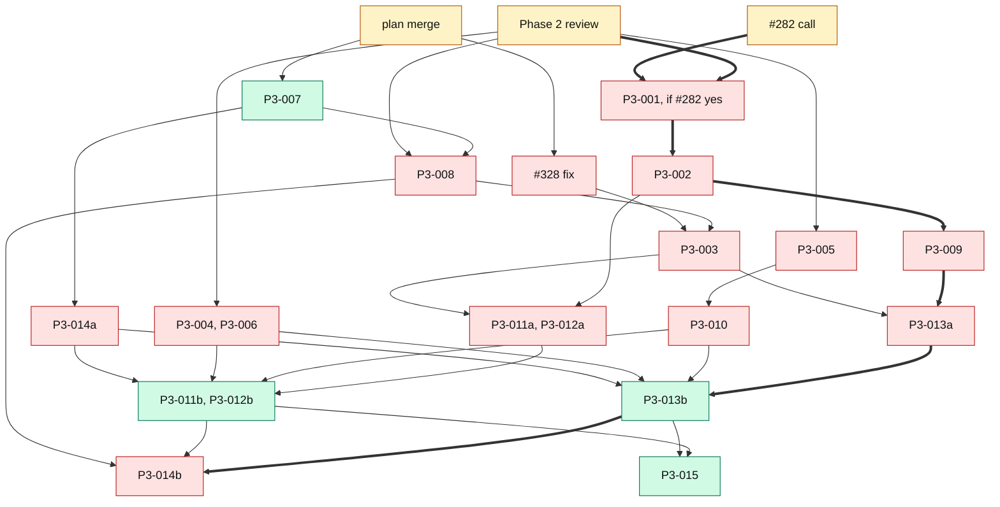

# Phase 3: agent-written extractors on real repos

**Goal:** an agent writes a plugin for a reviewed model inside a sandbox, the plugin is accepted
only through all nine gates, and `mitos run` *(new)* runs the accepted plugins on pinned real
repositories and prints a graph in which every edge carries its evidence.

The draft and its decisions are in [#610](https://github.com/kitimark/mitos/issues/610). Names
marked *(new)* do not exist on `main` yet. This phase adds them.

**Exit criteria**

1. `.github/scripts/accept-plugins.sh --record` runs `mitos-gate accept` with gates 0 to 7 and
   `--paranoid` on every plugin in `examples/acme/Plugins/`, and `lake exe mitos-gate cheats`
   rejects the corpus. Each check that P3-001, P3-002, P3-003 and P3-006 add has a case that it
   rejects (`docs/process.md`, Security fixes). Gate 7's cases have `full=7`.
2. Gate 8: `mitos-gate packet` *(new)* prints the review packet of a plugin, and its suite in
   `gate/` shows that no comment or docstring of the plugin reaches the packet. The verdict on each
   pilot plugin PR names the packet it read at its head.
3. Three pilot conventions each have a model the owner approved (`spec-approved`) and a plugin
   that an agent wrote in the P3-010 loop, accepted as criterion 1 says.
4. At least one model bug in a pilot model is caught by gate 6, gate 7 or `mitos-gate refute`
   *(new)*, and is filed as a model issue. A seeded wrong model in `eval/cheats/` does not count,
   and neither does #328, which Phase 2's differential run found.
5. The nightly `run` job *(new)* runs `mitos run` on every repository in `runner/repos.tsv`
   *(new)* at its pinned commit and exits 0. Its summary gives, per repository, the facts of each
   plugin, the edges and the unresolved requirements. The runner refuses a fact whose span does not
   hold its key, and a test in `runner/` *(new)* shows it.
6. The scorecard has a line for each pilot edge type, on fixtures cut from those repositories with
   hand labels, and precision of `confirmed` edges is 1.0 on each.
7. For each pilot plugin, the run log gives the loop's attempts, `wall_min` and `tokens`.
   `tokens` is not `null`: it is the sum that `.claude/scripts/usage-sum.sh` gives over the loop's
   journals, output plus cache-read tokens (`CLAUDE.md`, Done means verified).

## Before Phase 3 starts

Nothing blocks this plan. Rows that touch `core/` or `gate/` start after item 1, and P3-001 also
after item 2 (D6). P3-007 touches neither, so it starts when this plan merges.

1. **The Phase 2 review and close** (`docs/process.md`, Phase review). Every Phase 2 task issue
   (#202 to #213) is closed, except P2-011's toolchain bump, #147, which is in the CI and toolchain
   milestone. The nightly run of 28 Nov (at `00fae4d`) passed all five jobs: `full`, `diff`,
   `resolve` (which picks the canary versions) and both canaries, v4.36.0 and v4.37.0-rc1. The
   Phase 2 milestone still has 14 open follow-up issues. The owner reviews the exit criteria by the
   numbers.
2. **#282, the owner's call.** Should acceptance pin the order and count of facts? The issue is
   assigned to the owner and has no answer yet. It changes what every Phase 3 plugin proves, so it
   is row P3-001, which lands before any pilot plugin. On "no", P3-001 is dropped, and each pilot
   plugin pins its own order, as `GoMod.run_eq` does in `examples/acme/Plugins/GoMod.lean`.
3. **#328 before gate 7.** Gate 7 (P3-003) runs GoMod on pinned go.mod files, and GoMod differs
   from Go there only on the two quoted paths of #328. So #328's model fix lands before P3-003, or
   P3-003 starts with a triage list that is pinned like the models. #276 item 2, #549 items 4 and 5
   (Q1 and Q2) and #546 M1 are Phase 2 follow-ups that can close beside Phase 3.
4. **The shared lanes.** One PR that touches `core/` is open at a time (`docs/process.md`,
   Parallelism). P3-001, P3-002 and P3-009 take that lane, and so do the steps of #595: steps 2 to
   4 restate spec, and step 1 edits `core/Mitos/Proofs/`. The root orders them. `gate/` is shared
   with the Watch rows P2-013 and P2-015 to P2-022, and with the Gate architecture milestone. The
   Paths table below gives each row its files.

## Scope decisions

The owner chose D1 on 28 Nov. It is recorded on
[#610](https://github.com/kitimark/mitos/issues/610#issuecomment-7240838251). D2 to D6 have no
owner answer yet. Each one below is the root's default: the option that #610 recommends, with its
reason. The owner can change any of them in review before merging this plan.

- **D1, scope: option C (the owner's decision).** Agent-written extractors on real repositories: a
  thin runner, gates 7 and 8, the agent loop and a pilot of three conventions. Option A, the
  roadmap as written, designs the rule DSL before any real convention exists. Option B, real
  repositories first, moves the agent loop to Phase 4. The pilot is the measurement: it needs a
  runner and the full gate, and it shows what a rule language must express.
- **D2, rule DSL: design only (root default).** P3-015 designs it from the three pilot plugins:
  which of them a rule can express, and the generic theorems. The build is Phase 4. Reason: the
  design should follow from plugins that exist, which is why D1 chose C.
- **D3, pilot conventions (root default).**
  1. A binding over the line layer, such as an env-var or config key. It gives the first real
     `binds` facts, so chains stop being synthetic, and the nightly "most derivations" number
     (`plan/phase-2.md`, Revisit D1 by measurement) starts to mean something. A chain is real only
     where its requirement and its provision are real facts too, so P3-011a picks a binding whose
     two ends some plugin extracts.
  2. `requirements.txt` or Dockerfile `FROM` over the line layer. The roadmap puts a Dockerfile
     layer in Phase 4, so this model reads a subset, as the go.mod model did in Phase 2.
  3. Go `import` over the token layer (D4). An import names a package, the go.mod plugin provides
     modules, and the resolver matches identities exactly. So P3-013a first decides which identity
     an import gives.

  Repositories: the 13 public Go modules pinned in `eval/diff/pins.tsv`, with their licences in
  `eval/diff/licences.tsv`, unless the owner names their own. Those pins are go.mod files from
  the module proxy, so P3-007's manifest pins each repository at a commit. Which of them hold
  Dockerfiles, env files or `requirements.txt` is not checked yet. A model row that needs another
  repository adds its pin and its licence. Reason: three conventions over the two layers the core
  will have are the smallest pilot the roadmap names (3 to 5 conventions, one of them source code).
- **D4, syntax layer: the token lexer only (root default).** P3-009 adds
  `core/Mitos/Core/Tokens.lean` *(new)* beside `Mitos.lines`. It imports only `Init`, `Std` and
  `Mitos.Core`, as every file of the plugin surface must (`mitos-gate imports`). JSON stays
  deferred. Reason: the roadmap's pilot needs one source-code convention over a token lexer. The
  go.mod tokenizer lives in its reviewed model (`examples/acme/Models/GoMod/Tokens.lean`); a core
  layer is proved once for every later source-code plugin.
- **D5, store: NDJSON files only (root default).** The runner writes facts as NDJSON and resolves
  from scratch on each run. No SQLite. Reason: nothing reads facts between runs yet, and a store
  belongs with incremental resolution, which is Phase 4.
- **D6, start (root default).** Rows outside `core/` and `gate/` wait only for this plan's merge
  and the rows they depend on. The rest also waits for the Phase 2 review, and P3-001 also for the
  #282 call. Reason: the core lane holds one PR at a time, and the review may still need it.

The root's defaults below come from checking the draft against `main`:

- **Gate 8 is a review, not a step of `accept`.** The roadmap's gate 8 is a human review of the
  definition-hole code and the model diff, with comments and docstrings removed before any
  LLM-assisted review. No command can decide it, so `accept` runs gates 0 to 7. P3-004's
  `mitos-gate packet` prints what the reviewers read: the owner reads the model diff in the model's
  spec PR, and the verifier of each plugin PR reads the plugin with its comments removed.
- **Mutation in gate 6 mutates the golden files.** `Mitos.Model.Adequate`
  (`core/Mitos/Core/ModelExamples.lean`) states `M.Holds g.file f ↔ f ∈ g.facts` on each golden
  file. So a model that gate 6 accepts already rejects every mutant of the listed facts: a fact
  dropped, a span shifted or an identity renamed. What gate 6 cannot rule out is a lookup-table
  model, which holds only on the golden files (`docs/process.md`, "What gate 6 does not show").
  P3-002 therefore derives files from the golden files, whose facts follow from the listed ones,
  and gate 6 proves the model adequate on them too. The derivation is trusted, so it is a core
  definition, and P3-002 is a spec row.
- **Gate 7 runs plugin code in the worker.** Gates 2 to 6 build and check proofs under
  `lake comparator`; no gate runs a plugin's extractor today. Gate 7 runs it on the model's corpus,
  so it uses the sandboxed worker of P3-008: bubblewrap with no network and with CPU, memory and time
  limits. The worker is in `gate/`, because gate 7's verdict rests on it, and the runner uses the
  same worker.
- **Gate 7 fails closed.** Every model has a corpus: pinned files with golden facts, or with a real
  tool's vendored output, as `eval/diff/` vendors `go mod edit -json`. The corpus is pinned with
  the models, so the builder cannot change it, and the record names it. A model with no corpus is
  rejected at gate 7, so P3-003 gives ToyRequire and GoMod theirs.
- **The Plausible search runs in the loop, not in the gate.** Gate files import only `Init`,
  `Std`, `Lean` and `MitosGate` (`mitos-gate imports`), and Plausible runs code while it
  elaborates. So `mitos-gate refute` (P3-005) only judges a counterexample's `decide` proof, and
  P3-010 gives the builder the search.
- **The runner checks anchoring itself.** It checks each fact with `Mitos.Span.text` when it reads
  it. No core file changes, so the runner takes no core slot.
- **Hand labels on cut fixtures.** Recall needs every true edge of a fixture labelled, so a
  fixture must be small enough to label by hand. The pilot fixtures are files cut from the pinned
  repositories, in `eval/fixtures/` as today, each with its licence recorded the way
  `eval/diff/licences.tsv` records them. The nightly runner on whole repositories reports counts,
  not precision.
- **Each pilot is a model row and a plugin row.** The builder must not edit the model it proves
  against, and the model needs `spec-approved` while the plugin does not. So each pilot has an
  `a` row (the model, which the owner merges) and a `b` row (the plugin from the loop, which agents
  merge).
- **The plugin list leaves `.github/`.** `.github/scripts/accept-plugins.sh` lists each plugin and
  its model, and fails when `Plugins/` holds a plugin it does not list. P3-014a reads that list
  from the committed records (`examples/acme/accepted/*.json`, which name both) or from a file
  outside `.github/`, so the `b` rows need no `.github` edit. Without P3-014a, each `b` row edits
  `.github/` and the owner merges it.

## Tasks

| # | Task | Kind | Issue |
|---|---|---|---|
| P3-001 | If the owner answers yes on #282: the obligations pin the order and count of facts. `core/Mitos/Core/Obligations.lean` states it (for example no repeated fact, in span order), the Challenge that `gate/MitosGate/Accept.lean` generates names it, ToyRequire and GoMod prove it and are re-accepted, and a cheat case that repeats a fact is rejected. Lands before any pilot plugin (owner-gated: `core/Mitos/Core/`, `statements.lock`, `gate/`, `eval/cheats/`) | spec | none yet |
| P3-002 | Gate 6 mutation on the golden files: `ModelExamples.mutants` *(new)* in `core/Mitos/Core/ModelExamples.lean` derives files from each golden file whose facts follow from the listed ones (for example the file with a newline added at its end, with the same facts), and gate 6's Challenge also states `Mitos.Model.Adequate` on them. ToyRequire and GoMod are re-proved. A lookup-table model is a cheat case that gates 0 to 6 accept today and gate 6 then rejects (owner-gated: `core/Mitos/Core/`, `statements.lock`, `models.lock`, `gate/`, `eval/cheats/`) | spec, gate | none yet |
| P3-003 | Gate 7 in `accept`: the plugin runs in the worker (P3-008) on its model's corpus, `examples/acme/Corpus/` *(new)*, which is pinned with the models. Its facts are compared with the corpus's expected facts (golden facts, or a real tool's vendored output, as `eval/diff/` compares go.mod), every fact must be anchored, and a difference rejects. The record names the corpus's hash. ToyRequire and GoMod get corpora. Gate 7 cheat cases (owner-gated: `gate/`, `eval/cheats/`, `models.lock`, `docs/process.md`) | gate | none yet |
| P3-004 | Gate 8, the review packet: `mitos-gate packet` *(new)* prints, for one plugin, the diff of its model's files against a base commit, the golden examples, and the plugin source with every comment and docstring removed. A suite in `gate/` shows that no comment or docstring reaches the packet (owner-gated: `gate/`, `docs/process.md`) | gate | none yet |
| P3-005 | Counterexample exit: `mitos-gate refute` *(new)* generates a Challenge that states that a given file and fact refute an obligation (for example the model says a fact holds whose key is not in the file, so no extractor is both anchored and complete), and the comparator judges its `decide` proof. The run log then records `counterexample`, and a model issue is opened (owner-gated: `gate/`, `docs/process.md`) | gate | none yet |
| P3-006 | Lint allow-list for attributes and commands (#461), so that a new Lean attribute fails closed before agents write plugins at volume; one lint-test case per class (owner-gated: `gate/`, `eval/cheats/`, `docs/process.md`) | gate | none yet |
| P3-007 | Runner `mitos run` *(new)* in `runner/` *(new)*: a manifest of repositories at pinned commits (`runner/repos.tsv` *(new)*), git through `IO.Process`, every plugin of the workspace linked into one executable, a plugin refused when its record does not match the tree, facts written as NDJSON and checked with `Mitos.Span.text`, then resolve and impact. No store. Until P3-008 lands, the plugins run in the runner's own process | impl | none yet |
| P3-008 | Worker sandbox: one process runs a plugin's extractor on given files under bubblewrap, with no network and with CPU, memory and time limits, and prints NDJSON facts. The caller checks each fact's anchoring again. Gate 7 and the runner use it, and this PR moves the runner onto it (owner-gated: `gate/`) | gate, impl | none yet |
| P3-009 | Token layer in the core, for one source-code convention: `core/Mitos/Core/Tokens.lean` *(new)*, a small lexer with span theorems beside `Mitos.lines`, imported by `core/Mitos/Core.lean` (owner-gated: `core/Mitos/Core/`, `statements.lock`) | spec, impl | none yet |
| P3-010 | The agent loop: a skill and a sandbox in which a builder gets a model and its examples, has lean-lsp-mcp (not configured in this repository yet) and a Plausible search over the obligations, cannot write the gate, the models, the locks or the logs, and ends with an accepted record or a `mitos-gate refute` counterexample (owner-gated: `.claude/`) | process | none yet |
| P3-011a | Pilot 1 model: a binding over the line layer (D3). The model, its golden files, its adequacy module and its gate 7 corpus; `examples/acme/models.lock` (owner-gated: `spec-approved`) | spec | none yet |
| P3-011b | Pilot 1 plugin, written by the P3-010 loop and accepted as exit criterion 1 says; its line in the runner; a fixture cut from a pinned repository, with hand labels; its scorer edge type | impl | none yet |
| P3-012a | Pilot 2 model: `requirements.txt` or Dockerfile `FROM` over the line layer (D3), with the same parts as P3-011a (owner-gated: `spec-approved`) | spec | none yet |
| P3-012b | Pilot 2 plugin, with the same parts as P3-011b | impl | none yet |
| P3-013a | Pilot 3 model: Go `import` over the token layer (P3-009). It first decides which identity an import gives (D3), then has the same parts as P3-011a (owner-gated: `spec-approved`) | spec | none yet |
| P3-013b | Pilot 3 plugin, with the same parts as P3-011b | impl | none yet |
| P3-014a | One early `.github` PR: `.github/scripts/accept-plugins.sh` reads the plugin list from the committed records or from a file outside `.github/`, so the `b` rows need no `.github` edit; CI builds `runner/` and runs its tests (owner-gated: `.github/`) | ci | none yet |
| P3-014b | Nightly wiring: a `run` job *(new)* runs `mitos run` on `runner/repos.tsv` and writes its counts to the job summary. The pilot fixtures need no wiring, because CI and the nightly job already score every directory in `eval/fixtures/` (owner-gated: `.github/`) | ci | none yet |
| P3-015 | Rule DSL design from the pilot: which pilot plugins a rule expresses, and the generic theorems. Design only, in its task file; the build is Phase 4 | design | none yet |

Each open row gets an issue in the Phase 3 milestone once this plan merges, and its status lives
in that issue and its PRs. P3-001 and P3-006 may take over #282 and #461, which are in the Gate
architecture milestone now.

Row ids are the draft's. P3-011 to P3-013 are split into a model row and a plugin row, and P3-014
into an early and a late `.github` PR. The core track runs in order: P3-001, P3-002, P3-009. The
runner track runs beside it: P3-007, then P3-008, then P3-003, which also waits for #328. P3-005
goes before P3-010. P3-004, P3-006 and P3-014a go at any time before the `b` rows. Each `a` row
waits for P3-002 and P3-003, and P3-013a also for P3-009. Each `b` row waits for its `a` row,
P3-001, P3-004, P3-006, P3-010 and P3-014a. P3-014b and P3-015 come last.

## Running Phase 3 in parallel

Each row is one agent, one worktree and one PR. At most three builders run at once, and one PR
that touches `core/` is open at a time (`docs/process.md`, Parallelism). In the graph, thick
arrows are the critical path, solid arrows wait for a spec, a gate or a build, and colours are the
classes under "Who decides".



**Waves.** A row starts when every row it waits for has merged, the owner's merges included.

| Wave | Runs at once | Waits for |
|---|---|---|
| W0 | The owner's calls: this plan's merge, #282, the Phase 2 review | nothing |
| W1 | P3-001 (core). P3-005. P3-007. #328's model fix | this plan's merge; for P3-001 and P3-005 also the Phase 2 review, and for P3-001 also #282 |
| W2 | P3-002 (core). P3-008. P3-010. P3-014a | P3-001; P3-007 for P3-008 and P3-014a; P3-005 for P3-010 |
| W3 | P3-009 (core). P3-003 | P3-002; P3-008 and #328 |
| W4 | P3-011a. P3-012a. P3-013a | P3-002 and P3-003; P3-009 for P3-013a |
| W5 | P3-011b. P3-012b. P3-013b | each its `a` row, and P3-001, P3-004, P3-006, P3-010, P3-014a |
| W6 | P3-014b. P3-015 | the three `b` rows; P3-008 |

P3-004 and P3-006 wait only for the Phase 2 review, so they take a free builder in W1 to W4. The
critical path is the Phase 2 review, P3-001, P3-002, P3-009, P3-013a, P3-013b and P3-014b: seven
waves, three core PRs in series, and seven owner steps (the review, the #282 call, and the merges
of P3-001, P3-002, P3-009, P3-013a and P3-014b). On a "no" for #282, P3-001 is dropped, P3-002
moves to W1, and the path is one wave shorter. The runner track (P3-007, P3-008, P3-003) reaches
W4 in the same number of waves.

**Paths.** A row writes only its Owns cell, its task file `tasks/<row>-<slug>.md` and its own
run-log file. It writes a path the owner keeps (`CLAUDE.md`, "What stays with the user") only
where its cell names it, and then the owner merges. "Shared files" orders a path in two cells.

| Row | Owns | Reads | Also must not touch |
|---|---|---|---|
| P3-001 | `core/Mitos/Core/Obligations.lean`, `statements.lock`, `challenge` and `obligationNames` in `gate/MitosGate/Accept.lean`, `examples/acme/Plugins/*.lean`, `examples/acme/accepted/*.json`, the plugins of the cases in `eval/cheats/` that the new obligation breaks, new cases there, the obligations text in "The acceptance gate" of `docs/process.md` | `core/Mitos/Core/Fact.lean`, #282 | `core/Mitos/Core/ModelExamples.lean`, `examples/acme/Models/` |
| P3-002 | `core/Mitos/Core/ModelExamples.lean`, `statements.lock`, `adequacyChallenge` in `gate/MitosGate/Accept.lean`, `examples/acme/Models/*/Adequacy.lean`, `examples/acme/models.lock`, `examples/acme/accepted/*.json`, the adequacy modules of the cases in `eval/cheats/` that prove their own, new cases there, the gate 6 text in `docs/process.md` | `examples/acme/Models/*/Examples.lean` | the examples modules, `core/Mitos/Core/Obligations.lean`, `examples/acme/Plugins/` |
| P3-003 | a corpus module in `gate/MitosGate/` *(new)*, the gate 7 step and `writeRecord` in `gate/MitosGate/Accept.lean`, `gate/MitosGate/GateId.lean`, `examples/acme/Corpus/` *(new)* and its lines in `examples/acme/models.lock`, `examples/acme/accepted/*.json`, new cases in `eval/cheats/`, the gate 7 text in `docs/process.md` | the worker of P3-008, `eval/diff/cases/` | `examples/acme/Models/`, `eval/diff/` |
| P3-004 | a packet module in `gate/MitosGate/` *(new)*, its line in `gate/Main.lean`, `gate/packet-test.sh` *(new)*, the gate 8 text in `docs/process.md` | `gate/MitosGate/Lint.lean` | `gate/MitosGate/Accept.lean` |
| P3-005 | a refute module in `gate/MitosGate/` *(new)*, its line in `gate/Main.lean`, `gate/refute-test.sh` *(new)*, the "Counterexample exit" rule in `docs/process.md` | `gate/MitosGate/Accept.lean`, `core/Mitos/Core/Obligations.lean` | `core/`, `examples/acme/Models/` |
| P3-006 | `gate/MitosGate/Lint.lean`, `gate/LintTest.lean`, `eval/cheats/unguarded`, new cases in `eval/cheats/`, the gate 1 text in `docs/process.md` | #461 | `gate/MitosGate/Accept.lean` |
| P3-007 | `runner/` *(new)*: a Lake project with its own `lean-toolchain` that requires the workspace by path, as `eval/diff/` does, and `runner/repos.tsv` *(new)*, the repositories at pinned commits with their licences | `core/Mitos/Impl/`, `examples/acme/accepted/*.json`, `eval/diff/pins.tsv`, `eval/diff/licences.tsv` | `core/`, `examples/acme/`, `gate/` |
| P3-008 | a worker module in `gate/MitosGate/` *(new)*, its line in `gate/Main.lean`, `gate/worker-test.sh` *(new)*, the runner's call of it in `runner/` | P3-007 as merged | `gate/MitosGate/Accept.lean` |
| P3-009 | `core/Mitos/Core/Tokens.lean` *(new)*, one import in `core/Mitos/Core.lean`, `statements.lock`, `examples/acme/accepted/*.json` | `core/Mitos/Core/Lines.lean`, `examples/acme/Models/GoMod/Tokens.lean` | `core/Mitos/Core/Obligations.lean`, `core/Mitos/Core/ModelExamples.lean` |
| P3-010 | the loop's skill in `.claude/skills/` *(new)* and its copy and roster line in `.agents/`, the hook and settings lines that keep the builder off the gate, the models, the locks and the logs, the lean-lsp-mcp configuration *(new)*, the builder's Plausible search | `gate/`, `examples/acme/Models/` | `gate/`, `examples/acme/` |
| P3-011a, P3-012a, P3-013a | `examples/acme/Models/<X>.lean` and `examples/acme/Models/<X>/` *(new)*, its corpus in `examples/acme/Corpus/`, `examples/acme/models.lock`, `examples/acme/accepted/*.json` | the core's line or token layer, `examples/acme/Models/GoMod*` | the other models, `examples/acme/Plugins/` |
| P3-011b, P3-012b, P3-013b | `examples/acme/Plugins/<X>.lean` and `examples/acme/accepted/<X>.json` *(new)*, the plugin's line in `runner/`, `eval/fixtures/<x>/` *(new)*, a scorer module in `eval/score/Score/` *(new)*, one import and one call in `eval/score/Score.lean`, the loop's run-log records | `examples/acme/Models/<X>*` | `examples/acme/Models/`, `examples/acme/models.lock` |
| P3-014a | `.github/scripts/accept-plugins.sh`, `.github/scripts/accept-plugins.test.sh`, the `runner/` build and test steps and their cache key lines in `.github/workflows/ci.yml` | P3-007 as merged | `.github/workflows/nightly.yml` |
| P3-014b | the `run` job in `.github/workflows/nightly.yml` | every row | `.github/workflows/ci.yml` |
| P3-015 | `tasks/P3-015-<slug>.md` *(new)*, its design and sketch | the three pilot plugins and their run logs | every path outside `tasks/` |

**Shared files.** These rules keep parallel rows apart with no change outside `plan/`.

1. **Generated files** (`statements.lock`, `examples/acme/models.lock`, `accepted/*.json`). A row
   that moves their inputs regenerates them at its head after its last rebase, never by hand. A
   record hashes every `.lean` file under `core/Mitos/`, the Challenge, `models.lock` and the
   toolchain (`writeRecord` in `gate/MitosGate/Accept.lean`). So P3-001, P3-002, P3-003, P3-009,
   the `a` rows and the #595 steps all re-record.
2. **Core files.** P3-001, P3-002, P3-009 and the #595 steps share `core/` and `statements.lock`.
   Each branches from `main` after the one before it merges, so two lock changes never meet.
3. **`gate/MitosGate/Accept.lean`.** P3-001 edits `challenge` and `obligationNames`, P3-002
   `adequacyChallenge`, and P3-003 the gate 7 step and `writeRecord`. They merge one at a time,
   and the later one rebases and re-records.
4. **`gate/Main.lean`.** P3-004, P3-005 and P3-008 each add one subcommand line.
5. **`docs/process.md`.** P3-001 to P3-006 each edit only their own gate's text in "The
   acceptance gate" or the "Counterexample exit" rule. P3-003 and P3-004 replace the sentence
   "Gates 7 (corpus and differential runs) and 8 (human review) come in later phases".
6. **`eval/cheats/`.** New case directories collide with nothing. P3-001 and P3-002 edit an
   existing case only so that its `expect` stays true. A case whose `expect` would have to change
   is a spec question for the owner, never an edit to get green (`CLAUDE.md`, Rounds).
7. **`examples/acme/models.lock`.** P3-002, P3-003 and the `a` rows regenerate it, one at a time.
8. **`runner/`.** P3-007 creates it. P3-008 and the `b` rows each edit one call or one line.
9. **`.github/`, `ops/runs/`, `tasks/`.** Only P3-014a and P3-014b write `.github/`. Run-log and
   task files carry the row id (`ops/runs/<UTC date>/<row>-builder-<attempt>.json`).

**Who decides.**

- **A, an agent carries and merges it:** P3-007, P3-011b, P3-012b and P3-013b (once P3-014a has
  merged), P3-015.
- **B, the owner merges it, and its agent stops at verified and green:** P3-001, P3-002, P3-009
  and the `a` rows (`spec-approved`); P3-003 (`gate/`, and `models.lock` for the corpora); P3-004,
  P3-005, P3-006 and P3-008 (`gate/`); P3-010 (`.claude/`); P3-014a and P3-014b (`.github/`).
  That is 14 owner merges, or 13 if the answer on #282 is no, plus #328.
- **C, an owner decision comes first:** #282 (before P3-001); the Phase 2 review (before the core
  and gate rows, D6); the owner's own repositories, if any (D3, before the `a` rows); the host
  that lean-lsp-mcp installs from, if the session's network blocks it (before P3-010; `CLAUDE.md`,
  Outside the repo); P3-014a's list change (without it, each `b` row is class B); every model
  issue a pilot opens (exit criterion 4).

A row in class B that touches `gate/`, `eval/cheats/` or `.github/`, or needs `spec-approved`, is
trust-critical: it needs an `opus` verifier at `xhigh` or above.

**Brief template.** The root fills one per row from that row's cells.

```text
Goal: <Phase 3's goal, one line>. Task: <row>, issue #<n>: <the row's text>.
Role: PR owner; opus, xhigh for Lean proofs, a spec or a trust path, else sonnet, high.
Start: worktree at main <sha>, after <the rows it waits for> merged.
Owns: <Owns cell>, tasks/<row>-<slug>.md, ops/runs/<UTC date>/<row>-builder-<attempt>.json.
Reads: <Reads cell>. Writes nothing else. Never adds spec-approved.
Gate before each push, the lines the change can affect (docs/process.md, "What runs where"):
  lake build && lake exe mitos-gate imports && lake exe mitos-gate lock --check
  cd core && lake check && lake comparator --paranoid
  lake exe mitos-gate accept --workspace examples/acme --plugin <P> --model <M> --paranoid
  lake exe mitos-gate cheats <new or edited cases>
  lake exe mitos-lint-test
  lake --dir eval/score exe mitos-score eval/fixtures/<fixture>
  lake --dir runner exe mitos run runner/repos.tsv     (once P3-007 has merged)
Done when: <observable result>; generated files regenerated at the head; PR says Closes #<n>;
  gate green at the head; every bot thread answered.
Stop and report when: an edit falls outside Owns; a statement or a model looks false
  (counterexample, model issue); a theorem, gate, cheat case or expect line would weaken; an
  open PR holds an Owns file.
Budget: <iterations> iterations, <hours> h wall; when it runs out, a stuck report.
Report: PR, head, each check and result, resolved conflicts, post ids. No session link or ID.
```

## Deferred to Phase 4

- Building the rule DSL, which P3-015 designs.
- The JSON, TOML, YAML, proto and Dockerfile layers, and `package.json`.
- The SQLite store.
- A HashMap resolver with an equivalence proof, incremental-equals-from-scratch, and the
  derivation-DAG certificate checker.

## Not in this plan, because they have their own milestones

- Watch, P2-013 to P2-029 (`plan/phase-2.md`, Watch track).
- Land, #508 and #193 (`plan/land.md`).
- The Mathlib track, #372 and #595, in the Gate architecture milestone. Its core steps share the
  core lane (Before Phase 3 starts, item 4).
- Staged judging, #55, in the Gate architecture milestone.
- The provenance fix for Fable PRs, #603, in the Provenance and verdicts milestone.
- P2-011's toolchain bump, #147, in the CI and toolchain milestone.
